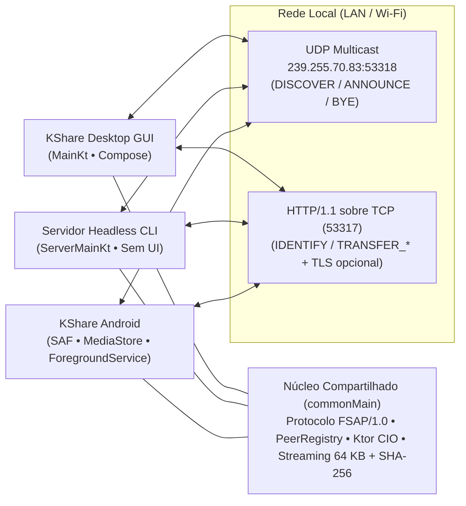

# ⚡ KShare

> **Transferência de arquivos P2P rápida, segura e sem nuvem na sua rede local.**  
> Multiplataforma em **Kotlin & Compose Multiplatform** sobre o protocolo próprio **`FSAP/1.0`**.


O **KShare** conecta computadores (**Linux e Windows**, via GUI Compose ou Servidor Headless CLI) e dispositivos **Android** conectados à mesma rede local (**Wi-Fi / Ethernet**) para envio direto de arquivos — sem servidores externos, sem criação de contas e sem limites artificiais de tamanho.

*(Nota técnica: desenvolvido originalmente sob o codinome acadêmico `FileShare`, mantendo o namespace `br.edu.fileshare` e a especificação oficial **`FSAP/1.0`** nos pacotes e contratos).*

---

## ✨ Por que o KShare?

- **Descoberta Automática Zero-Config + Fallback Manual:**
  - Encontra automaticamente outros nós na LAN via **UDP Multicast** (`239.255.70.83:53318`) com mensagens `ANNOUNCE`, `DISCOVER` e despedida imediata `BYE`;
  - Filtra interfaces virtuais/inativas (`loopback`, `docker0`, `veth`, WSL2, VPN), gerencia TTL de `18 s` no `PeerRegistry` e ativa `WifiManager.MulticastLock` no Android;
  - Em redes com *AP Isolation* ou emuladores, conecta manualmente via **`IP:Porta`** pelo handshake TCP **`IDENTIFY`**.
- **Streaming Binário `O(1)` & Integridade Criptográfica:**
  - Leitura, transmissão e escrita em blocos fixos de **64 KB (`65536 B`)** — sem carregar arquivos inteiros na RAM (`readBytes()` é proibido);
  - Gravação temporária isolada em `.part` com **commit atômico** e promoção somente após validação integral via **SHA-256** (com sufixo automático anti-sobrescrita `arquivo (1).ext`).
- **Multiplataforma de Ponta a Ponta (4 Direções):**
  - Transferências **Desktop ↔ Desktop**, **Desktop ↔ Android** e **Android ↔ Android**;
  - No **Desktop**, oferece aplicativo gráfico Compose e um **Servidor Independente Headless/CLI** (`ServerMainKt`) desacoplado da UI;
  - No **Android**, usa **Storage Access Framework (`OpenMultipleDocuments`)**, salva em **`Downloads/FileShare`** via `MediaStore.Downloads` e mantém conexões vivas com **`FsapForegroundService` (`dataSync`)** e ação rápida de cancelamento pela notificação.
- **Segurança, Confirmação Explícita e Proteção na LAN:**
  - Toda sessão exige confirmação explícita do destinatário (`60 s` de timeout) e gera um `transferToken` efêmero por sessão (`X-FSAP-Transfer-Token`);
  - Sanitização estrita de caminhos (`FileNameSanitizer` contra *Path Traversal* e nomes reservados Windows);
  - Proteções anti-DoS (limite de `256 KB` em JSON, reserva concorrente de disco com retorno `HTTP 507`, corte de overflow, timeout de estagnação de `15 s` e limite de sessões simultâneas);
  - **Transporte TLS Opcional (`--tls`) com TOFU:** certificado X.509 RSA-2048 efêmero e verificação de **fingerprint SHA-256** (*Trust On First Use* + sufixo curto de 8 dígitos hexadecimais nas telas de aprovação e conexão).

---

## 🏗️ Arquitetura e Protocolo `FSAP/1.0`

O núcleo de rede, protocolo, máquinas de estados (`LocalNodeState`, `PeerConnectionState`, `TransferState`), segurança e componentes UI reside em `commonMain`, totalmente desacoplado dos adaptadores de plataforma (`jvmCommonMain`, `desktopMain`, `androidMain`).



### Fluxo Resumido de Operação (`FSAP/1.0`)
1. **Descoberta:** Ao iniciar, o nó anuncia presença via `ANNOUNCE` periódico (`5 s`), envia `DISCOVER` ativo para localizar pares e responde com *jitter* aleatório (`50..300 ms`). Ao encerrar normalmente, emite `BYE`.
2. **Negociação:** O remetente calcula o `SHA-256` em streaming e envia `TRANSFER_REQUEST` (`1..N` arquivos). O destinatário aprova manualmente e emite `TRANSFER_ACCEPT` com `transferToken` único.
3. **Transferência & Commit:** Cada arquivo é transmitido por `PUT /fsap/v1/transfers/{id}/files/{fileId}/content` em chunks de `64 KB`, gravado em `.part`, validado por tamanho + `SHA-256` e consolidado após `TRANSFER_COMPLETE`. Qualquer erro, recusa (`TRANSFER_REJECT`), timeout (`15 s`) ou cancelamento bilateral remove os `.part` imediatamente.

---

## 🚀 Quick Start (Como Executar)

### Pré-requisitos
- **JDK 17+** configurado (`JAVA_HOME`)
- **Android SDK (`compileSdk 35`)** via `ANDROID_HOME` ou `local.properties` *(necessário apenas para compilar ou rodar o app Android)*

### 1. App Desktop Gráfico (Linux / Windows)
```bash
./scripts/run-desktop-ui.sh
# ou diretamente via Gradle:
./gradlew :composeApp:run
```

### 2. Servidor Desktop Independente (Headless / CLI)
Ideal para receber arquivos em máquinas sem interface gráfica, servidores locais ou demonstrações de rede separando UI e serviço:
```bash
./scripts/run-desktop-server.sh --port 53317 --alias Servidor-LAN
# ou com criptografia TLS opcional (imprime o fingerprint SHA-256 no console):
./scripts/run-desktop-server.sh --port 53319 --alias Servidor-TLS --download-dir ./tmp-recebidos --tls
```

Empacotamento e execução como JAR executável independente:
```bash
./scripts/run-desktop-server.sh --jar --port 53317
# equivalente manual:
./gradlew :composeApp:packageDesktopServerJar
java -jar composeApp/build/libs/fileshare-server-all.jar --help
```
**Opções suportadas pelo `ServerMainKt`:** `--port <1..65535>`, `--alias <nome>`, `--download-dir <caminho>`, `--tls`, `--auto-accept-test`, `-h` / `--help`.

### 3. App Android (Smartphone ou Emulador)

#### Gerar e instalar o APK de Debug (`Android 8.0+ / API 26–35`)
```bash
./gradlew :composeApp:assembleDebug
adb install -r composeApp/build/outputs/apk/debug/composeApp-debug.apk
# ou instalar direto em um aparelho/emulador conectado:
./gradlew :composeApp:installDebug
```
O APK compilado é gerado em [`composeApp/build/outputs/apk/debug/composeApp-debug.apk`](composeApp/build/outputs/apk/debug/composeApp-debug.apk). Também é possível abrir a raiz do repositório no **Android Studio** e executar a configuração `composeApp`, ou arrastar o `.apk` diretamente para a janela de um emulador aberto.

#### Conectando Emulador Android ↔ PC na mesma máquina
Como o Emulador Android utiliza NAT virtual (`10.0.2.15`), pacotes UDP Multicast não atravessam entre emulador e host; utilize a **Conexão Manual por IP (`IDENTIFY`)**:
- **Emulador → PC:** no app KShare do emulador, abra **Conectar por IP** e use o IP especial **`10.0.2.2`** com a porta **`53317`** (Desktop GUI) ou **`53319`** (Servidor CLI).
- **PC → Emulador:** redirecione a porta com o ADB no PC e conecte para **`127.0.0.1:53327`**:
  ```bash
  adb forward tcp:53327 tcp:53317
  ```

---

## 🧪 Qualidade, Testes e Inspeção de Rede

O projeto cobre **100% do catálogo formal `TC-FSAP-001` a `TC-FSAP-026`**, testes unitários multiplataforma, proteção contra exaustão de recursos, transporte TLS e interoperabilidade ponta a ponta:

| Comando | O que verifica |
| :--- | :--- |
| `./scripts/check-structure.sh` | Integridade estrutural dos `41` artefatos de documentação, ADRs, backlog, skills e build |
| `./gradlew :composeApp:desktopTest` | Núcleo `commonTest` + `desktopTest` (`TC-FSAP-001..026`, concorrência, anti-DoS e TLS) |
| `./gradlew :composeApp:testDebugUnitTest :composeApp:assembleDebug` | Testes unitários Android (`SAF`, `MediaStore`, `MulticastLock`, `FsapForegroundService`, E2E) e APK Debug |
| `./scripts/run-interop-checks.sh` | Executor sequencial unificado (estrutura + Desktop + Android) e resumo de comandos LAN |

**Inspeção de pacotes em bancada (`Wireshark` / `tcpdump`):**
- **Wireshark (Display Filter):** `udp.port == 53318 or tcp.port == 53317 or tcp.port == 53319`
- **tcpdump (Capture Filter):** `tcp port 53317 or tcp port 53319 or udp port 53318`

---

## 📁 Estrutura do Repositório

```text
fileshare/
├── composeApp/src/
│   ├── commonMain/kotlin/br/edu/fileshare/
│   │   ├── ProjectInfo.kt               # Metadados do app (KShare) e protocolo (FSAP/1.0)
│   │   ├── core/                        # DI, logging, relógio, UUID e locks multiplataforma
│   │   ├── protocol/                    # Envelopes, DTOs, validadores, erros e máquinas de estados
│   │   ├── network/                     # Descoberta UDP, cliente/servidor Ktor CIO e streaming 64 KB
│   │   ├── security/tls/                # Contrato TLS multiplataforma e capacidades SHA-256
│   │   ├── storage/                     # Portas FileSource/FileSink, cota de disco e FileNameSanitizer
│   │   └── ui/                          # App Compose, tema Material 3, ViewModels e telas/diálogos
│   ├── jvmCommonMain/kotlin/br/edu/fileshare/
│   │   ├── core/ & network/             # Clock, UUID, Locks, MulticastSocket, NetworkInterface, SHA-256
│   │   └── security/tls/                # PlatformTlsProvider (certificado X.509 RSA-2048 efêmero)
│   ├── desktopMain/kotlin/br/edu/fileshare/desktop/
│   │   ├── Main.kt & runtime/           # Cliente Gráfico Desktop (Compose Multiplatform)
│   │   ├── server/ & di/                # Servidor Desktop Independente (ServerMainKt / CLI / --tls)
│   │   └── storage/ & logging/          # FilePicker nativo, java.nio e Logback
│   ├── androidMain/kotlin/br/edu/fileshare/android/
│   │   ├── MainActivity.kt & di/        # Entrypoint Android + seletores SAF / permissões
│   │   ├── network/ & service/          # MulticastLockManager e FsapForegroundService (dataSync)
│   │   └── runtime/ & storage/          # Runtime Android, SAF OpenMultipleDocuments e MediaStore
│   ├── commonTest/                      # Testes unitários e conformidade UDP (TC-FSAP-001..005)
│   ├── desktopTest/                     # Rede, anti-DoS, TLS e conformidade TC-FSAP-006..026
│   └── androidUnitTest/                 # SAF, MediaStore, MulticastLock, ForegroundService e E2E
├── docs/                                # Especificação FSAP/1.0, ADRs, segurança, testes e relatório final
├── tasks/                               # Backlog (47 / 47 DONE), milestones (M0–M6) e dependências
├── scripts/                             # Scripts de validação, servidor CLI, UI Desktop e interoperabilidade
└── .agent/skills/                       # Skills especializadas do projeto
```

---

## 📚 Documentação Técnica e Acadêmica

| Área | Documento | Conteúdo Principal |
| :--- | :--- | :--- |
| **Protocolo** | [**`docs/protocol-fsap.md`**](docs/protocol-fsap.md) | Especificação normativa oficial do protocolo **FSAP/1.0**, portas e temporizadores |
| **Mensagens** | [**`docs/protocol-messages.md`**](docs/protocol-messages.md) | Contratos campo a campo das 12 mensagens JSON + exemplos válidos/inválidos |
| **Estados & Fluxos** | [**`docs/state-machine.md`**](docs/state-machine.md) · [**`docs/communication-flows.md`**](docs/communication-flows.md) | Máquinas de estados formais e diagramas de sequência Mermaid de ponta a ponta |
| **Rede & Streaming** | [**`docs/discovery.md`**](docs/discovery.md) · [**`docs/transfer-flow.md`**](docs/transfer-flow.md) | UDP Multicast (`239.255.70.83:53318`), TTL `18 s`, chunks `64 KB`, `.part` e `SHA-256` |
| **Segurança & Erros** | [**`docs/security.md`**](docs/security.md) · [**`docs/error-codes.md`**](docs/error-codes.md) | *Path Traversal*, `transferToken`, anti-DoS, TLS opcional e 17 códigos `FSAP-ERR-*` |
| **Arquitetura & ADRs** | [**`docs/architecture.md`**](docs/architecture.md) · [**`docs/decisions/`**](docs/decisions/README.md) | Arquitetura KMP em camadas e registros de decisão (`ADR-001` a `ADR-006`) |
| **Testes & Relatório** | [**`docs/protocol-test-cases.md`**](docs/protocol-test-cases.md) · [**`docs/testing.md`**](docs/testing.md) · [**`docs/academic-foundation.md`**](docs/academic-foundation.md) | Catálogo `TC-FSAP-001`..`026`, roteiro LAN e relatório acadêmico final consolidado |
| **Gestão & Contribuição** | [**`tasks/backlog.md`**](tasks/backlog.md) · [**`tasks/milestones.md`**](tasks/milestones.md) · [**`CONTRIBUTING.md`**](CONTRIBUTING.md) | Backlog completo (`47 / 47 DONE`), milestones M0–M6, [grafo](tasks/dependency-graph.md) e convenções Git |
