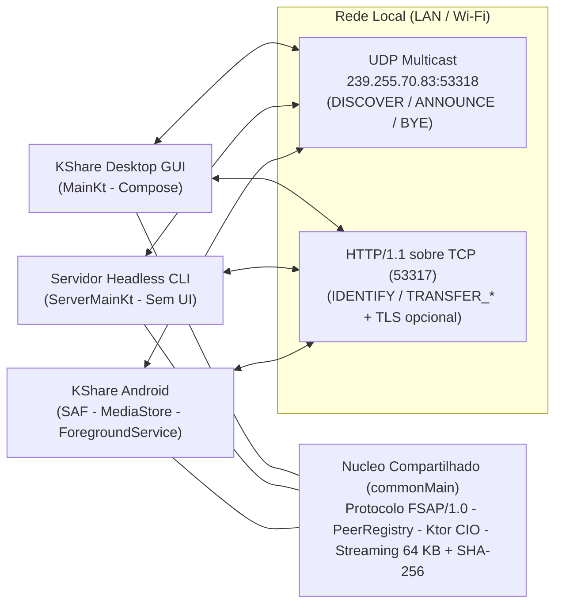

# KShare

**Transferência de arquivos P2P rápida, segura e sem nuvem na sua rede local.**  
Aplicação multiplataforma em **Kotlin e Compose Multiplatform** baseada no protocolo próprio **`FSAP/1.0`**.

[](https://kotlinlang.org/)
[](https://www.jetbrains.com/compose-multiplatform/)
[](https://ktor.io/)
[](#downloads-e-releases)
[](docs/protocol-fsap.md)
[](https://github.com/enzosarmento/file-share/releases/latest)
[](LICENSE)

O **KShare** conecta computadores (**Linux e Windows**, via interface gráfica Desktop ou servidor headless CLI) e dispositivos **Android** conectados à mesma rede local (**Wi-Fi / Ethernet**) para envio direto de arquivos — sem servidores externos, sem criação de contas e sem limites artificiais de tamanho.

*(Nota técnica: desenvolvido originalmente sob o codinome acadêmico `FileShare`, mantendo o namespace `br.edu.fileshare` e a especificação normativa **`FSAP/1.0`** nos pacotes e contratos).*

---

## Downloads e Releases

Os instaladores e binários pré-compilados ficam disponíveis para **download direto** na aba de [Releases do GitHub](https://github.com/enzosarmento/file-share/releases/latest) e são gerados automaticamente para **Linux, Windows e Android** pelo workflow [`.github/workflows/release.yml`](.github/workflows/release.yml):

| Plataforma / Alvo | Download Direto (Última Release) | Como Instalar / Executar |
| :--- | :--- | :--- |
| **Android (`8.0+ / API 26–35`)** | [`kshare-android.apk`](https://github.com/enzosarmento/file-share/releases/latest/download/kshare-android.apk) | Baixe e instale diretamente no aparelho, arraste para o emulador ou execute `adb install -r kshare-android.apk`. |
| **Desktop Linux (`.deb` — Debian / Ubuntu / Mint)** | [`kshare-linux-amd64.deb`](https://github.com/enzosarmento/file-share/releases/latest/download/kshare-linux-amd64.deb) | Instale via terminal com `sudo dpkg -i kshare-linux-amd64.deb` (ou abrindo o arquivo no gerenciador de pacotes). |
| **Desktop Windows (64-bit — Instalador)** | [`kshare-windows-x64.msi`](https://github.com/enzosarmento/file-share/releases/latest/download/kshare-windows-x64.msi) | Execute o instalador `.msi` (não requer privilégios de administrador) e abra o app **KShare** pelo Menu Iniciar. |
| **Desktop Windows (64-bit — Portável)** | [`kshare-windows-x64-portable.zip`](https://github.com/enzosarmento/file-share/releases/latest/download/kshare-windows-x64-portable.zip) | Extraia o arquivo `.zip` e execute `KShare/KShare.exe` diretamente sem instalação. |
| **Servidor Desktop Independente (`Linux / Windows`)** | [`kshare-server-all.jar`](https://github.com/enzosarmento/file-share/releases/latest/download/kshare-server-all.jar) | Execute sem depender da GUI com `java -jar kshare-server-all.jar --port 53317`. |
| **Verificação de Integridade** | [`SHA256SUMS.txt`](https://github.com/enzosarmento/file-share/releases/latest/download/SHA256SUMS.txt) | Valide os artefatos baixados no mesmo diretório com `sha256sum -c SHA256SUMS.txt`. |

### Gerar os artefatos de release localmente ou publicar uma nova versão

Para empacotar localmente em `dist/` os binários suportados pelo seu sistema operacional (no Linux: APK, `.deb` e `.jar`; no Windows: `.msi`, `.zip` portável e `.jar`):
```bash
./scripts/prepare-release-assets.sh v1.1.0
```
Para disparar a compilação multiplataforma no GitHub Actions (`ubuntu-latest` + `windows-latest`) e publicar a Release com todos os instaladores anexados:
```bash
git tag v1.1.0 && git push origin v1.1.0
```
*(Também é possível disparar manualmente pela aba **Actions -> Release KShare -> Run workflow** no GitHub).*

---

## Principais Funcionalidades

- **Descoberta Automática Zero-Config + Fallback Manual:**
  - Localiza dispositivos automaticamente na LAN via **UDP Multicast** (`239.255.70.83:53318`) com mensagens `ANNOUNCE`, `DISCOVER` e despedida imediata `BYE`;
  - Filtra interfaces virtuais/inativas (`loopback`, `docker0`, `veth`, WSL2, VPN), controla expiração TTL de `18 s` no `PeerRegistry` e gerencia `WifiManager.MulticastLock` no Android;
  - Em redes com *AP Isolation* ou emuladores, conecta diretamente via **`IP:Porta`** usando handshake TCP **`IDENTIFY`**.
- **Streaming Binário `O(1)` e Integridade Criptográfica:**
  - Leitura, transmissão e gravação em blocos fixos de **64 KB (`65536 B`)** — sem carregar arquivos inteiros na memória RAM (`readBytes()` é proibido);
  - Gravação temporária em `.part` com **commit atômico** somente após validação integral via **SHA-256** e política automática de não-sobrescrita (`arquivo (1).ext`).
- **Suporte Multiplataforma Completo (4 Direções):**
  - Transferências **Desktop <-> Desktop**, **Desktop <-> Android** e **Android <-> Android**;
  - No **Desktop**, disponibiliza aplicativo gráfico Compose e um **Servidor Independente Headless/CLI** (`ServerMainKt`) totalmente desacoplado da UI;
  - No **Android**, integra **Storage Access Framework (`OpenMultipleDocuments`)**, grava por padrão em **`Downloads/Kshare`** via `MediaStore.Downloads` (com escolha livre de pasta via SAF) e mantém conexões ativas em segundo plano com **`FsapForegroundService` (`dataSync`)** e botão de cancelamento na notificação.
- **Segurança, Confirmação Explícita e Proteção na LAN:**
  - Aprovação explícita obrigatória pelo destinatário (timeout de `60 s`) com geração de `transferToken` efêmero por sessão (`X-FSAP-Transfer-Token`);
  - Sanitização estrita de nomes contra *Path Traversal* e nomes reservados do Windows (`FileNameSanitizer`);
  - Proteções anti-DoS (limite de `256 KB` para corpos JSON, reserva concorrente de espaço em disco com retorno `HTTP 507`, corte de overflow, timeout de estagnação de `15 s` e controle de sessões simultâneas);
  - **Transporte TLS Opcional (`--tls`) com TOFU:** certificado X.509 RSA-2048 efêmero e verificação de **fingerprint SHA-256** (*Trust On First Use* + sufixo curto de 8 dígitos hexadecimais nas telas de aprovação e conexão).

---

## Arquitetura e Protocolo `FSAP/1.0`

Toda a lógica de protocolo, serialização JSON, máquinas de estados (`LocalNodeState`, `PeerConnectionState`, `TransferState`), segurança e componentes visuais compartilha o source set `commonMain`, isolada dos adaptadores nativos em `jvmCommonMain`, `desktopMain` e `androidMain`.



### Fluxo Resumido de Operação (`FSAP/1.0`)
1. **Descoberta:** Ao iniciar, o nó emite `ANNOUNCE` periódico (`5 s`), envia `DISCOVER` ativo e pares respondem com *jitter* aleatório (`50..300 ms`). No encerramento gracioso, envia `BYE`.
2. **Negociação:** O remetente calcula o `SHA-256` em streaming e envia `TRANSFER_REQUEST` com `1..N` arquivos. O destinatário confirma manualmente e retorna `TRANSFER_ACCEPT` contendo um `transferToken` efêmero.
3. **Transferência e Commit:** Cada arquivo é enviado via `PUT /fsap/v1/transfers/{id}/files/{fileId}/content` em chunks de `64 KB`, gravado em `.part`, validado por tamanho e `SHA-256`, e promovido ao destino final após `TRANSFER_COMPLETE`. Qualquer falha, recusa (`TRANSFER_REJECT`), timeout (`15 s`) ou cancelamento bilateral remove os arquivos `.part` imediatamente.

---

## Como Executar a partir do Código-Fonte

### Pré-requisitos
- **JDK 17+** configurada (`JAVA_HOME`);
- **Android SDK (`compileSdk 35`)** via `ANDROID_HOME` ou `local.properties` *(necessário apenas para compilar ou testar o alvo Android)*.

### 1. App Desktop Gráfico (Linux / Windows)
```bash
./scripts/run-desktop-ui.sh
# ou diretamente via Gradle:
./gradlew :composeApp:run
```

### 2. Servidor Desktop Independente (Headless / CLI)
Ideal para ambientes sem interface gráfica, servidores locais ou testes isolados de rede:
```bash
./scripts/run-desktop-server.sh --port 53317 --alias Servidor-LAN
# com transporte TLS opcional (exibe o fingerprint SHA-256 no terminal):
./scripts/run-desktop-server.sh --port 53319 --alias Servidor-TLS --download-dir ./tmp-recebidos --tls
```
Para gerar e executar via JAR executável independente:
```bash
./scripts/run-desktop-server.sh --jar --port 53317
# equivalente manual:
./gradlew :composeApp:packageDesktopServerJar
java -jar composeApp/build/libs/fileshare-server-all.jar --help
```
**Opções CLI suportadas pelo `ServerMainKt`:** `--port <1..65535>`, `--alias <nome>`, `--download-dir <caminho>`, `--tls`, `--auto-accept-test`, `-h` / `--help`.

### 3. App Android e Emulador

- **Gerar apenas o arquivo `.apk` (sem precisar de celular ou emulador conectado):**
  ```bash
  ./gradlew :composeApp:assembleDebug
  ```
  O arquivo é gerado em [`composeApp/build/outputs/apk/debug/composeApp-debug.apk`](composeApp/build/outputs/apk/debug/composeApp-debug.apk).

- **Instalar diretamente em um aparelho físico ou emulador em execução (`Android 8.0+ / API 26–35`):**
  ```bash
  # Verifique antes se há ao menos 1 dispositivo com status "device"
  adb devices -l

  # Caso não haja emulador aberto, liste os AVDs e inicie um deles:
  emulator -list-avds
  emulator -avd Pixel_9

  # Então instale via Gradle ou diretamente via ADB:
  ./gradlew :composeApp:installDebug
  # ou:
  adb install -r composeApp/build/outputs/apk/debug/composeApp-debug.apk
  ```
  > **Importante:** `:composeApp:installDebug` falha com `DeviceException: No connected devices!` se não houver nenhum emulador aberto ou aparelho conectado com *Depuração USB*/*Depuração por Wi-Fi* autorizada em `adb devices -l`. Para apenas gerar o APK e copiá-lo manualmente para o celular, utilize `:composeApp:assembleDebug`.

  Também é possível abrir a raiz do projeto no **Android Studio** e executar a configuração `composeApp`, ou arrastar o APK para dentro de um emulador em execução.

#### Conectando Emulador Android <-> PC na mesma máquina
Como o Emulador Android opera atrás de NAT virtual (`10.0.2.15`), pacotes UDP Multicast não atravessam entre o emulador e o sistema hospedeiro. Utilize a **Conexão Manual por IP (`IDENTIFY`)**:
- **Emulador -> PC:** no app KShare do emulador, abra **Conectar por IP** e informe **`10.0.2.2`** com a porta **`53317`** (Desktop GUI) ou **`53319`** (Servidor CLI);
- **PC -> Emulador:** crie um encaminhamento de porta via ADB no terminal do PC e conecte pelo Desktop em **`127.0.0.1:53327`**:
  ```bash
  adb forward tcp:53327 tcp:53317
  ```

---

## Testes, Qualidade e Inspeção de Rede

O projeto cobre **100% dos casos de conformidade `TC-FSAP-001` a `TC-FSAP-026`**, testes unitários multiplataforma, limites anti-DoS, transporte TLS e interoperabilidade:

| Comando | Finalidade |
| :--- | :--- |
| `./scripts/check-structure.sh` | Verifica a presença dos `41` artefatos estruturais, documentais, ADRs, skills e build |
| `./gradlew :composeApp:desktopTest` | Executa `commonTest` + `desktopTest` (`TC-FSAP-001..026`, concorrência, anti-DoS e TLS) |
| `./gradlew :composeApp:testDebugUnitTest :composeApp:assembleDebug` | Executa testes Android (`SAF`, `MediaStore`, `MulticastLock`, `FsapForegroundService`, E2E) e compila o APK |
| `./scripts/run-interop-checks.sh` | Executa toda a verificação em sequência (estrutura + Desktop + Android) e resume comandos de bancada |

**Filtros recomendados para inspeção de pacotes em bancada:**
- **Wireshark (Display Filter):** `udp.port == 53318 or tcp.port == 53317 or tcp.port == 53319`
- **tcpdump (Capture Filter):** `tcp port 53317 or tcp port 53319 or udp port 53318`

---

## Estrutura do Repositório

```text
fileshare/
├── .github/workflows/release.yml        # Pipeline GitHub Actions para testes e publicacao de Releases (APK/JAR)
├── composeApp/src/
│   ├── commonMain/kotlin/br/edu/fileshare/
│   │   ├── ProjectInfo.kt               # Metadados do projeto (KShare) e protocolo (FSAP/1.0)
│   │   ├── core/                        # DI, logging, relogio, UUID e locks multiplataforma
│   │   ├── protocol/                    # Envelopes, DTOs, validadores, erros e maquinas de estados
│   │   ├── network/                     # Descoberta UDP, cliente/servidor Ktor CIO e streaming 64 KB
│   │   ├── security/tls/                # Contrato TLS multiplataforma e capacidades SHA-256
│   │   ├── storage/                     # Portas FileSource/FileSink, cota de disco e FileNameSanitizer
│   │   └── ui/                          # App Compose, tema Material 3, ViewModels e telas/dialogos
│   ├── jvmCommonMain/kotlin/br/edu/fileshare/
│   │   ├── core/ & network/             # Clock, UUID, Locks, MulticastSocket, NetworkInterface, SHA-256
│   │   └── security/tls/                # PlatformTlsProvider (certificado X.509 RSA-2048 efemero)
│   ├── desktopMain/kotlin/br/edu/fileshare/desktop/
│   │   ├── Main.kt & runtime/           # Cliente Grafico Desktop (Compose Multiplatform)
│   │   ├── server/ & di/                # Servidor Desktop Independente (ServerMainKt / CLI / --tls)
│   │   └── storage/ & logging/          # Seletor nativo, java.nio e Logback
│   ├── androidMain/kotlin/br/edu/fileshare/android/
│   │   ├── MainActivity.kt & di/        # Entrypoint Android + seletores SAF / permissoes
│   │   ├── network/ & service/          # MulticastLockManager e FsapForegroundService (dataSync)
│   │   └── runtime/ & storage/          # Runtime Android, SAF OpenMultipleDocuments e MediaStore
│   ├── commonTest/                      # Testes unitarios e conformidade UDP (TC-FSAP-001..005)
│   ├── desktopTest/                     # Rede, anti-DoS, TLS e conformidade TC-FSAP-006..026
│   └── androidUnitTest/                 # Testes de SAF, MediaStore, MulticastLock, Service e E2E
├── docs/                                # Especificacao FSAP/1.0, ADRs, seguranca, testes e relatorio final
└── scripts/                             # Scripts de validacao, servidor CLI, UI Desktop, interop e release
```

---

## Documentação Técnica

| Área | Documento | Conteúdo |
| :--- | :--- | :--- |
| **Protocolo** | [`docs/protocol-fsap.md`](docs/protocol-fsap.md) | Especificação normativa oficial do protocolo **FSAP/1.0**, portas e temporizadores |
| **Mensagens** | [`docs/protocol-messages.md`](docs/protocol-messages.md) | Contratos campo a campo das 12 mensagens JSON e exemplos válidos/inválidos |
| **Estados e Fluxos** | [`docs/state-machine.md`](docs/state-machine.md) · [`docs/communication-flows.md`](docs/communication-flows.md) | Máquinas de estados formais e diagramas de sequência Mermaid de ponta a ponta |
| **Rede e Streaming** | [`docs/discovery.md`](docs/discovery.md) · [`docs/transfer-flow.md`](docs/transfer-flow.md) | UDP Multicast (`239.255.70.83:53318`), TTL `18 s`, chunks `64 KB`, `.part` e `SHA-256` |
| **Segurança e Erros** | [`SECURITY.md`](SECURITY.md) · [`docs/security.md`](docs/security.md) · [`docs/error-codes.md`](docs/error-codes.md) | Política de segurança, *Path Traversal*, `transferToken`, anti-DoS, TLS/TOFU e 17 códigos `FSAP-ERR-*` |
| **Arquitetura e ADRs** | [`docs/architecture.md`](docs/architecture.md) · [`docs/decisions/README.md`](docs/decisions/README.md) | Arquitetura KMP em camadas e registros de decisão (`ADR-001` a `ADR-006`) |
| **Testes e Relatório** | [`docs/protocol-test-cases.md`](docs/protocol-test-cases.md) · [`docs/testing.md`](docs/testing.md) · [`docs/academic-foundation.md`](docs/academic-foundation.md) | Catálogo `TC-FSAP-001..026`, roteiro LAN e relatório acadêmico final consolidado |

---

## Como Contribuir

Contribuições para evolução do protocolo, correções de rede, melhorias de interface ou novos testes de conformidade são bem-vindas seguindo as regras definidas em [`CONTRIBUTING.md`](CONTRIBUTING.md):

### Fluxo de Trabalho
1. Faça um **fork** (ou clone) do repositório e crie sua branch sempre a partir de **`develop`**:
   - Novas funcionalidades: `feature/<dominio>-<id-curto>`
   - Correções: `fix/<descricao-curta>`
   - Documentação: `docs/<topico>`
   - Testes: `test/<escopo>`
2. Implemente e valide localmente toda a suíte afetada antes de abrir o Pull Request:
   ```bash
   ./scripts/check-structure.sh
   ./gradlew :composeApp:desktopTest
   ./gradlew :composeApp:testDebugUnitTest :composeApp:assembleDebug
   ```
3. Utilize **Conventional Commits** nas mensagens de commit:
   ```text
   <tipo>(<escopo>): <descrição curta no imperativo>
   ```
   Tipos aceitos: `feat`, `fix`, `docs`, `test`, `refactor`, `build`, `chore`.
4. Abra um **Pull Request** direcionado para **`develop`** (a branch `main` recebe exclusivamente integrações de `develop` já homologadas).

### Diretrizes Técnicas Obrigatórias
- **Linguagem e Estilo:** todo código deve ser escrito exclusivamente em **Kotlin**, seguindo o estilo oficial (`kotlin.code.style=official`);
- **Separação UI / Rede:** pacotes `br.edu.fileshare.protocol.*` e `br.edu.fileshare.network.*` não podem importar `androidx.compose.*`, `java.awt.*` ou `javax.swing.*`;
- **Streaming O(1):** é proibido carregar arquivos transferidos integralmente na RAM (`readBytes()`); utilize chunks de **64 KB**, `.part` temporário, limpeza garantida em `finally` e verificação `SHA-256`;
- **Fidelidade ao Protocolo:** qualquer alteração de contrato JSON, cabeçalho `X-FSAP-*` ou código `FSAP-ERR-*` exige atualização prévia em [`docs/protocol-fsap.md`](docs/protocol-fsap.md) e [`docs/protocol-messages.md`](docs/protocol-messages.md).

Para detalhes completos sobre revisão de código e *Definition of Done*, consulte [`CONTRIBUTING.md`](CONTRIBUTING.md) e [`docs/architecture.md`](docs/architecture.md).

---

## Licença

Este projeto é distribuído sob a **Licença MIT**. Consulte o arquivo [`LICENSE`](LICENSE) na raiz do repositório para ler os termos completos de uso, modificação e distribuição.
