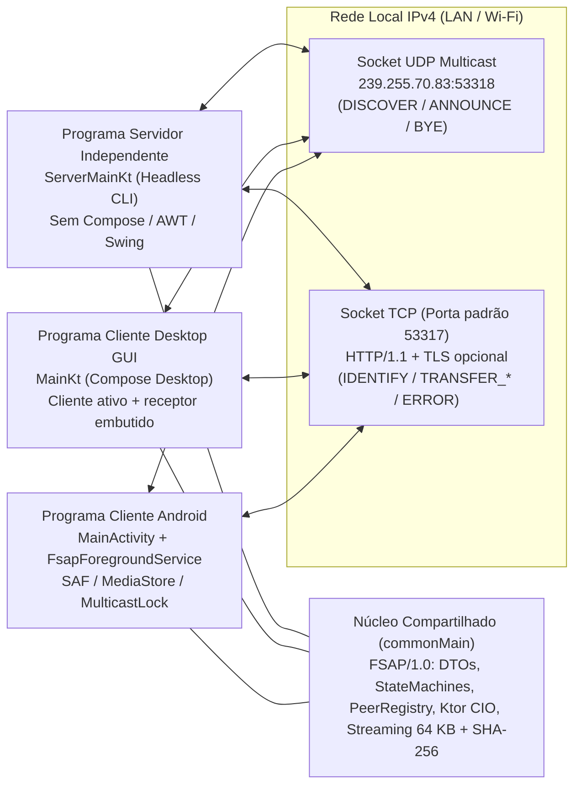
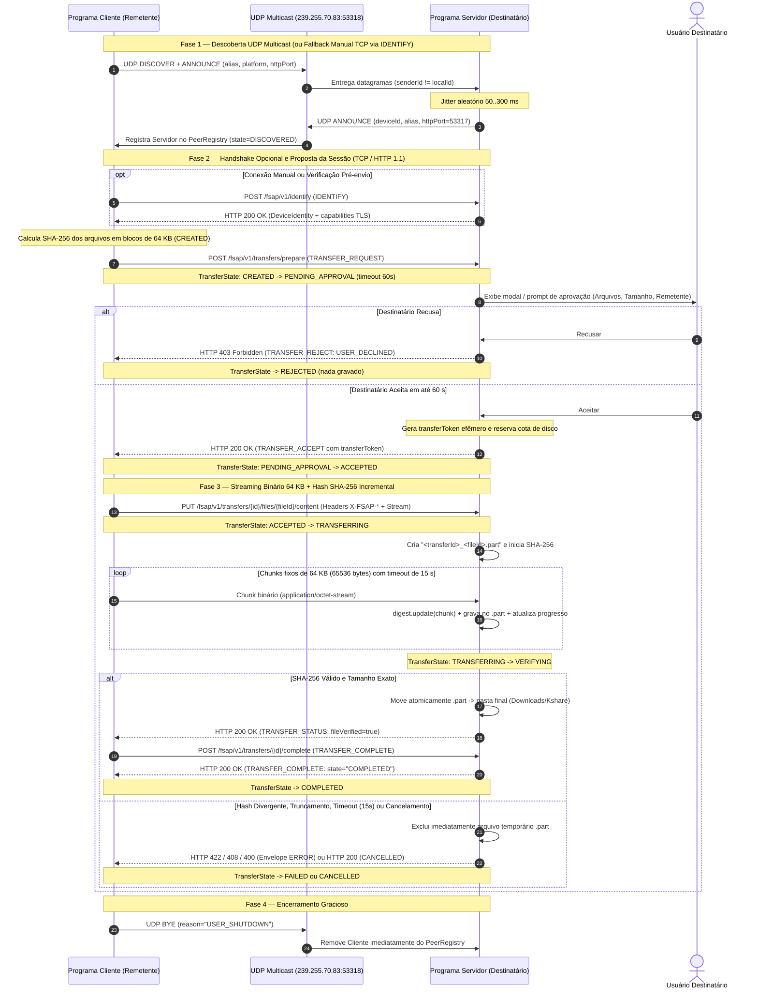
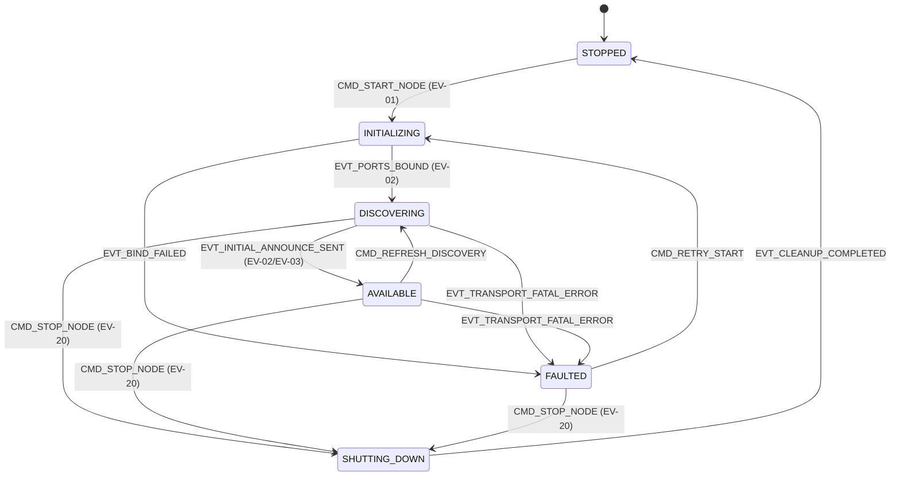
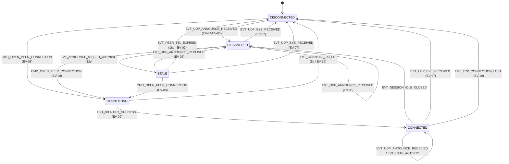
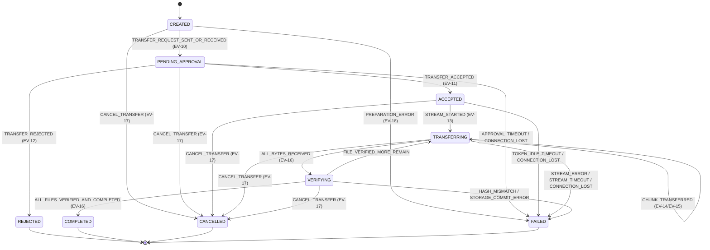

# KShare — Aplicação Distribuída de Transferência de Arquivos em Rede Local (`FSAP/1.0`)

[](https://kotlinlang.org/)
[](https://www.jetbrains.com/compose-multiplatform/)
[](https://ktor.io/)
[](#5-protocolo-da-camada-de-aplicação--fsap10)
[](#6-requisitos-mínimos-de-funcionamento)
[](LICENSE)

> **Documentação para Apresentação de Redes de Computadores:** Este `README.md` reúne de forma **autocontida** toda a especificação exigida pela disciplina — propósito da aplicação, arquitetura distribuída cliente-servidor com sockets UDP e TCP, motivação da escolha dos protocolos de transporte, funcionamento ponta a ponta, catálogo integral de eventos (`EV-01` a `EV-20`), máquinas de estados formais, todas as 12 mensagens e 17 códigos de erro do protocolo **`FSAP/1.0`**, além dos requisitos mínimos e roteiro de demonstração e inspeção de tráfego.
>
> **Guia do Projeto e Downloads:** Para baixar instaladores prontos (`.apk`, `.deb`, `.msi`, `.zip` portável e `.jar`), consultar o guia de uso para usuário final, estrutura do repositório e instruções de contribuição, acesse [**`README-PROJECT.md`**](README-PROJECT.md).

*(Nota técnica: o sistema foi projetado originalmente sob o codinome acadêmico `FileShare`, mantendo o namespace `br.edu.fileshare` e a identificação normativa **`FSAP` — FileShare Application Protocol `1.0`** nos pacotes, cabeçalhos HTTP e contratos JSON).*

---

## Sumário

- [1. Propósito da Aplicação](#1-propósito-da-aplicação)
- [2. Arquitetura Distribuída Cliente-Servidor](#2-arquitetura-distribuída-cliente-servidor)
- [3. Motivação da Escolha dos Protocolos de Transporte (UDP e TCP)](#3-motivação-da-escolha-dos-protocolos-de-transporte-udp-e-tcp)
- [4. Funcionamento da Aplicação](#4-funcionamento-da-aplicação)
- [5. Protocolo da Camada de Aplicação — FSAP/1.0](#5-protocolo-da-camada-de-aplicação--fsap10)
  - [5.1. Especificação Geral, Identidade, Envelope, Cabeçalhos e Temporizadores](#51-especificação-geral-identidade-envelope-cabeçalhos-e-temporizadores)
  - [5.2. Catálogo Completo de Eventos de Comunicação (`EV-01` a `EV-20`)](#52-catálogo-completo-de-eventos-de-comunicação-ev-01-a-ev-20)
  - [5.3. Máquinas de Estados Formais](#53-máquinas-de-estados-formais)
  - [5.4. Catálogo Completo das 12 Mensagens do Protocolo (`FSAP/1.0`)](#54-catálogo-completo-das-12-mensagens-do-protocolo-fsap10)
  - [5.5. Catálogo Completo de Códigos de Erro (`17 Códigos FSAP-ERR-*`)](#55-catálogo-completo-de-códigos-de-erro-17-códigos-fsap-err-)
- [6. Requisitos Mínimos de Funcionamento](#6-requisitos-mínimos-de-funcionamento)
- [7. Como Executar, Demonstrar e Inspecionar na Rede](#7-como-executar-demonstrar-e-inspecionar-na-rede)
- [8. Documentação Complementar e Guia do Projeto](#8-documentação-complementar-e-guia-do-projeto)
- [9. Licença](#9-licença)

---

## 1. Propósito da Aplicação

### 1.1. Problema Resolvido e Motivação
O **KShare** resolve o problema da transferência direta de arquivos entre dispositivos heterogêneos — computadores Desktop (**Linux** e **Windows**) e dispositivos móveis (**Android**) — conectados à mesma rede local (**LAN / WLAN**). No cotidiano, usuários frequentemente recorrem a soluções indiretas que desperdiçam largura de banda externa e comprometem privacidade ou integridade:
- upload e download em serviços de nuvem com limite de tamanho ou cota;
- mensageiros instantâneos que aplicam compressão destrutiva em imagens/vídeos e exigem conexão ativa à internet (WAN);
- cabos USB com falhas de driver MTP entre sistemas operacionais distintos;
- configuração manual de servidores de arquivos tradicionais (SMB, FTP ou SSH/SFTP).

Inspirado na proposta prática do *LocalSend* e projetado do zero com foco acadêmico em **Redes de Computadores**, o KShare elimina intermediários externos permitindo transferências diretas em LAN/Wi-Fi (inclusive em laboratórios desconectados da internet), enquanto aplica na prática os pilares da pilha TCP/IP:
- definição formal de um protocolo próprio de camada de aplicação (**`FSAP/1.0`**);
- uso combinado e justificado de sockets **UDP Multicast** e **TCP** (enquadrado via **HTTP/1.1** com opção de **TLS**);
- controle de concorrência em memória constante $O(1)$ (`64 KB`) e verificação criptográfica de integridade ponta a ponta via **SHA-256**.

### 1.2. Objetivos e Capacidades Entregues
1. **Descoberta Zero-Config + Fallback Manual:** localizar pares automaticamente na sub-rede via UDP Multicast (`239.255.70.83:53318`), ou conectar diretamente via `IP:Porta` TCP quando o roteador bloquear multicast.
2. **Negociação e Consentimento Explícito:** transmitir o manifesto completo de arquivos (`nome`, `tamanho`, `SHA-256`) antes do fluxo binário, exigindo aprovação humana explícita no destinatário e emissão de um `transferToken` efêmero.
3. **Streaming `O(1)` e Commit Atômico:** ler, transmitir e gravar arquivos de múltiplos gigabytes em blocos fixos de **64 KB (`65536 bytes`)** diretamente em arquivos temporários `.part`, promovendo o arquivo ao destino final (`Downloads/Kshare` por padrão ou pasta escolhida pelo usuário) apenas após validação exata de tamanho e `SHA-256`.
4. **Múltiplas Conexões e Multiplataforma Real:** atender transferências concorrentes (Desktop ↔ Desktop, Desktop ↔ Android e Android ↔ Android) com **Programa Servidor Independente Headless/CLI** totalmente desacoplado da interface gráfica.
5. **Proteção e Confidencialidade na LAN:** proteção contra *Path Traversal*, reserva concorrente de espaço em disco (`HTTP 507`), limites anti-DoS (`256 KB` para metadados JSON, corte de overflow), cancelamento bilateral com limpeza garantida de `.part` e transporte **TLS opcional** com modelo **TOFU** (*Trust On First Use*).

### 1.3. Limitações Conhecidas
- **Redes com *AP Isolation* ou filtro multicast:** roteadores Wi-Fi públicos ou corporativos frequentemente bloqueiam pacotes IGMP/UDP Multicast (`239.255.70.83:53318`). Nesse cenário, utiliza-se a **Conexão Manual por IP (`IDENTIFY`)** sobre TCP unicast.
- **Políticas de background no Android:** o sistema operacional Android restringe sockets em segundo plano para economizar bateria; o KShare mitiga essa limitação executando o serviço de rede dentro de um **`FsapForegroundService` (`dataSync`)** com notificação persistente e `WifiManager.MulticastLock`.
- **Firewalls locais:** firewalls do Windows ou Linux (`ufw`/`firewalld`) precisam permitir tráfego local nas portas **`53318/UDP`** e **`53317/TCP`** (ou na porta dinâmica selecionada).
- **Interfaces de rede virtuais:** adaptadores Docker, WSL2, VirtualBox e VPNs são ignorados automaticamente pelo filtro `JvmNetworkInterfaceProvider` para evitar que anúncios multicast escapem para redes virtuais erradas.

---

## 2. Arquitetura Distribuída Cliente-Servidor

### 2.1. Separação Explícita em Duas Partes: Programa Cliente e Programa Servidor
O KShare implementa uma **arquitetura cliente-servidor distribuída** composta por dois papéis claramente isolados em código e processo, que se comunicam exclusivamente por sockets **UDP** e **TCP**:

| Parte Distribuída | Entrypoint / Classe Principal | Papel na Comunicação por Sockets | Isolamento Arquitetural |
| :--- | :--- | :--- | :--- |
| **Programa Servidor (Independente Headless/CLI)** | [`ServerMainKt`](composeApp/src/desktopMain/kotlin/br/edu/fileshare/desktop/server/ServerMain.kt) (`FsapHttpServer` + `DiscoveryCoordinator`) | Escuta passivamente conexões **TCP (`53317`, ou próxima porta livre em conflito)** nas rotas HTTP `/fsap/v1/*` e anuncia presença no socket **UDP Multicast (`239.255.70.83:53318`)**. Valida `IDENTIFY`, gerencia consentimento (`TRANSFER_REQUEST` -> `TRANSFER_ACCEPT`/`REJECT`), emite `transferToken`, grava fluxos binários em `.part`, valida `SHA-256` e promove os arquivos recebidos ao diretório configurado. | **100% independente de UI:** proibido importar `androidx.compose.*`, `java.awt.*` ou `javax.swing.*`. Roda em terminal puro via `./gradlew :composeApp:runDesktopServer`, `./scripts/run-desktop-server.sh` ou `java -jar kshare-server-all.jar`. |
| **Programa Cliente (Desktop GUI & Android App)** | [`MainKt`](composeApp/src/desktopMain/kotlin/br/edu/fileshare/desktop/Main.kt) (Desktop) e [`MainActivity`](composeApp/src/androidMain/kotlin/br/edu/fileshare/android/MainActivity.kt) (Android) via [`FsapHttpClient`](composeApp/src/commonMain/kotlin/br/edu/fileshare/network/client/FsapHttpClient.kt) | Mantém listener **UDP Multicast (`53318`)** para construir a lista ativa de dispositivos (`PeerRegistry`) ou conecta manualmente por `IP:Porta` via **TCP (`IDENTIFY`)**. Seleciona arquivos via seletor nativo (Desktop / Android SAF `OpenMultipleDocuments`), calcula hashes `SHA-256`, inicia conexões TCP ativas em direção ao servidor remoto, negocia `TRANSFER_REQUEST`, envia chunks binários de `64 KB` em `TRANSFER_CONTENT` e acompanha progresso/cancelamento. | Consome os serviços de rede apenas por interfaces e `StateFlow`, mantendo UI desacoplada da camada de transporte (`br.edu.fileshare.protocol.*` e `br.edu.fileshare.network.*`). |

> **Simetria Operacional nas Aplicações Gráficas:** Para viabilizar envios em qualquer direção (**Desktop <-> Android**, **Desktop <-> Desktop**, **Android <-> Android**) sem exigir que o usuário abra dois programas diferentes, os aplicativos gráficos Desktop e Android instanciam internamente um módulo servidor (`FsapHttpServer`, hospedado no Android dentro de `FsapForegroundService`) em paralelo ao módulo cliente. Mesmo assim, o contrato de comunicação em cada transferência é estritamente **Cliente (Remetente) -> Servidor (Destinatário)**, e o **`ServerMainKt`** comprova a execução autônoma do Servidor sem qualquer camada gráfica.

### 2.2. Topologia e Fluxo Entre Módulos



### 2.3. Organização dos Módulos de Rede e Protocolo no Código-Fonte
- `composeApp/src/commonMain/kotlin/br/edu/fileshare/protocol/`: constantes (`FsapConstants`), envelope e codec JSON (`FsapEnvelope`, `FsapJson`), DTOs (`FsapPayloads`, `DeviceIdentity`), cabeçalhos (`FsapHeaders`), validadores (`FsapMessageValidator`), máquinas de estado (`LocalNodeStateMachine`, `PeerConnectionStateMachine`, `TransferStateMachine`) e 17 códigos de erro (`FsapErrorCode`).
- `composeApp/src/commonMain/kotlin/br/edu/fileshare/network/discovery/`: `DiscoveryBroadcaster`, `DiscoveryListener`, `DiscoveryCoordinator`, `PeerRegistry`, `PeerRegistrySweeper`, `ManualPeerConnector`.
- `composeApp/src/commonMain/kotlin/br/edu/fileshare/network/server/`: `FsapHttpServer` (Ktor CIO + troca automática de porta livre em conflito), `ServerTransferSessionManager`, `TransferTokenManager` e rotas `/fsap/v1/*` (`TransferPrepareRoute`, `TransferContentRoute`, `TransferControlRoutes`).
- `composeApp/src/commonMain/kotlin/br/edu/fileshare/network/client/`, `transfer/` e `streaming/`: `FsapHttpClient`, `TransferCoordinator`, `TransferProgressTracker`, `IncrementalSha256Channel`.
- `composeApp/src/jvmCommonMain/`: `JvmMulticastTransport` (`java.net.MulticastSocket`), `JvmNetworkInterfaceProvider`, `PlatformTlsProvider` (certificados efêmeros X.509 RSA-2048).
- `composeApp/src/desktopMain/`: cliente gráfico (`MainKt`, `DesktopAppRuntime`) e servidor headless independente (`ServerMainKt`, `ServerCliParser`, `ConsoleTransferApprovalHandler`).
- `composeApp/src/androidMain/`: `MainActivity`, `AndroidFileShareRuntime`, `FsapForegroundService` (`dataSync`), `AndroidMulticastLockManager` e `AndroidFileSink` (`MediaStore.Downloads` + SAF).

---

## 3. Motivação da Escolha dos Protocolos de Transporte (`UDP` e `TCP`)

Em vez de forçar um único protocolo de transporte para tarefas com exigências opostas, o protocolo **`FSAP/1.0`** utiliza uma **arquitetura híbrida** que explora as propriedades nativas de **UDP** e **TCP**:

### 3.1. Por que Socket UDP (`239.255.70.83:53318`) no Plano de Descoberta?
Na inicialização da aplicação na rede local, um dispositivo ainda não conhece os endereços IP de seus pares:
1. **Comunicação Sem Conexão (*Connectionless*) e 1-para-N via Multicast:** Usando `MulticastSocket` inscrito no grupo administrativo IPv4 `239.255.70.83` (`RFC 2365`, IP `TTL = 1` restrito à sub-rede local, `SO_REUSEADDR = true`), um único datagrama `DISCOVER` ou `ANNOUNCE` alcança todos os dispositivos interessados simultaneamente na camada de enlace. Com TCP puro, o nó teria de sondar dezenas ou centenas de IPs sequencialmente abrindo múltiplos *Three-Way Handshakes* infrutíferos.
2. **Preservação Nativa de Fronteira de Datagrama:** Cada pacote UDP entregue contém exatamente uma mensagem JSON completa do protocolo FSAP. Os datagramas são limitados a `MAX_UDP_DATAGRAM_BYTES = 1024 bytes`, permanecendo abaixo do MTU típico de redes Ethernet (`1500 bytes`) para evitar fragmentação IP e quedas silenciosas em roteadores Wi-Fi.
3. **Tolerância Natural a Perdas:** Como `ANNOUNCE` é emitido periodicamente a cada **`5 s`** (`T_ANNOUNCE_INTERVAL`), a eventual perda de um pacote UDP sem retransmissão é corrigida naturalmente no ciclo seguinte, sem overhead de estado por conexão. O *jitter* aleatório de **`50..300 ms`** ao responder `DISCOVER` evita colisão simultânea de quadros Wi-Fi quando vários pares respondem ao mesmo tempo.
4. **Higiene Multicast e Anti-Amplificação:** Datagramas com `senderId` igual ao próprio nó (loopback multicast) ou com JSON inválido são descartados silenciosamente sem gerar resposta na rede multicast. No Android, `WifiManager.MulticastLock` (`setReferenceCounted(false)`) garante a recepção desses pacotes enquanto o serviço estiver ativo.

### 3.2. Por que Socket TCP (`Porta 53317`) com HTTP/1.1 no Plano de Controle e Dados?
Uma vez descoberto o endereço IPv4 real do receptor (via `DatagramPacket.address.hostAddress` no UDP ou entrada manual por IP), toda a negociação de sessão e transferência de arquivos exige garantias que o UDP não oferece:
1. **Confiabilidade e Ordenação Estrita:** Arquivos binários (documentos, vídeos, imagens, ISOs de até `64 GiB`) não toleram perda, duplicação ou entrega fora de ordem. O **TCP** (`RFC 9293`) garante entrega confiável e ordenada via números de sequência, ACKs e retransmissão automática transparente à aplicação.
2. **Controle de Fluxo e Congestionamento:** A janela deslizante e os algoritmos de controle de congestionamento do TCP evitam que um remetente rápido (ex.: Desktop conectado via Ethernet Gigabit) sature os buffers de rede ou o armazenamento de um receptor mais lento (ex.: smartphone Android em Wi-Fi).
3. **Detecção Imediata de Fechamento ou Queda:** O estado de conexão TCP permite identificar encerramento limpo (`FIN`), reset abrupto (`RST`), recusa de porta (`ECONNREFUSED`) e estagnação de fluxo (`T_STREAM_READ_TIMEOUT = 15 s`), viabilizando o descarte automático de arquivos `.part` incompletos.
4. **Enquadramento de Fluxo Contínuo (*Byte Stream*) via HTTP/1.1 (`Ktor CIO`):** Como o TCP entrega um fluxo contínuo de bytes sem fronteiras de mensagem, o HTTP/1.1 (`RFC 9112`) atua como camada de enquadramento trazendo:
   - delimitação exata do fluxo binário via cabeçalho `Content-Length` e corpo bruto `application/octet-stream` (eliminando o overhead de **33%** que Base64 em JSON causaria);
   - rotas semânticas (`/fsap/v1/info`, `/fsap/v1/identify`, `/fsap/v1/transfers/...`), cabeçalhos customizados (`X-FSAP-*`) e códigos de status HTTP interoperáveis;
   - facilidade para envolver o socket TCP em **TLS** opcional (`--tls`) com certificado efêmero X.509 RSA-2048 e confiança *Trust On First Use* (TOFU).
5. **Tolerância a Conflito de Porta e Fallback Determinístico:** Caso a porta TCP padrão `53317` já esteja em uso no host (`autoSelectPortOnConflict = true`), `FsapHttpServer` alterna automaticamente para a próxima porta livre (evitando `53318/UDP`) e divulga a porta efetiva nos próximos `ANNOUNCE` e `IDENTIFY`. Quando o UDP Multicast é bloqueado pela infraestrutura de rede (*AP Isolation* ou NAT de emulador Android), o cliente utiliza conexão **TCP direta por IP:Porta** executando o handshake `IDENTIFY` (`POST /fsap/v1/identify`).

### 3.3. Quadro Comparativo Técnico (`UDP` vs. `TCP`)

| Critério Técnico | Socket UDP Multicast no KShare | Socket TCP (`HTTP/1.1`) no KShare |
| :--- | :--- | :--- |
| **Subsistema do FSAP/1.0** | **Plano de Descoberta** (`ANNOUNCE`, `DISCOVER`, `BYE`) | **Plano de Controle e Dados Binários** (`IDENTIFY`, `TRANSFER_*`, `ERROR`) |
| **Endereço e Porta Padrão** | Grupo Multicast IPv4 `239.255.70.83`, porta **`53318/UDP`** | IPv4 unicast do nó receptor, porta **`53317/TCP`** *(com fallback automático em conflito)* |
| **Orientação à Conexão** | **Sem conexão (*Connectionless*):** alcança múltiplos pares em 1 datagrama sem handshake | **Orientado a conexão (*Connection-oriented*):** *Three-Way Handshake* (`SYN`, `SYN-ACK`, `ACK`) ponto a ponto |
| **Confiabilidade e Ordem** | **Melhor esforço (*Best-effort*):** perdas eventuais recuperadas pelo anúncio a cada `5 s` | **Entrega confiável e ordenada:** retransmissão de segmentos e integridade estrita da sequência de bytes |
| **Controle de Fluxo / Congestionamento** | Controlado pela aplicação via baixa cadência (`<= 1024 B` a cada `5 s`) + jitter (`50..300 ms`) | Nativo no TCP (janela deslizante + controle de congestionamento) adaptado à banda do enlace |
| **Delimitação de Dados** | Fronteira de pacote preservada por datagrama (`1 datagrama = 1 JSON UTF-8`) | Fluxo contínuo delimitado por HTTP `Content-Length`, rotas `/fsap/v1/*` e chunks de streaming de `64 KB` |
| **Detecção de Falha** | TTL de presença em `PeerRegistry` (`STALE` em `12 s`, remoção em `18 s`) ou pacote `BYE` | Exceções de socket (`ECONNREFUSED`, `EOFException`, `RST`) e timeout de inatividade (`15 s`) |

---

## 4. Funcionamento da Aplicação

### 4.1. Ciclo Operacional Ponta a Ponta
1. **Inicialização do Nó (`EV-01` -> `EV-02`):** O nó carrega ou gera seu `deviceId` (UUID v4 persistente), valida o diretório de downloads (por padrão **`Downloads/Kshare`** no Desktop e **`Downloads/Kshare` via `MediaStore.Downloads`** no Android), sobe o servidor HTTP/TCP `FsapHttpServer` na porta `53317` (ou próxima porta livre) e abre o socket UDP Multicast em `239.255.70.83:53318` filtrando interfaces virtuais. No Android, o serviço é mantido vivo pelo `FsapForegroundService` (`dataSync`) com `MulticastLock` adquirido.
2. **Descoberta na LAN ou Conexão Manual por IP (`EV-02` a `EV-09`):**
   - *Via UDP Multicast:* o nó envia `DISCOVER` e passa a emitir `ANNOUNCE` a cada `5 s`; pares ativos respondem com jitter de `50..300 ms` e são registrados no `PeerRegistry` pelo `deviceId` (atualizando automaticamente alterações de *alias*, IP ou porta TCP). Pares silenciosos passam a `STALE` em `12 s` e expiram em `18 s` (ou imediatamente ao enviar `BYE`).
   - *Via Conexão Manual TCP:* se o multicast estiver bloqueado na rede, o usuário informa `IP:Porta` e o cliente executa handshake `POST /fsap/v1/identify` (`IDENTIFY`, timeout `5 s`).
3. **Seleção de Arquivos e Proposta de Transferência (`EV-10`):** O usuário cliente escolhe `1..100` arquivos pelos seletores nativos (Desktop ou Android SAF `OpenMultipleDocuments`). Em `Dispatchers.IO`, o cliente lê cada arquivo em blocos de `64 KB` para pré-calcular seu digest `SHA-256` e envia `POST /fsap/v1/transfers/prepare` (`TRANSFER_REQUEST`) ao servidor receptor.
4. **Validação Prévia e Autorização Explícita (`EV-11` / `EV-12`):**
   - O servidor receptor valida versão `MAJOR`, sanitiza os nomes (`FileNameSanitizer` contra *Path Traversal*, barras, bytes nulos e nomes reservados Windows `CON`/`NUL`/`AUX`), verifica limite de sessões simultâneas (`MAX_CONCURRENT_RECEIVE_SESSIONS = 8`) e verifica/reserva espaço livre em disco (`HTTP 507` caso insuficiente, com margem de segurança).
   - O destinatário visualiza o modal de confirmação (ou prompt interativo no Servidor CLI, aceito automaticamente apenas se `--auto-accept-test` estiver ativo) com remetente, lista de arquivos, tamanhos e sufixo TLS se aplicável, dispondo de `60 s` (`T_APPROVAL_TIMEOUT`):
     - **Recusa:** retorna `HTTP 403` com `TRANSFER_REJECT`, encerrando em `REJECTED` sem gravar nada em disco;
     - **Aceite:** gera um `transferToken` aleatório de 256 bits associado ao `(transferId, senderId)` e retorna `HTTP 200` com `TRANSFER_ACCEPT`.
5. **Streaming Binário `O(1)`, Verificação `SHA-256` e Commit Atômico (`EV-13` a `EV-16`):**
   - Para cada arquivo aceito, o cliente executa `PUT /fsap/v1/transfers/{transferId}/files/{fileId}/content` enviando os bytes puros em chunks fixos de **`64 KB` (`65536 bytes`)**. O servidor nunca carrega o arquivo inteiro na RAM (`readBytes()` é proibido).
   - No receptor, cada bloco de `64 KB` recebido do socket alimenta simultaneamente o cálculo incremental de `MessageDigest("SHA-256")` e a escrita em arquivo temporário **`.part`** (em `.fsap-staging` no Desktop ou `cacheDir/incoming/` no Android).
   - Ao atingir exatamente `Content-Length == sizeBytes`, o servidor finaliza o `SHA-256`: se coincidir com `X-FSAP-File-SHA256`, fecha/sincroniza o descritor, aplica política de não-sobrescrita (`documento (1).pdf`) e promove atomicamente o arquivo para a pasta configurada (`Downloads/Kshare` ou pasta escolhida pelo usuário, reversível pelo botão **"Restaurar padrão"**). Por fim, o cliente envia `TRANSFER_COMPLETE` para concluir o lote em `COMPLETED`.
6. **Cancelamento Bilateral, Falhas e Saída Graciosa (`EV-17` a `EV-20`):**
   - Tanto remetente quanto destinatário podem cancelar a transferência a qualquer momento (`POST /fsap/v1/transfers/{id}/cancel` ou cancelamento via notificação no Android);
   - Qualquer cancelamento, erro de hash (`422 HASH_MISMATCH`), truncamento (`400 SIZE_MISMATCH`), overflow de stream, falta de espaço (`507`) ou timeout (`15 s` sem dados) aciona o bloco `finally`, interrompendo o canal TCP e **excluindo imediatamente todos os arquivos `.part` residuais** (*Clean-on-Error*);
   - Ao encerrar a aplicação (`SIGINT`/`SIGTERM` ou fechamento da janela), sessões em curso são canceladas e o nó transmite datagrama UDP `BYE` antes de fechar os sockets em até `2 s`.

### 4.2. Diagrama de Sequência Completo (Descoberta, Transferência, Falha e Saída)



### 4.3. Pipeline de Streaming `O(1)` e Segurança na Camada de Aplicação

```text
[Arquivo Origem (Desktop java.nio / Android SAF ContentResolver)]
       │  (lê bloco sequencial de 64 KB)
       ▼
[Buffer Remetente: ByteArray(65536)]
       │  (escreve direto no ByteWriteChannel do Socket TCP / Ktor CIO)
       ▼
══════════════ Rede Local (Segmentos TCP / HTTP PUT octet-stream) ══════════════
       │  (lê do ByteReadChannel TCP com timeout de estagnação de 15 s)
       ▼
[Buffer Receptor: ByteArray(65536)]
       ├──► 1. Atualiza MessageDigest("SHA-256").update(buffer, 0, bytesRead)
       ├──► 2. Escreve em arquivo temporário "<transferId>_<fileId>.part"
       └──► 3. Corta overflow > sizeBytes e atualiza progresso (throttling 100 ms)
```

Mecanismos de proteção integrados diretamente no caminho de dados:
- **Sanitização estrita (`FileNameSanitizer`):** bloqueia nomes vazios, `> 255` caracteres, `/`, `\`, `..`, bytes nulos `\u0000` e nomes reservados do Windows (`CON`, `PRN`, `AUX`, `NUL`, `COM1..9`, `LPT1..9`), garantindo que nenhuma escrita escape do diretório de destino.
- **Proteção contra esgotamento de recursos (Anti-DoS):** limite rígido de **`256 KB`** (`262144 bytes`) para requisições JSON (tanto via `Content-Length` quanto *Transfer-Encoding chunked*), limite de **`100` arquivos por lote**, limite de **`64 GiB` por arquivo**, reserva concorrente de espaço livre com margem de `16 MiB` (mapeando `ENOSPC` para `HTTP 507`), e limite de **`8` sessões receptoras simultâneas** (`MAX_CONCURRENT_RECEIVE_SESSIONS = 8`, respondendo `BUSY` acima do teto).
- **TLS + TOFU Opcional (`--tls` / alternância nas configurações):** gera certificado autoassinado RSA-2048 X.509 por sessão contendo SAN para os IPs LAN locais e publica o fingerprint SHA-256 nas `capabilities` do dispositivo; clientes validam o certificado pelo modelo *Trust On First Use* (TOFU), rejeitando mudanças inesperadas de chave (proteção MITM) e exibindo um sufixo curto de 8 dígitos hexadecimais para conferência visual.

---

## 5. Protocolo da Camada de Aplicação — `FSAP/1.0`

### 5.1. Especificação Geral, Identidade, Envelope, Cabeçalhos e Temporizadores

- **Nome Oficial:** `FSAP` (*FileShare Application Protocol*)
- **Versão Atual:** `1.0` (formato `MAJOR.MINOR`). Versionamentos com mesmo `MAJOR` (`1.x`) mantêm compatibilidade via parser tolerante (`ignoreUnknownKeys = true`); divergência de `MAJOR` (ex.: `2.0`) é rejeitada com `HTTP 505` (`FSAP-ERR-505-UNSUPPORTED_VERSION`).
- **Portas e Endereços Padrão:**
  - Grupo Multicast UDP (Plano de Descoberta): **`239.255.70.83`**, porta **`53318/UDP`** (`TTL IP = 1`).
  - Servidor HTTP/1.1 sobre TCP (Plano de Controle e Dados): porta padrão **`53317/TCP`** *(bind local em `0.0.0.0`, configurável; se ocupada, o servidor alterna automaticamente para uma porta livre e a anuncia no campo `httpPort`)*.

#### Estrutura de Identidade do Dispositivo (`DeviceIdentity`)

| Campo | Tipo | Formato / Restrição | Descrição |
| :--- | :--- | :--- | :--- |
| `deviceId` | `String` | UUID v4 canônico (`36` chars, RFC 9562) | Identificador global único do dispositivo, gerado e persistido localmente. |
| `alias` | `String` | UTF-8, `1..64` caracteres visíveis (sem `\n`, `\r`, `\u0000`) | Nome exibido na UI (editável pelo usuário). |
| `deviceType` | `String` | Enum: `"DESKTOP"` \| `"MOBILE"` \| `"TABLET"` \| `"SERVER"` | Categoria do dispositivo (`SERVER` no processo headless CLI). |
| `platform` | `String` | Enum: `"LINUX"` \| `"WINDOWS"` \| `"ANDROID"` | Sistema operacional em execução. |
| `protocolVersion` | `String` | `"1.0"` (`^\d+\.\d+$`) | Versão `MAJOR.MINOR` do protocolo suportada pelo nó. |
| `httpPort` | `Int` | `1024..65535` (padrão `53317`) | Porta TCP efetiva em que o servidor HTTP/FSAP está escutando. |
| `capabilities` | `Array<String>` | Lista de strings (padrão `["MULTI_FILE", "SHA256_STREAM"]`) | Capacidades opcionais do nó (ex.: `"TLS"`, `"TLS_SHA256:<hex>"`). |

#### Envelope Padrão FSAP (JSON UTF-8 sem BOM)
Todas as mensagens textuais (UDP e HTTP/TCP) trafegam encapsuladas neste envelope:

```json
{
  "protocol": "FSAP",
  "version": "1.0",
  "type": "<MESSAGE_TYPE>",
  "messageId": "<UUIDv4>",
  "timestamp": "2026-11-22T20:00:00Z",
  "senderId": "<UUIDv4 do dispositivo emissor>",
  "payload": { }
}
```

#### Cabeçalhos HTTP Normativos (`FsapHeaders`) e Rotas `/fsap/v1/*`

| Cabeçalho / Tipo MIME | Uso Obrigatório | Valor Esperado |
| :--- | :--- | :--- |
| `X-FSAP-Version` | Todas as requisições HTTP `/fsap/v1/*` | `"1.0"` |
| `X-FSAP-Protocol` | Requisições de transferência binária (`TRANSFER_CONTENT`) | `"FSAP/1.0"` |
| `X-FSAP-Sender-Id` | Requisições `PUT .../content` | UUID v4 do dispositivo remetente |
| `X-FSAP-Transfer-Token` | `PUT .../content`, `GET .../status` | Token opaco emitido em `TRANSFER_ACCEPT` |
| `X-FSAP-File-SHA256` | Requisições `PUT .../content` | Hash SHA-256 em hex minúsculo (`64` chars) |
| `Content-Type` | Envelopes JSON / Stream binário | `application/json; charset=utf-8` ou `application/octet-stream` |
| `Content-Length` | Requisições `PUT .../content` | Tamanho exato em bytes (`Long`) declarado no manifesto |

**Endpoints HTTP/TCP (`FsapConstants.Routes`):**
- `GET /fsap/v1/info` — consulta rápida da identidade e capacidades do nó servidor
- `POST /fsap/v1/identify` — handshake bidirecional `IDENTIFY` (usado na Conexão Manual por IP e verificação pré-envio)
- `POST /fsap/v1/transfers/prepare` — envio de `TRANSFER_REQUEST`, devolvendo `TRANSFER_ACCEPT` (`200`) ou `TRANSFER_REJECT` (`403`)
- `PUT /fsap/v1/transfers/{transferId}/files/{fileId}/content` — streaming binário `TRANSFER_CONTENT` de cada arquivo
- `GET /fsap/v1/transfers/{transferId}/status` — consulta idempotente `TRANSFER_STATUS`
- `POST /fsap/v1/transfers/{transferId}/cancel` — cancelamento explícito `TRANSFER_CANCEL`
- `POST /fsap/v1/transfers/{transferId}/complete` — confirmação global do lote `TRANSFER_COMPLETE`

#### Limites e Temporizadores Normativos (`FsapConstants`)

| Constante Normativa | Valor Padrão | Significado e Ação ao Atingir o Limite |
| :--- | :---: | :--- |
| `MAX_UDP_DATAGRAM_BYTES` | `1024 B` | Limite máximo de datagrama UDP aceito (abaixo do MTU Ethernet 1500 B). |
| `MAX_JSON_BODY_BYTES` | `262144 B` (`256 KB`) | Tamanho máximo aceito em qualquer corpo JSON HTTP (proteção anti-DoS). |
| `CHUNK_SIZE_BYTES` | `65536 B` (`64 KB`) | Tamanho do bloco de leitura/escrita e cálculo incremental de SHA-256. |
| `MAX_FILE_SIZE_BYTES` | `64 GiB` (`68719476736 B`) | Limite máximo por arquivo individual (`FSAP-ERR-413-FILE_TOO_LARGE`). |
| `MAX_FILES_PER_BATCH` | `100 arquivos` | Quantidade máxima de itens em `TRANSFER_REQUEST.files`. |
| `MAX_CONCURRENT_RECEIVE_SESSIONS` | `8 sessões` | Máximo de sessões receptoras simultâneas ativas por nó servidor. |
| `T_ANNOUNCE_INTERVAL` | `5000 ms` (`5 s`) | Intervalo periódico entre emissões de `ANNOUNCE` no grupo multicast. |
| `T_DISCOVER_JITTER` | `50..300 ms` | Atraso aleatório antes de responder `DISCOVER` com `ANNOUNCE`. |
| `T_PEER_STALE` | `12000 ms` (`12 s`) | Tempo sem `ANNOUNCE` para marcar o par preventivamente como `STALE`. |
| `T_PEER_TTL` | `18000 ms` (`18 s`) | Tempo máximo sem `ANNOUNCE` antes de expirar e remover o par (`DISCONNECTED`). |
| `T_PEER_SWEEP_INTERVAL` | `3000 ms` (`3 s`) | Periodicidade da varredura de expiração de TTL na `PeerRegistry`. |
| `T_TCP_CONNECT_TIMEOUT` | `5000 ms` (`5 s`) | Timeout de estabelecimento TCP em `IDENTIFY` e `TRANSFER_REQUEST`. |
| `T_APPROVAL_TIMEOUT` | `60000 ms` (`60 s`) | Tempo limite para aprovação humana no destinatário (`FSAP-ERR-408-APPROVAL_TIMEOUT`). |
| `T_TOKEN_IDLE_TTL` | `30000 ms` (`30 s`) | Validade ociosa do `transferToken` entre aceite/arquivo anterior e próximo `PUT`. |
| `T_STREAM_READ_TIMEOUT` | `15000 ms` (`15 s`) | Tempo máximo sem bytes no stream antes de abortar (`FSAP-ERR-408-STREAM_TIMEOUT`). |
| `T_SHUTDOWN_GRACE` | `2000 ms` (`2 s`) | Janela de encerramento gracioso para `TRANSFER_CANCEL` e `BYE`. |
| `T_PROGRESS_THROTTLE` | `100 ms` | Cadência mínima de emissão de progresso para manter UI responsiva. |

---

### 5.2. Catálogo Completo de Eventos de Comunicação (`EV-01` a `EV-20`)

Todos os **20 eventos** previstos pelo protocolo `FSAP/1.0` e sua correspondência com mensagens e transições de estados:

| ID | Evento | Origem | Destinatário | Condição de Ocorrência | Mensagem FSAP | Estado Anterior -> Resultante | Ação Esperada (Origem e Destinatário) |
| :--- | :--- | :--- | :--- | :--- | :--- | :--- | :--- |
| **EV-01** | **Inicialização de um dispositivo** | Sistema / Usuário Local | Nó Local | Usuário abre o app (GUI) ou o Servidor CLI. | *(Interno)* | `Node: STOPPED` -> `INITIALIZING` | Carregar/gerar `deviceId`, validar diretório de escrita, fazer bind HTTP/TCP (`53317`) e preparar socket UDP (`53318`). |
| **EV-02** | **Entrada do dispositivo na rede** | Nó Local | Multicast (`239.255.70.83:53318`) | Sockets vinculados e interfaces LAN ativas; ingresso no grupo IGMP concluído. | `DISCOVER` + `ANNOUNCE` | `Node: INITIALIZING` -> `DISCOVERING` -> `AVAILABLE` | **Origem:** envia `DISCOVER` seguido de `ANNOUNCE` e inicia `T_ANNOUNCE_INTERVAL`. **Destinatários:** agendam `ANNOUNCE` com jitter. |
| **EV-03** | **Anúncio periódico de presença** | Timer `T_ANNOUNCE_INTERVAL` | Multicast (`239.255.70.83:53318`) | Disparo a cada `5 s` enquanto nó estiver em `AVAILABLE` ou `DISCOVERING`. | `ANNOUNCE` | `Node: AVAILABLE` -> `AVAILABLE` | **Origem:** serializa `AnnouncePayload` e transmite datagrama UDP multicast nas interfaces IPv4 válidas. |
| **EV-04** | **Recebimento de anúncio UDP** | Nó Remoto (LAN) | Listener UDP Local | Recepção de datagrama UDP na porta `53318` com `senderId != localDeviceId`. | `ANNOUNCE` ou `DISCOVER` | `Node: AVAILABLE` -> `AVAILABLE` | **Destinatário:** valida envelope JSON; se `DISCOVER`, responde `ANNOUNCE` após jitter; se `ANNOUNCE`, encaminha ao `PeerRegistry` (EV-05/EV-06). |
| **EV-05** | **Descoberta de novo dispositivo** | `PeerRegistry` Local | Sessão / UI Local | Recepção de `ANNOUNCE` ou `IDENTIFY` de `deviceId` ainda ausente na tabela local. | `ANNOUNCE` / `IDENTIFY` | `Peer: DISCONNECTED` -> `DISCOVERED` | Inserir par na `PeerRegistry` com `lastSeenAt = now`, IP real de origem e `httpPort`, atualizando o `StateFlow`. |
| **EV-06** | **Atualização de dispositivo conhecido** | `PeerRegistry` Local | Sessão / UI Local | Recepção de `ANNOUNCE` de um `deviceId` já existente na `PeerRegistry`. | `ANNOUNCE` | `Peer: DISCOVERED` ou `STALE` -> `DISCOVERED` | Renovar `lastSeenAt = now` e sincronizar alterações de `alias`, IP ou `httpPort`. |
| **EV-07** | **Expiração ou saída do dispositivo** | Timer `T_PEER_SWEEP_INTERVAL` ou `BYE` | `PeerRegistry` / UI Local | `now - lastSeenAt > 18000 ms` ou recepção de datagrama UDP `BYE`. | `BYE` *(ou sweep interno)* | `Peer: DISCOVERED` / `STALE` -> `DISCONNECTED` | Marcar `STALE` em `12 s`, remover dispositivo indisponível em `18 s` (ou imediatamente no `BYE`) e notificar UI. |
| **EV-08** | **Solicitação de conexão** | Cliente (Remetente) | Servidor (Destinatário) | Usuário conecta manualmente por `IP:Porta` ou seleciona par para validar TCP. | `IDENTIFY` | `Peer: DISCONNECTED` / `DISCOVERED` -> `CONNECTING` | **Origem:** abre socket TCP (timeout `5 s`) e envia `IDENTIFY`. **Destinatário:** valida versão do protocolo. |
| **EV-09** | **Estabelecimento de conexão** | Servidor (Destinatário) | Cliente (Remetente) | Servidor responde `200 OK` ao `IDENTIFY` com sua `DeviceIdentity`. | `IDENTIFY` (`200 OK`) | `Peer: CONNECTING` -> `CONNECTED` | **Origem:** confirma dispositivo como alcançável por TCP, verifica capacidades TLS/TOFU e habilita envios. |
| **EV-10** | **Solicitação de transferência** | Cliente (Remetente) | Servidor (Destinatário) | Usuário seleciona arquivos, hashes `SHA-256` são calculados e proposta é enviada. | `TRANSFER_REQUEST` | `Transfer: CREATED` -> `PENDING_APPROVAL` | **Origem:** envia manifesto JSON (`POST .../prepare`) e aguarda até `60 s`. **Destinatário:** valida nomes/espaço e solicita aprovação ao usuário. |
| **EV-11** | **Aceitação de transferência** | Usuário / Servidor Destinatário | Cliente (Remetente) | Usuário destinatário aprova o recebimento dentro de `60 s`. | `TRANSFER_ACCEPT` | `Transfer: PENDING_APPROVAL` -> `ACCEPTED` | **Destinatário:** gera `transferToken`, reserva espaço temporário e responde `200 OK`. **Origem:** guarda token e dispara EV-13. |
| **EV-12** | **Rejeição de transferência** | Usuário / Servidor Destinatário | Cliente (Remetente) | Usuário recusa a transferência ou política local/limite de sessões bloqueia (`BUSY`). | `TRANSFER_REJECT` | `Transfer: PENDING_APPROVAL` -> `REJECTED` | **Destinatário:** retorna `HTTP 403` com `reasonCode` e descarta sessão. **Origem:** exibe motivo ao remetente. |
| **EV-13** | **Início do envio de arquivo** | Cliente (Remetente) | Servidor (Destinatário) | Estado `ACCEPTED` ativo; cliente abre fluxo binário do arquivo seguinte. | `TRANSFER_CONTENT` (Headers + Stream) | `Transfer: ACCEPTED` -> `TRANSFERRING` | **Origem:** abre `PUT .../content` com `X-FSAP-Transfer-Token`. **Destinatário:** valida token, cria `.part` e inicializa `MessageDigest("SHA-256")`. |
| **EV-14** | **Recepção contínua de dados (Streaming)** | Cliente (Remetente) | Servidor (Destinatário) | Leitura e escrita contínua de blocos fixos de `64 KB` pelo socket TCP. | `TRANSFER_CONTENT` (Body Stream) | `Transfer: TRANSFERRING` -> `TRANSFERRING` | **Origem:** lê `64 KB` e envia no socket. **Destinatário:** lê chunk, atualiza `sha256Digest`, grava em `.part` e incrementa `bytesTransferred`. |
| **EV-15** | **Atualização de progresso** | Motor de Streaming | UI local / Polling opcional | A cada chunk processado (throttling `100 ms`) ou consulta `GET .../status`. | `TRANSFER_STATUS` *(ou evento interno)* | `Transfer: TRANSFERRING` -> `TRANSFERRING` | Atualizar barra de progresso (`percentage`, bytes transferidos/totais e taxa em bytes/s) em ambas as pontas. |
| **EV-16** | **Verificação de integridade e conclusão** | Servidor + Cliente | Ambos | Recepção exata de `sizeBytes`; servidor valida `SHA-256` e cliente confirma fim do lote. | `TRANSFER_COMPLETE` | `Transfer: TRANSFERRING` -> `VERIFYING` -> `COMPLETED` | **Destinatário:** valida `calculatedSha256 == expectedSha256`, promove `.part` para arquivo definitivo e responde `200 OK` ao `TRANSFER_COMPLETE`. |
| **EV-17** | **Cancelamento bilateral** | Usuário (Remetente ou Destinatário) | Contraparte da Sessão | Usuário aciona "Cancelar" em `PENDING_APPROVAL`, `TRANSFERRING` ou notificação Android. | `TRANSFER_CANCEL` | `Transfer: PENDING_APPROVAL` / `TRANSFERRING` -> `CANCELLED` | **Solicitante:** envia `TRANSFER_CANCEL` e aborta coroutine. **Contraparte:** interrompe leitura/escrita, fecha stream e exclui `.part`. |
| **EV-18** | **Erro durante a transferência** | Servidor ou Cliente | Contraparte da Sessão | Divergência de `SHA-256`, falta de espaço (`507`), tamanho inválido ou violação de contrato. | `ERROR` | `Transfer: TRANSFERRING` / `VERIFYING` -> `FAILED` | **Detector:** emite envelope `ERROR` com código `FSAP-ERR-*`, remove `.part` imediatamente e encerra sessão como `FAILED`. |
| **EV-19** | **Desconexão inesperada** | Camada TCP / SO | Motor de Sessão | Queda de Wi-Fi, `IOException`, `EOFException` prematura ou timeout de stream (`> 15 s`). | *(Exceção TCP / `ERROR` local)* | `Transfer: *` -> `FAILED` / `Peer: CONNECTED` -> `DISCONNECTED` | Cancelar job ativo, fechar descritores, apagar arquivos `.part` órfãos e reportar `FSAP-ERR-408-STREAM_TIMEOUT` ou `FSAP-ERR-503-CONNECTION_LOST`. |
| **EV-20** | **Encerramento normal da aplicação** | Usuário / SO (`SIGINT`/`SIGTERM`) | Multicast e Sessões Ativas | Fechamento do aplicativo GUI ou sinal de parada no Servidor CLI. | `TRANSFER_CANCEL` + `BYE` (UDP) | `Node: AVAILABLE` -> `SHUTTING_DOWN` -> `STOPPED` | Cancelar sessões ativas, limpar `.part`, enviar datagrama UDP `BYE`, liberar `MulticastLock` e fechar sockets em até `2 s`. |

---

### 5.3. Máquinas de Estados Formais

Para suportar **múltiplas conexões e transferências simultâneas**, uma única máquina de estados global para o aplicativo entraria em conflito (ex.: o dispositivo não poderia estar `AVAILABLE` para novos colegas enquanto estivesse `CONNECTED` com um par específico). Por isso, o protocolo `FSAP/1.0` separa o comportamento em **três máquinas de estados ortogonais e determinísticas**, implementadas em `FiniteStateMachine` com exclusão mútua por `Mutex`:

#### Máquina 1 — Ciclo de Vida do Nó Local (`LocalNodeState`)

Governa o serviço de rede do próprio dispositivo (`STOPPED`, `INITIALIZING`, `DISCOVERING`, `AVAILABLE`, `FAULTED`, `SHUTTING_DOWN`):



- **Estados e Invariantes:**
  - `STOPPED`: estado inicial ou pós-encerramento; zero portas vinculadas e `MulticastLock` liberado.
  - `INITIALIZING`: carrega `deviceId`, valida diretório de downloads, aloca servidor HTTP/TCP (`53317` ou livre) e prepara socket UDP (`53318`).
  - `DISCOVERING`: ingresso no grupo IGMP `239.255.70.83`, envio de `DISCOVER` ativo e coleta das primeiras respostas `ANNOUNCE`.
  - `AVAILABLE`: timers `T_ANNOUNCE_INTERVAL` (`5 s`) e `T_PEER_SWEEP_INTERVAL` (`3 s`) ativos; servidor aceitando `IDENTIFY` e `TRANSFER_REQUEST`.
  - `FAULTED`: falha de bind ou perda total das interfaces de rede; permite nova tentativa (`CMD_RETRY_START`) ou parada limpa (`CMD_STOP_NODE`).
  - `SHUTTING_DOWN`: envia `TRANSFER_CANCEL` em sessões ativas, emite datagrama UDP `BYE` e fecha sockets dentro de `T_SHUTDOWN_GRACE` (`2 s`).

#### Máquina 2 — Presença e Conexão por Par Remoto (`PeerConnectionState`)

Instanciada individualmente para cada `deviceId` conhecido na `PeerRegistry` (`DISCONNECTED`, `DISCOVERED`, `STALE`, `CONNECTING`, `CONNECTED`):



- **Comportamento em Timeout e Queda:**
  - Ausência de `ANNOUNCE` entre `12 s` e `18 s` move o par para `STALE`; ao atingir `T_PEER_TTL` (`18 s`), o sweeper transita o par para `DISCONNECTED` e o remove da lista ativa. Pares adicionados manualmente via TCP `IDENTIFY` permanecem isentos da expiração automática do multicast enquanto estiverem acessíveis.
  - Handshake `IDENTIFY` em `CONNECTING` respeita `T_TCP_CONNECT_TIMEOUT` (`5 s`); se expirar ou falhar, retorna a `DISCONNECTED`.

#### Máquina 3 — Sessão de Transferência (`TransferState`)

Governa simetricamente cada `transferId` no Cliente (Remetente) e no Servidor (Destinatário). Possui 5 estados não terminais (`CREATED`, `PENDING_APPROVAL`, `ACCEPTED`, `TRANSFERRING`, `VERIFYING`) e **4 estados terminais imutáveis** (`REJECTED`, `COMPLETED`, `CANCELLED`, `FAILED`):



**Tabela Exaustiva das 18 Transições Permitidas (`TransferStateMachine`):**

| # | Estado Anterior | Evento Gatilho | Mensagem Associada | Estado Resultante | Guarda / Condição de Transição |
| :---: | :--- | :--- | :--- | :--- | :--- |
| 1 | `CREATED` | `TRANSFER_REQUEST_SENT_OR_RECEIVED` (`EV-10`) | `TRANSFER_REQUEST` | `PENDING_APPROVAL` | Manifesto possui `1..100` arquivos com `sizeBytes >= 0` e SHA-256 válido. |
| 2 | `CREATED` | `CANCEL_TRANSFER` (`EV-17`) | *(Local)* | `CANCELLED` | Cancelado antes do envio da solicitação. |
| 3 | `CREATED` | `PREPARATION_ERROR` (`EV-18`) | *(Local)* | `FAILED` | Erro de leitura local ou arquivo removido antes do envio. |
| 4 | `PENDING_APPROVAL` | `TRANSFER_ACCEPTED` (`EV-11`) | `TRANSFER_ACCEPT` | `ACCEPTED` | Destinatário aprovou em `<= 60 s` e gerou `transferToken`. |
| 5 | `PENDING_APPROVAL` | `TRANSFER_REJECTED` (`EV-12`) | `TRANSFER_REJECT` | `REJECTED` | Destinatário recusou (`USER_DECLINED`, `BUSY` ou `POLICY_BLOCKED`). |
| 6 | `PENDING_APPROVAL` | `CANCEL_TRANSFER` (`EV-17`) | `TRANSFER_CANCEL` | `CANCELLED` | Cancelamento por remetente ou destinatário durante espera. |
| 7 | `PENDING_APPROVAL` | `APPROVAL_TIMEOUT` / `CONNECTION_LOST` | `ERROR` | `FAILED` | Excedidos `60 s` sem resposta ou queda do socket TCP. |
| 8 | `ACCEPTED` | `STREAM_STARTED` (`EV-13`) | `TRANSFER_CONTENT` | `TRANSFERRING` | Token válido (`X-FSAP-Transfer-Token`) e `fileId` pertence ao manifesto aceito. |
| 9 | `ACCEPTED` | `CANCEL_TRANSFER` (`EV-17`) | `TRANSFER_CANCEL` | `CANCELLED` | Cancelamento antes do primeiro chunk binário. |
| 10 | `ACCEPTED` | `TOKEN_IDLE_TIMEOUT` / `CONNECTION_LOST` | `ERROR` | `FAILED` | Excedidos `30 s` (`T_TOKEN_IDLE_TTL`) sem início de `PUT .../content`. |
| 11 | `TRANSFERRING` | `CHUNK_TRANSFERRED` (`EV-14`/`EV-15`) | `TRANSFER_CONTENT` / `TRANSFER_STATUS` | `TRANSFERRING` | `bytesReceived < sizeBytes` e canal ativo. |
| 12 | `TRANSFERRING` | `ALL_BYTES_RECEIVED` (`EV-16`) | `TRANSFER_CONTENT` (EOF exato) | `VERIFYING` | `bytesReceived == sizeBytes`. |
| 13 | `TRANSFERRING` | `CANCEL_TRANSFER` (`EV-17`) | `TRANSFER_CANCEL` | `CANCELLED` | Cancelamento durante fluxo; apaga `.part`. |
| 14 | `TRANSFERRING` | `STREAM_ERROR` / `STREAM_TIMEOUT` / `CONNECTION_LOST` | `ERROR` | `FAILED` | Erro de disco/`ENOSPC`, truncamento ou `> 15 s` sem bytes. |
| 15 | `VERIFYING` | `FILE_VERIFIED_MORE_REMAIN` | `TRANSFER_CONTENT` (`200 OK` parcial) | `TRANSFERRING` | `sha256` validado, `.part` promovido e ainda existem arquivos pendentes no lote. |
| 16 | `VERIFYING` | `ALL_FILES_VERIFIED_AND_COMPLETED` (`EV-16`) | `TRANSFER_COMPLETE` | `COMPLETED` | Último arquivo validado com SHA-256 idêntico e `TRANSFER_COMPLETE` confirmado. |
| 17 | `VERIFYING` | `CANCEL_TRANSFER` (`EV-17`) | `TRANSFER_CANCEL` | `CANCELLED` | Cancelamento recebido antes da confirmação final. |
| 18 | `VERIFYING` | `HASH_MISMATCH` / `STORAGE_COMMIT_ERROR` | `ERROR` | `FAILED` | `calculatedSha256 != expectedSha256` ou falha ao mover `.part`. |

**Bloqueio de Transições Inválidas:** Qualquer tentativa de pular etapas (ex.: enviar `TRANSFER_CONTENT` antes de `TRANSFER_ACCEPT`, enviar `TRANSFER_COMPLETE` antes da verificação de todos os arquivos, ou alterar qualquer estado terminal `REJECTED`/`COMPLETED`/`CANCELLED`/`FAILED`) é rejeitada pela `TransferStateMachine` com **`HTTP 409 Conflict`** e código **`FSAP-ERR-409-INVALID_STATE_TRANSITION`**, sem alterar arquivos em disco.

---

### 5.4. Catálogo Completo das 12 Mensagens do Protocolo (`FSAP/1.0`)

#### A. Mensagens do Plano de Descoberta (UDP Multicast — `239.255.70.83:53318`)

| Mensagem (`type`) | Objetivo e Direção | Campos do `payload` (Obrigatórios / Opcionais) | Resposta Esperada / Tratamento de Erro | Estados Associados |
| :--- | :--- | :--- | :--- | :--- |
| **`ANNOUNCE`** | Declara presença periódica (a cada `5 s`) ou responde a um `DISCOVER`. **Emissor -> Grupo Multicast.** | `alias` (`1..64` chars, obrig.), `deviceType` (obrig.), `platform` (obrig.), `httpPort` (`1024..65535`, obrig.), `capabilities` (`Array<String>`, opc.) | Sem resposta na rede (*fire-and-forget*). Atualiza `PeerRegistry`. Datagramas inválidos ou > `1024 B` são descartados silenciosamente com log `WARN`. | Emissor: `DISCOVERING` -> `AVAILABLE`. Receptor: `Peer -> DISCOVERED`. |
| **`DISCOVER`** | Solicita resposta imediata dos nós ativos ao iniciar ou atualizar lista. **Emissor -> Grupo Multicast.** | `requesterAlias` (`1..64` chars, obrig.), `requesterHttpPort` (`1024..65535`, obrig.) | Receptores ativos (`AVAILABLE`) respondem com `ANNOUNCE` após jitter aleatório (`50..300 ms`). Envelope inválido é descartado em silêncio. | Emissor: `DISCOVERING`. |
| **`BYE`** | Notifica encerramento gracioso do nó para remoção imediata da lista de pares. **Emissor -> Grupo Multicast.** | `reason` (`String`, máx. `64` chars, opc. — ex.: `"USER_SHUTDOWN"`, `"SERVICE_STOPPED"`) | Sem resposta na rede. Receptores removem `senderId` imediatamente do `PeerRegistry`. | Emissor: `SHUTTING_DOWN` -> `STOPPED`. Receptor: `Peer -> DISCONNECTED`. |

#### B. Mensagens do Plano de Controle e Transferência (HTTP/1.1 sobre TCP — Porta `53317`)

| Mensagem (`type`) | Transporte e Rota HTTP | Emissor -> Receptor | Campos Principais do `payload` / Cabeçalhos | Respostas e Erros Possíveis | Estados Associados |
| :--- | :--- | :--- | :--- | :--- | :--- |
| **`IDENTIFY`** | `POST /fsap/v1/identify` *(e leitura rápida `GET /fsap/v1/info`)* | Cliente -> Servidor | `alias`, `deviceType`, `platform`, `httpPort`, `capabilities` | `200 OK` com `IDENTIFY` do servidor; `400` (`MALFORMED_MESSAGE` / `VALIDATION_FAILED`); `505` (`UNSUPPORTED_VERSION`). | `Peer: CONNECTING` -> `CONNECTED`. |
| **`TRANSFER_REQUEST`** | `POST /fsap/v1/transfers/prepare` | Cliente -> Servidor | `transferId` (UUID v4), `senderAlias`, `senderDeviceType`, `totalBytes` (`Long`), `files[]` (`fileId`, `fileName`, `sizeBytes`, `sha256`, `mimeType`) | `200 OK` (`TRANSFER_ACCEPT`) ou `403` (`TRANSFER_REJECT`). Erros: `400` (`INVALID_FILENAME`), `408` (`APPROVAL_TIMEOUT`), `413` (`FILE_TOO_LARGE`), `507` (`INSUFFICIENT_STORAGE`). | `Transfer: CREATED` -> `PENDING_APPROVAL`. |
| **`TRANSFER_ACCEPT`** | Corpo da resposta `200 OK` de `.../prepare` | Servidor -> Cliente | `transferId` (UUID v4), `transferToken` (`32..128` chars aleatórios), `acceptedFileIds[]`, `chunkSizeBytes` (padrão `65536`) | Cliente inicia envio binário de cada arquivo aceito em até `30 s` (`T_TOKEN_IDLE_TTL`). | `PENDING_APPROVAL` -> `ACCEPTED`. |
| **`TRANSFER_REJECT`** | Corpo da resposta `403 Forbidden` de `.../prepare` | Servidor -> Cliente | `transferId`, `reasonCode` (`"USER_DECLINED"` \| `"BUSY"` \| `"POLICY_BLOCKED"`), `reasonMessage` (opc., máx. `256` chars) | Cliente fecha a sessão e exibe o motivo da recusa sem enviar dados binários. | `PENDING_APPROVAL` -> `REJECTED`. |
| **`TRANSFER_CONTENT`** | `PUT /fsap/v1/transfers/{transferId}/files/{fileId}/content` | Cliente -> Servidor | **Headers:** `X-FSAP-Protocol`, `X-FSAP-Version`, `X-FSAP-Sender-Id`, `X-FSAP-Transfer-Token`, `X-FSAP-File-SHA256`, `Content-Length`, `Content-Type: application/octet-stream`. **Body:** bytes brutos em chunks de `64 KB`. | `200 OK` com envelope `TRANSFER_STATUS` do arquivo verificado (`fileId`, `state="VERIFYING"`, `fileVerified=true`, `bytesReceived`, `calculatedSha256`). Erros: `400`, `401`, `404`, `408`, `409`, `422`, `507`. | `ACCEPTED` -> `TRANSFERRING` -> `VERIFYING`. |
| **`TRANSFER_STATUS`** | `GET /fsap/v1/transfers/{transferId}/status` *(ou resposta por arquivo de `PUT .../content`)* | Cliente -> Servidor | **Consulta:** `transferId`, `state`, `totalBytesTransferred`, `totalBytes`, `currentFileId` (opc.), `filesCompleted`, `totalFiles`. | `200 OK` (idempotente sem alterar estado), `401` (`UNAUTHORIZED_TRANSFER`), `404`. | Qualquer estado de `TransferState`. |
| **`TRANSFER_CANCEL`** | `POST /fsap/v1/transfers/{transferId}/cancel` | Cliente <-> Servidor | `transferId`, `cancelledBy` (`"SENDER"` \| `"RECEIVER"`), `reason` (opc. — ex.: `"USER_REQUESTED"`, `"APP_SHUTDOWN"`) | `200 OK` confirmando `CANCELLED` e exclusão imediata de todos os arquivos `.part`. | Não terminais -> `CANCELLED`. |
| **`TRANSFER_COMPLETE`** | `POST /fsap/v1/transfers/{transferId}/complete` | Cliente -> Servidor | `transferId`, `completedFiles[]` (`{ fileId, sha256 }`), `state` (opc., `"COMPLETED"` na resposta do servidor) | `200 OK` com `TRANSFER_COMPLETE` confirmando `state: "COMPLETED"`; `409` (`INVALID_STATE_TRANSITION`) se faltarem arquivos; `422` (`HASH_MISMATCH`). | `VERIFYING` -> `COMPLETED`. |
| **`ERROR`** | Corpo JSON de respostas `4xx` / `5xx` | Servidor -> Cliente | `errorCode` (`FSAP-ERR-*`), `httpStatus`, `category` (`VALIDATION` \| `AUTH` \| `STATE` \| `INTEGRITY` \| `STORAGE` \| `TIMEOUT` \| `NETWORK` \| `INTERNAL`), `message`, `transferId` (opc.), `fileId` (opc.), `recoverable` (`Boolean`) | Se `recoverable == false`, sessão encerra em `FAILED` e arquivos `.part` são deletados (*Clean-on-Error*). | Sessão -> `FAILED` (ou mantém terminal). |

#### Exemplos Reais de Mensagens Trocadas

1. **Descoberta UDP (`ANNOUNCE`):**
```json
{
  "protocol": "FSAP",
  "version": "1.0",
  "type": "ANNOUNCE",
  "messageId": "1b9d6bcd-bbfd-4b2d-9b5d-ab8dfbbd4bed",
  "timestamp": "2026-11-22T20:00:05Z",
  "senderId": "f47ac10b-58cc-4372-a567-0e02b2c3d479",
  "payload": {
    "alias": "Desktop-Ubuntu-Lab",
    "deviceType": "DESKTOP",
    "platform": "LINUX",
    "httpPort": 53317,
    "capabilities": ["MULTI_FILE", "SHA256_STREAM"]
  }
}
```

2. **Proposta de Transferência HTTP (`TRANSFER_REQUEST` -> `POST /fsap/v1/transfers/prepare`):**
```json
{
  "protocol": "FSAP",
  "version": "1.0",
  "type": "TRANSFER_REQUEST",
  "messageId": "550e8400-e29b-41d4-a716-446655440000",
  "timestamp": "2026-11-22T20:05:00Z",
  "senderId": "f47ac10b-58cc-4372-a567-0e02b2c3d479",
  "payload": {
    "transferId": "7c9e6679-7425-40de-944b-e07fc1f90ae7",
    "senderAlias": "Desktop-Ubuntu-Lab",
    "senderDeviceType": "DESKTOP",
    "totalBytes": 2097152,
    "files": [
      {
        "fileId": "file-001",
        "fileName": "relatorio-redes-final.pdf",
        "sizeBytes": 2097152,
        "sha256": "9f86d081884c7d659a2feaa0c55ad015a3bf4f1b2b0b822cd15d6c15b0f00a08",
        "mimeType": "application/pdf"
      }
    ]
  }
}
```

3. **Autorização (`TRANSFER_ACCEPT` em resposta `HTTP 200 OK`):**
```json
{
  "protocol": "FSAP",
  "version": "1.0",
  "type": "TRANSFER_ACCEPT",
  "messageId": "8f14e45f-ea9a-4b4e-8f4d-3e8a7f6c1122",
  "timestamp": "2026-11-22T20:05:04Z",
  "senderId": "a1b2c3d4-e5f6-4a7b-8c9d-0e1f2a3b4c5d",
  "payload": {
    "transferId": "7c9e6679-7425-40de-944b-e07fc1f90ae7",
    "transferToken": "b3f0c8e7d6a549218f7e6d5c4b3a2910fedcba9876543210",
    "acceptedFileIds": ["file-001"],
    "chunkSizeBytes": 65536
  }
}
```

4. **Cabeçalhos da Transmissão Binária (`TRANSFER_CONTENT`):**
```http
PUT /fsap/v1/transfers/7c9e6679-7425-40de-944b-e07fc1f90ae7/files/file-001/content HTTP/1.1
Host: 192.168.1.42:53317
Content-Type: application/octet-stream
Content-Length: 2097152
X-FSAP-Protocol: FSAP/1.0
X-FSAP-Version: 1.0
X-FSAP-Sender-Id: f47ac10b-58cc-4372-a567-0e02b2c3d479
X-FSAP-Transfer-Token: b3f0c8e7d6a549218f7e6d5c4b3a2910fedcba9876543210
X-FSAP-File-SHA256: 9f86d081884c7d659a2feaa0c55ad015a3bf4f1b2b0b822cd15d6c15b0f00a08

<2.097.152 bytes brutos do arquivo transmitidos em chunks de 64 KB>
```

5. **Falha de Integridade (`ERROR` `HTTP 422 Unprocessable Entity`):**
```json
{
  "protocol": "FSAP",
  "version": "1.0",
  "type": "ERROR",
  "messageId": "d3b07384-d113-4e09-8386-4f63274e5c88",
  "timestamp": "2026-11-22T20:06:10Z",
  "senderId": "a1b2c3d4-e5f6-4a7b-8c9d-0e1f2a3b4c5d",
  "payload": {
    "errorCode": "FSAP-ERR-422-HASH_MISMATCH",
    "httpStatus": 422,
    "category": "INTEGRITY",
    "message": "Digest SHA-256 calculado diverge do esperado.",
    "transferId": "7c9e6679-7425-40de-944b-e07fc1f90ae7",
    "fileId": "file-001",
    "recoverable": false
  }
}
```

---

### 5.5. Catálogo Completo de Códigos de Erro (`17 Códigos FSAP-ERR-*`)

Princípios obrigatórios: (1) decisões de cliente/servidor baseiam-se no código canônico `errorCode` imutável; (2) qualquer erro com `recoverable: false` aciona remoção imediata dos arquivos `.part` (*Clean-on-Error*); (3) datagramas UDP malformados nunca geram resposta de erro na rede multicast.

| Código Canônico (`errorCode`) | Categoria | HTTP | Recuperável | Condição de Disparo e Comportamento Esperado |
| :--- | :---: | :---: | :---: | :--- |
| **`FSAP-ERR-400-MALFORMED_MESSAGE`** | `VALIDATION` | `400` | Não | JSON sintaticamente inválido, envelope FSAP ausente ou campos nulos/incorretos; servidor rejeita antes de alocar sessão. |
| **`FSAP-ERR-400-INVALID_FILENAME`** | `VALIDATION` | `400` | Não | Nome vazio, `> 255` chars, `/`, `\`, `..`, `\u0000` ou reservado Windows (`CON`, `NUL`, `AUX`); bloqueado no `TRANSFER_REQUEST`. |
| **`FSAP-ERR-400-SIZE_MISMATCH`** | `VALIDATION` | `400` | Não | Bytes recebidos em `TRANSFER_CONTENT` divergem de `sizeBytes` / `Content-Length`; servidor deleta `.part`. |
| **`FSAP-ERR-401-UNAUTHORIZED_TRANSFER`** | `AUTH` | `401` | Não | Tentativa de `TRANSFER_CONTENT`, `STATUS` ou `COMPLETE` sem `X-FSAP-Transfer-Token` válido/ativo (`> 30 s` ocioso). |
| **`FSAP-ERR-403-TRANSFER_REJECTED`** | `AUTH` | `403` | Não | Destinatário recusou a proposta no modal/CLI ou política local bloqueou (`TRANSFER_REJECT`). |
| **`FSAP-ERR-404-DEVICE_NOT_FOUND`** | `NETWORK` | `404` | Sim | IP:Porta informado manualmente não responde ao `IDENTIFY` ou `deviceId` esperado mudou. |
| **`FSAP-ERR-404-FILE_NOT_FOUND`** | `STORAGE` | `404` | Não | Arquivo local sumiu antes do envio ou `transferId`/`fileId` não existe no manifesto aceito. |
| **`FSAP-ERR-408-APPROVAL_TIMEOUT`** | `TIMEOUT` | `408` | Sim | Destinatário não aceitou nem recusou em até `60 s` (`T_APPROVAL_TIMEOUT`); proposta descartada. |
| **`FSAP-ERR-408-STREAM_TIMEOUT`** | `TIMEOUT` | `408` | Sim | Nenhum byte recebido no socket TCP durante `15 s` (`T_STREAM_READ_TIMEOUT`) em `TRANSFERRING`; fecha canal e apaga `.part`. |
| **`FSAP-ERR-409-INVALID_STATE_TRANSITION`** | `STATE` | `409` | Não | Mensagem recebida fora de ordem na máquina de estados (ex.: completar sem enviar todos os arquivos ou alterar estado terminal). |
| **`FSAP-ERR-413-FILE_TOO_LARGE`** | `STORAGE` | `413` | Não | `sizeBytes` excede `64 GiB` ou manifesto excede limite configurado; rejeitado no `TRANSFER_REQUEST`. |
| **`FSAP-ERR-422-HASH_MISMATCH`** | `INTEGRITY` | `422` | Não | Digest **SHA-256** calculado em streaming diverge de `X-FSAP-File-SHA256`; arquivo `.part` é excluído na hora. |
| **`FSAP-ERR-499-TRANSFER_CANCELLED`** | `STATE` | `499` | Não | Transferência interrompida via `TRANSFER_CANCEL`; ambos abortam stream e removem `.part`. |
| **`FSAP-ERR-500-INTERNAL_ERROR`** | `INTERNAL` | `500` | Não | Exceção inesperada ou erro interno de I/O; limpa `.part` sem vazar caminhos sensíveis do sistema. |
| **`FSAP-ERR-503-CONNECTION_LOST`** | `NETWORK` | `503` | Sim | Socket recusado (`ECONNREFUSED`), resetado (`ECONNRESET`) ou encerrado prematuramente (`EOFException`); limpa `.part`. |
| **`FSAP-ERR-505-UNSUPPORTED_VERSION`** | `VALIDATION` | `505` | Não | Versão `MAJOR` do protocolo FSAP incompatível com `"1.x"`. |
| **`FSAP-ERR-507-INSUFFICIENT_STORAGE`** | `STORAGE` | `507` | Não | Espaço disponível no destino menor que `totalBytes` (pré-reserva ou `ENOSPC` durante gravação); apaga `.part`. |

---

## 6. Requisitos Mínimos de Funcionamento

### 6.1. Requisitos para Execução (Uso Final e Demonstração)

| Plataforma | Sistema Operacional / Versão | Runtime e Memória Mínima | Permissões e Conectividade |
| :--- | :--- | :--- | :--- |
| **Servidor Desktop Independente (CLI)** | Linux (Ubuntu 22.04+, Debian 12+, Fedora 39+) ou Windows 10/11 (64-bit) | **JRE / JDK 17+** e **256 MB de RAM** livre; espaço em disco proporcional aos arquivos recebidos + `16 MiB` de margem | Interface de rede IPv4 ativa (LAN/Wi-Fi); portas liberadas no firewall local (`53317/TCP` ou configurada e `53318/UDP`). |
| **Cliente Desktop Gráfico (GUI)** | Linux (X11/Wayland, instalador `.deb`) ou Windows 10/11 (`.msi` / `.zip`) | **512 MB de RAM** livre (runtime JVM embutido nos pacotes `.deb`/`.msi`/`.zip`; **JDK 17+** se rodado via Gradle) | Mesma sub-rede IPv4 do servidor; acesso de leitura aos arquivos selecionados e escrita em `~/Downloads/Kshare` (ou pasta escolhida). |
| **Cliente / Nó Android** | **Android 8.0+ (`minSdk 26`, `targetSdk 35`)** | Smartphone ou tablet com **Wi-Fi ativo** na mesma sub-rede IPv4 local | Permissões no `AndroidManifest.xml`: `INTERNET`, `ACCESS_NETWORK_STATE`, `ACCESS_WIFI_STATE`, `CHANGE_WIFI_MULTICAST_STATE`, `FOREGROUND_SERVICE`, `FOREGROUND_SERVICE_DATA_SYNC`, `POST_NOTIFICATIONS`. Gravação padrão em `Downloads/Kshare` (`MediaStore.Downloads`) ou pasta escolhida via SAF. |

> **Ambiente de Rede:** Descoberta automática requer roteador/switch permitindo multicast IPv4 no grupo `239.255.70.83:53318`. Em redes com *AP Isolation* (ou emulador Android atrás de NAT), basta conectividade IP unicast para a porta TCP configurada (`53317`) usando **Conectar por IP**.

### 6.2. Requisitos para Compilação e Testes a partir do Código-Fonte
- **JDK 17+** configurado em `JAVA_HOME` (`jvmToolchain(17)` em [`composeApp/build.gradle.kts`](composeApp/build.gradle.kts));
- **Gradle Wrapper** (`./gradlew`, já incluso na raiz do repositório);
- **Android SDK (`compileSdk 35`)** via `ANDROID_HOME` ou `local.properties` *(necessário apenas para compilar o APK ou rodar `testDebugUnitTest`)*;
- **Stack Técnica:** Kotlin `2.1.21`, Compose Multiplatform `1.7.3`, Ktor `3.0.3` (engine `CIO`), Kotlinx Coroutines `1.10.1`, Kotlinx Serialization `1.8.0`.

---

## 7. Como Executar, Demonstrar e Inspecionar na Rede

### 7.1. Demonstração Padrão: Programa Servidor Independente + Programa Cliente

Em uma mesma máquina ou em máquinas distintas na LAN, inicie **primeiro o Programa Servidor** e **depois o Programa Cliente**:

1. **Iniciar o Programa Servidor Independente (Headless/CLI):**
   ```bash
   # Executa em porta dedicada (ex.: 53319) sem nenhuma interface gráfica:
   ./scripts/run-desktop-server.sh --port 53319 --alias Servidor-Redes

   # Variante com criptografia TLS opcional (exibe fingerprint SHA-256 no terminal):
   ./scripts/run-desktop-server.sh --port 53319 --alias Servidor-TLS --download-dir ./tmp-recebidos --tls
   ```
   Ou empacotado em JAR executável único:
   ```bash
   ./scripts/run-desktop-server.sh --jar --port 53317
   # equivalente manual:
   ./gradlew :composeApp:packageDesktopServerJar
   java -jar composeApp/build/libs/fileshare-server-all.jar --help
   ```
   **Parâmetros CLI oficiais ([`ServerCliParser.kt`](composeApp/src/desktopMain/kotlin/br/edu/fileshare/desktop/server/ServerCliParser.kt)):**
   - `--port <1..65535>`: porta HTTP/TCP do servidor (padrão `53317`);
   - `--alias <nome>`: nome visível na LAN (`1..64` caracteres);
   - `--download-dir <caminho>`: diretório de destino dos arquivos recebidos;
   - `--auto-accept-test`: aprova transferências automaticamente (útil para testes automatizados headless);
   - `--tls`: ativa transporte HTTPS/TLS efêmero X.509 RSA-2048;
   - `-h`, `--help`: exibe a ajuda de uso.

2. **Iniciar o Programa Cliente Desktop (GUI Compose):**
   ```bash
   ./scripts/run-desktop-ui.sh
   # ou:
   ./gradlew :composeApp:run
   ```
   Caso a porta padrão `53317` já esteja ocupada por outro processo na mesma máquina, o nó alterna automaticamente para a próxima porta livre (`53319`, `53320`, etc.).

3. **Compilar ou Instalar o App Android (Opcional na Demonstração):**
   ```bash
   # Apenas gerar o APK sem aparelho conectado:
   ./gradlew :composeApp:assembleDebug
   # Instalar em aparelho/emulador visível em `adb devices -l`:
   adb install -r composeApp/build/outputs/apk/debug/composeApp-debug.apk
   ```
   - *Emulador Android <-> PC na mesma máquina:* no app do emulador, conecte manualmente por IP para **`10.0.2.2:53317`** (GUI) ou **`10.0.2.2:53319`** (CLI). No sentido inverso (PC -> Emulador), rode `adb forward tcp:53327 tcp:53317` e conecte em **`127.0.0.1:53327`**.

### 7.2. Inspeção de Pacotes em Bancada (Wireshark / `tcpdump`)
Para observar em tempo real os datagramas UDP (`DISCOVER`, `ANNOUNCE`, `BYE`) e os fluxos TCP/HTTP (`IDENTIFY`, `TRANSFER_REQUEST`, `TRANSFER_ACCEPT`, stream binário de `64 KB` e `TRANSFER_COMPLETE`):
- **Wireshark (Display Filter):**
  ```text
  udp.port == 53318 or tcp.port == 53317 or tcp.port == 53319
  ```
- **tcpdump (Capture Filter):**
  ```bash
  sudo tcpdump -i any "tcp port 53317 or tcp port 53319 or udp port 53318" -nn
  ```

### 7.3. Suíte de Testes Automatizados e Conformidade (`TC-FSAP-001` a `TC-FSAP-026`)

| Comando | O que Valida |
| :--- | :--- |
| `./scripts/check-structure.sh` | Integridade estrutural dos `26` artefatos obrigatórios (documentos, especificações, ADRs e configuração Gradle) |
| `./gradlew :composeApp:desktopTest` | `commonTest` + `desktopTest`: `TC-FSAP-001..026`, máquinas de estado, descoberta UDP, concorrência, limites anti-DoS e TLS/TOFU |
| `./gradlew :composeApp:testDebugUnitTest :composeApp:assembleDebug` | Testes Android (`MulticastLock`, SAF, `MediaStore`, `FsapForegroundService`, E2E) e geração do APK |
| `./scripts/run-interop-checks.sh` | Execução unificada de estrutura + testes Desktop + testes/build Android e comandos de bancada |

---

## 8. Documentação Complementar e Guia do Projeto

- **Guia do Projeto, Downloads Pré-Compilados (`.apk`, `.deb`, `.msi`, `.zip`, `.jar`), Estrutura e Contribuição:** [**`README-PROJECT.md`**](README-PROJECT.md).
- **Guia de Conceitos de Redes e Mapeamento no Código para Apresentação Oral:** [**`docs/networking-presentation-guide.md`**](docs/networking-presentation-guide.md).
- **Documentos Técnicos Detalhados na Pasta `docs/`:**
  - Protocolo e Contratos: [`docs/protocol-fsap.md`](docs/protocol-fsap.md) · [`docs/protocol-messages.md`](docs/protocol-messages.md) · [`docs/error-codes.md`](docs/error-codes.md)
  - Estados e Diagramas de Sequência: [`docs/state-machine.md`](docs/state-machine.md) · [`docs/communication-flows.md`](docs/communication-flows.md)
  - Descoberta, Streaming e Segurança: [`docs/discovery.md`](docs/discovery.md) · [`docs/transfer-flow.md`](docs/transfer-flow.md) · [`docs/security.md`](docs/security.md) · [`SECURITY.md`](SECURITY.md)
  - Arquitetura, Decisões (`ADR-001..006`), Casos de Teste (`TC-FSAP-001..026`) e Relatório Consolidado: [`docs/architecture.md`](docs/architecture.md) · [`docs/decisions/README.md`](docs/decisions/README.md) · [`docs/protocol-test-cases.md`](docs/protocol-test-cases.md) · [`docs/testing.md`](docs/testing.md) · [`docs/academic-foundation.md`](docs/academic-foundation.md)
  - Colaboração e Git Flow: [`CONTRIBUTING.md`](CONTRIBUTING.md).

---

## 9. Licença

Este projeto é distribuído sob a **Licença MIT**. Consulte [`LICENSE`](LICENSE) na raiz do repositório para os termos completos de uso, modificação e distribuição.
