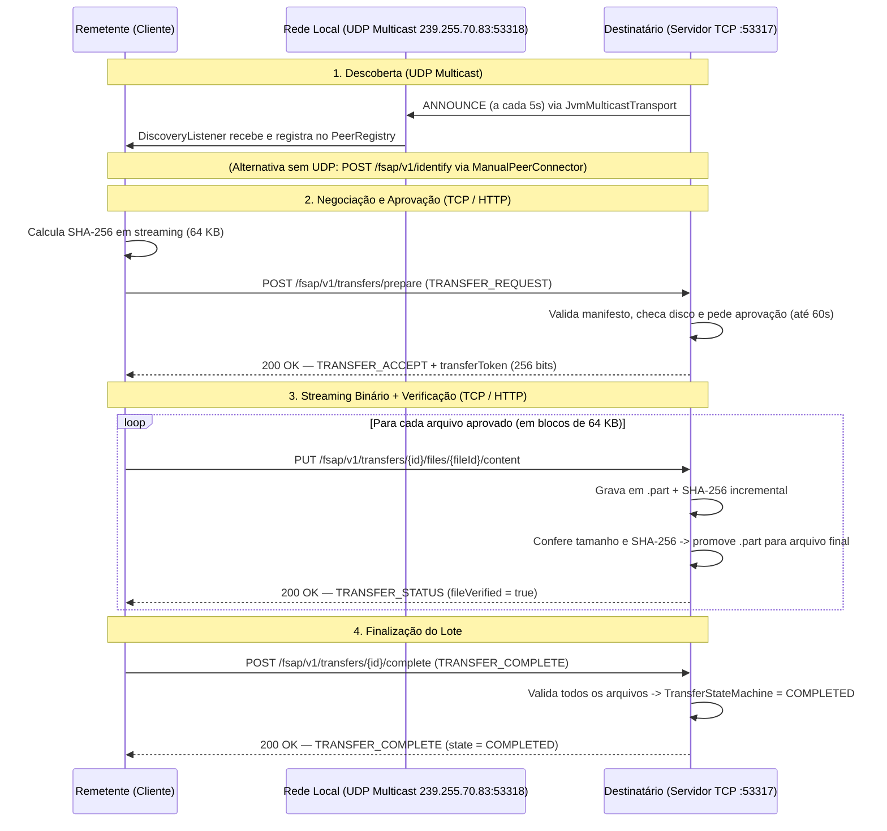

# Mapa do "Core" de Redes e Protocolo (`FSAP/1.0`) — KShare

Este documento resume onde está localizado o núcleo (**core**) do código responsável por **redes (UDP e TCP/HTTP)** e pela **implementação do protocolo `FSAP/1.0`**, com explicações simples de cada arquivo e do fluxo completo de ponta a ponta.

---

## Visão Geral: Onde mora o "Core"?

No KShare, toda a lógica de protocolo e rede é completamente separada da interface gráfica (Compose). Ela está organizada em **três pastas principais** (arquitetura Kotlin Multiplatform):

1. `composeApp/src/commonMain/kotlin/br/edu/fileshare/` — **O cérebro compartilhado.** Define o protocolo `FSAP/1.0`, o servidor e o cliente HTTP/TCP, a lógica de descoberta UDP e o streaming de arquivos.
2. `composeApp/src/jvmCommonMain/kotlin/br/edu/fileshare/` — **A ponte com o sistema operacional (Desktop + Android).** Onde ficam os sockets reais (`MulticastSocket`, `SSLServerSocket`), seleção de placas de rede, SHA-256 e geração de tokens/certificados.
3. `composeApp/src/androidMain/...` e `composeApp/src/desktopMain/...` — **Adaptações de cada plataforma**, como o `MulticastLock` do Wi-Fi no Android e o servidor de terminal (headless) no Desktop.

> **Ideia central do KShare:**
> - **UDP Multicast** (`239.255.70.83:53318`) = **"Radar"** para os dispositivos se encontrarem sozinhos na rede local.
> - **TCP + HTTP/1.1 (Ktor CIO)** (porta padrão `53317`) = **"Cabo confiável"** para identificar, aprovar e transferir os arquivos em blocos de 64 KB com verificação SHA-256.

---

## 1. Implementação do Protocolo `FSAP/1.0`

**Pasta:** `composeApp/src/commonMain/kotlin/br/edu/fileshare/protocol/`

Aqui está a "gramática" e o "manual de regras" do protocolo criado no projeto — sem abrir nenhum socket ainda.

### Regras, Mensagens e Erros

| Arquivo | O que faz (explicado de forma simples) |
| :--- | :--- |
| [`FsapConstants.kt`](../composeApp/src/commonMain/kotlin/br/edu/fileshare/protocol/FsapConstants.kt) | Centraliza todos os números oficiais do protocolo: IP multicast (`239.255.70.83`), porta UDP (`53318`), porta TCP/HTTP (`53317`), tamanho do bloco de envio (`64 KB`), timeouts e todas as rotas `/fsap/v1/...`. |
| [`FsapEnvelope.kt`](../composeApp/src/commonMain/kotlin/br/edu/fileshare/protocol/model/FsapEnvelope.kt) | Define o **"envelope padrão"** JSON (`FsapEnvelope<T>`) usado em todas as mensagens (protocolo, versão, tipo, UUID, timestamp, `senderId` e `payload`), além do codec `FsapJson`. |
| [`FsapPayloads.kt`](../composeApp/src/commonMain/kotlin/br/edu/fileshare/protocol/model/FsapPayloads.kt) | Define o **conteúdo interno** de cada tipo de mensagem: `ANNOUNCE`, `DISCOVER`, `BYE` (UDP) e `IDENTIFY`, `TRANSFER_REQUEST`, `TRANSFER_ACCEPT`, `TRANSFER_REJECT`, `TRANSFER_STATUS`, `TRANSFER_CANCEL`, `TRANSFER_COMPLETE`, `ERROR` (HTTP). |
| [`DeviceIdentity.kt`](../composeApp/src/commonMain/kotlin/br/edu/fileshare/protocol/model/DeviceIdentity.kt) | Representa o "RG" do dispositivo na rede (`deviceId`, apelido/alias, tipo, plataforma, porta HTTP e capacidades como TLS). |
| [`FsapHeaders.kt`](../composeApp/src/commonMain/kotlin/br/edu/fileshare/protocol/model/FsapHeaders.kt) | Nomes dos cabeçalhos HTTP personalizados (`X-FSAP-Version`, `X-FSAP-Protocol`, `X-FSAP-Sender-Id`, `X-FSAP-Transfer-Token`, `X-FSAP-File-SHA256`). |
| [`FsapMessageValidator.kt`](../composeApp/src/commonMain/kotlin/br/edu/fileshare/protocol/validation/FsapMessageValidator.kt) | O **"fiscal"** das mensagens: valida UUID v4, versão MAJOR compatível, portas válidas, nomes de arquivos seguros, formato do SHA-256 e soma exata de bytes do lote. |
| [`FsapErrorCode.kt`](../composeApp/src/commonMain/kotlin/br/edu/fileshare/protocol/error/FsapErrorCode.kt) | Catálogo dos **17 códigos de erro** padronizados (`FSAP-ERR-*`), cada um já mapeado para seu status HTTP correspondente e exceção tipada (`FsapProtocolException`). |

### Máquinas de Estado (FSM)

Garantem que ninguém pule etapas (por exemplo, tentar enviar bytes antes de o destinatário aprovar):

- [`FiniteStateMachine.kt`](../composeApp/src/commonMain/kotlin/br/edu/fileshare/protocol/statemachine/FiniteStateMachine.kt) — Motor genérico de máquina de estados com tabela de transições válidas.
- [`LocalNodeStateMachine.kt`](../composeApp/src/commonMain/kotlin/br/edu/fileshare/protocol/statemachine/LocalNodeStateMachine.kt) — Ciclo de vida do próprio dispositivo (`STOPPED` → `INITIALIZING` → `DISCOVERING` → `AVAILABLE` → `SHUTTING_DOWN`).
- [`PeerConnectionStateMachine.kt`](../composeApp/src/commonMain/kotlin/br/edu/fileshare/protocol/statemachine/PeerConnectionStateMachine.kt) — Estado de presença de cada dispositivo vizinho (`DISCONNECTED`, `DISCOVERED`, `STALE`, `CONNECTING`, `CONNECTED`).
- [`TransferStateMachine.kt`](../composeApp/src/commonMain/kotlin/br/edu/fileshare/protocol/statemachine/TransferStateMachine.kt) — Ciclo completo de uma transferência (`CREATED` → `PENDING_APPROVAL` → `ACCEPTED` → `TRANSFERRING` → `VERIFYING` → `COMPLETED` / `REJECTED` / `CANCELLED` / `FAILED`).

---

## 2. Camada UDP — Descoberta Automática na LAN

**Pastas:** `commonMain/.../network/discovery/`, `jvmCommonMain/.../network/discovery/` e `androidMain/.../android/network/`

Funciona como um "alto-falante" na rede local: a cada 5 segundos o aparelho envia um pequeno datagrama JSON (máx. 1024 bytes) para o grupo multicast `239.255.70.83:53318` com `TTL = 1` (não sai do roteador local).

### O Socket UDP Real (Baixo Nível)

| Arquivo | O que faz |
| :--- | :--- |
| [`MulticastTransport.kt`](../composeApp/src/commonMain/kotlin/br/edu/fileshare/network/discovery/MulticastTransport.kt) | Interface abstrata do transporte UDP (`open`, `send`, `receive`, `close`) e filtro de IPs privados RFC 1918. |
| [`JvmMulticastTransport.kt`](../composeApp/src/jvmCommonMain/kotlin/br/edu/fileshare/network/discovery/JvmMulticastTransport.kt) | **Onde o socket UDP nasce de fato:** usa `java.net.MulticastSocket` com `SO_REUSEADDR`, `TTL=1` e `joinGroup` nas placas de rede físicas da LAN. |
| [`JvmNetworkInterfaceProvider.kt`](../composeApp/src/jvmCommonMain/kotlin/br/edu/fileshare/network/discovery/JvmNetworkInterfaceProvider.kt) | Lista as interfaces de rede do sistema e **ignora placas falsas** (Docker, VPNs, virtuais e loopback) para enviar o multicast na rede Wi-Fi/Ethernet correta. |
| [`AndroidMulticastLockManager.kt`](../composeApp/src/androidMain/kotlin/br/edu/fileshare/android/network/AndroidMulticastLockManager.kt) | Exclusivo do Android: segura o `WifiManager.MulticastLock` (sem isso o Android descarta pacotes UDP multicast para economizar bateria) e prioriza a interface `wlan*`. |

### A Lógica de Descoberta (Alto Nível)

| Arquivo | O que faz |
| :--- | :--- |
| [`DiscoveryCoordinator.kt`](../composeApp/src/commonMain/kotlin/br/edu/fileshare/network/discovery/DiscoveryCoordinator.kt) | O "maestro" do UDP: liga e desliga o transporte, o emissor, o ouvinte e o faxineiro juntos. Se a rede bloquear multicast, falha de forma segura sem derrubar o app (`startBestEffort`). |
| [`DiscoveryBroadcaster.kt`](../composeApp/src/commonMain/kotlin/br/edu/fileshare/network/discovery/DiscoveryBroadcaster.kt) | Envia `DISCOVER` (quem está aí?), `ANNOUNCE` a cada 5s (estou aqui!) e `BYE` ao fechar o app (estou saindo!). |
| [`DiscoveryListener.kt`](../composeApp/src/commonMain/kotlin/br/edu/fileshare/network/discovery/DiscoveryListener.kt) | Escuta continuamente os pacotes UDP recebidos, ignora os próprios pacotes, descarta lixo silenciosamente e responde a `DISCOVER` com um atraso aleatório (*jitter* de 50–300 ms) para evitar tempestade na rede. |
| [`PeerRegistry.kt`](../composeApp/src/commonMain/kotlin/br/edu/fileshare/network/discovery/PeerRegistry.kt) | Lista reativa (`StateFlow`) dos dispositivos conhecidos na rede (tanto descobertos via UDP quanto adicionados via IP manual). |
| [`PeerRegistrySweeper.kt`](../composeApp/src/commonMain/kotlin/br/edu/fileshare/network/discovery/PeerRegistrySweeper.kt) | Roda a cada 3s removendo aparelhos que sumiram sem dar `BYE` (`> 12s` vira `STALE`, `> 18s` é removido). |

---

## 3. Camada TCP / HTTP — Servidor, Cliente e Transferência

Quando chega a hora de identificar um IP manual ou transferir arquivos de verdade, o KShare usa **HTTP/1.1 sobre TCP** com o motor **Ktor CIO** (corrotinas assíncronas, sem bloquear threads).

### 3.1. Servidor HTTP/TCP (quem recebe os arquivos)

**Pasta:** `composeApp/src/commonMain/kotlin/br/edu/fileshare/network/server/`

| Arquivo | O que faz |
| :--- | :--- |
| [`FsapHttpServer.kt`](../composeApp/src/commonMain/kotlin/br/edu/fileshare/network/server/FsapHttpServer.kt) | **Coração do servidor TCP:** sobe o servidor Ktor `CIO` na porta `53317` (ou escolhe outra livre se estiver ocupada), instala o tratamento global de erros `FSAP-ERR-*`, limita o corpo JSON a 256 KB e expõe as rotas `GET /fsap/v1/info` e `POST /fsap/v1/identify`. |
| [`TransferPrepareRoute.kt`](../composeApp/src/commonMain/kotlin/br/edu/fileshare/network/server/routes/TransferPrepareRoute.kt) | Rota `POST /fsap/v1/transfers/prepare`: recebe o manifesto de arquivos, checa espaço livre em disco, espera até 60s pela aprovação do usuário e devolve `TRANSFER_ACCEPT` (com token) ou `TRANSFER_REJECT`. |
| [`TransferContentRoute.kt`](../composeApp/src/commonMain/kotlin/br/edu/fileshare/network/server/routes/TransferContentRoute.kt) | Rota `PUT /fsap/v1/transfers/{id}/files/{fileId}/content`: valida o token, recebe os bytes em streaming de 64 KB salvando em arquivo temporário `.part`, confere o SHA-256 e só então grava o arquivo final. |
| [`TransferControlRoutes.kt`](../composeApp/src/commonMain/kotlin/br/edu/fileshare/network/server/routes/TransferControlRoutes.kt) | Rotas de controle: `GET .../status` (consultar andamento), `POST .../cancel` (cancelar e apagar `.part`) e `POST .../complete` (fechar o lote após todos os arquivos validados). |
| [`ServerTransferSessionManager.kt`](../composeApp/src/commonMain/kotlin/br/edu/fileshare/network/server/ServerTransferSessionManager.kt) | Gerencia todas as sessões de recebimento ativas (até 8 simultâneas), controla a `TransferStateMachine` de cada uma, timers de inatividade e limpeza de temporários. |
| [`TransferTokenManager.kt`](../composeApp/src/commonMain/kotlin/br/edu/fileshare/network/server/TransferTokenManager.kt) | Emite e valida o **token efêmero de 256 bits** (`X-FSAP-Transfer-Token`) com expiração por ociosidade de 30s. Usa [`PlatformTokenCrypto.jvm.kt`](../composeApp/src/jvmCommonMain/kotlin/br/edu/fileshare/network/server/PlatformTokenCrypto.jvm.kt) (`SecureRandom` + comparação em tempo constante). |
| [`TransferApprovalHandler.kt`](../composeApp/src/commonMain/kotlin/br/edu/fileshare/network/server/TransferApprovalHandler.kt) | Contrato que desacopla o servidor de como o usuário aprova o envio (na UI com popup, no console digitando S/N ou em auto-accept nos testes). |

### 3.2. Cliente HTTP/TCP e Orquestração (quem envia os arquivos)

| Arquivo | O que faz |
| :--- | :--- |
| [`FsapHttpClient.kt`](../composeApp/src/commonMain/kotlin/br/edu/fileshare/network/client/FsapHttpClient.kt) | **Coração do cliente TCP:** calcula o SHA-256 dos arquivos locais, envia `TRANSFER_REQUEST`, faz o upload binário (`PUT .../content`) sem carregar o arquivo todo na RAM, envia `TRANSFER_COMPLETE`, consulta status e cancela sessões. |
| [`ManualPeerConnector.kt`](../composeApp/src/commonMain/kotlin/br/edu/fileshare/network/discovery/ManualPeerConnector.kt) | Plano B quando o UDP multicast não funciona na rede: conecta direto por **IP + Porta via TCP** (`POST /fsap/v1/identify`) e registra o dispositivo no `PeerRegistry`. |
| [`TransferCoordinator.kt`](../composeApp/src/commonMain/kotlin/br/edu/fileshare/network/transfer/TransferCoordinator.kt) | Coordena múltiplos envios e recebimentos simultâneos (cada um na sua corrotina isolada) e implementa o cancelamento bilateral (avisa o outro lado antes de cortar o socket). |
| [`TransferProgressTracker.kt`](../composeApp/src/commonMain/kotlin/br/edu/fileshare/network/transfer/TransferProgressTracker.kt) | Calcula porcentagem, bytes transferidos e progresso em tempo real (com *throttle* de 100 ms para não sobrecarregar a tela). |

### 3.3. Streaming Binário (`64 KB`) e Integridade SHA-256

| Arquivo | O que faz |
| :--- | :--- |
| [`IncrementalSha256Channel.kt`](../composeApp/src/commonMain/kotlin/br/edu/fileshare/network/streaming/IncrementalSha256Channel.kt) | **Motor de streaming com memória fixa (`O(1)`):** lê e grava sempre em pedaços de **64 KB**, vai calculando o SHA-256 "enquanto os bytes passam", aplica timeout de 15s por leitura e descarta o arquivo `.part` se o tamanho ou o hash não baterem. |
| [`IncrementalSha256.jvm.kt`](../composeApp/src/jvmCommonMain/kotlin/br/edu/fileshare/network/streaming/IncrementalSha256.jvm.kt) | Implementação real do hash usando `java.security.MessageDigest("SHA-256")`. |

### 3.4. Segurança de Transporte (HTTPS / TLS Opcional)

| Arquivo | O que faz |
| :--- | :--- |
| [`FsapTlsContract.kt`](../composeApp/src/commonMain/kotlin/br/edu/fileshare/security/tls/FsapTlsContract.kt) | Contrato TLS e funções para anunciar/ler o fingerprint `TLS_SHA256:...` nas capacidades do dispositivo (modelo TOFU / pinning). |
| [`PlatformTlsProvider.jvm.kt`](../composeApp/src/jvmCommonMain/kotlin/br/edu/fileshare/security/tls/PlatformTlsProvider.jvm.kt) | Gera certificado X.509 autoassinado (RSA 2048), abre um proxy TCP TLSv1.3/1.2 (`SSLServerSocket`) na frente do Ktor CIO e configura o cliente HTTP com validação por pinning do SHA-256 do certificado. |

---

## 4. Onde tudo é "ligado" (Runtimes / Pontos de Entrada)

- **Servidor Desktop Headless (CLI, sem tela):** [`ServerMain.kt`](../composeApp/src/desktopMain/kotlin/br/edu/fileshare/desktop/server/ServerMain.kt)
- **App Desktop com Interface:** [`DesktopAppRuntime.kt`](../composeApp/src/desktopMain/kotlin/br/edu/fileshare/desktop/runtime/DesktopAppRuntime.kt)
- **App Android (Runtime + Serviço em 2º plano):** [`AndroidFileShareRuntime.kt`](../composeApp/src/androidMain/kotlin/br/edu/fileshare/android/runtime/AndroidFileShareRuntime.kt) e [`FsapForegroundService.kt`](../composeApp/src/androidMain/kotlin/br/edu/fileshare/android/service/FsapForegroundService.kt)

---

## 5. Fluxo Completo (de ponta a ponta)

### Passo a passo resumido

1. **Descoberta (UDP):** [`DiscoveryBroadcaster.kt`](../composeApp/src/commonMain/kotlin/br/edu/fileshare/network/discovery/DiscoveryBroadcaster.kt) envia `ANNOUNCE` via [`JvmMulticastTransport.kt`](../composeApp/src/jvmCommonMain/kotlin/br/edu/fileshare/network/discovery/JvmMulticastTransport.kt) → [`DiscoveryListener.kt`](../composeApp/src/commonMain/kotlin/br/edu/fileshare/network/discovery/DiscoveryListener.kt) ouve e cadastra o par no [`PeerRegistry.kt`](../composeApp/src/commonMain/kotlin/br/edu/fileshare/network/discovery/PeerRegistry.kt) *(ou o usuário usa IP manual via [`ManualPeerConnector.kt`](../composeApp/src/commonMain/kotlin/br/edu/fileshare/network/discovery/ManualPeerConnector.kt))*.
2. **Negociação (TCP/HTTP):** [`FsapHttpClient.kt`](../composeApp/src/commonMain/kotlin/br/edu/fileshare/network/client/FsapHttpClient.kt) calcula o SHA-256 dos arquivos e manda `POST /fsap/v1/transfers/prepare` → [`TransferPrepareRoute.kt`](../composeApp/src/commonMain/kotlin/br/edu/fileshare/network/server/routes/TransferPrepareRoute.kt) pede aprovação e responde `TRANSFER_ACCEPT` com um `transferToken`.
3. **Envio dos Bytes (TCP/HTTP Streaming):** O cliente faz `PUT /fsap/v1/transfers/{id}/files/{fileId}/content` enviando blocos de **64 KB** via [`IncrementalSha256Channel.kt`](../composeApp/src/commonMain/kotlin/br/edu/fileshare/network/streaming/IncrementalSha256Channel.kt).
4. **Verificação e Commit:** [`TransferContentRoute.kt`](../composeApp/src/commonMain/kotlin/br/edu/fileshare/network/server/routes/TransferContentRoute.kt) salva no `.part`, confere tamanho e SHA-256 e promove o arquivo para o destino final.
5. **Fechamento:** O cliente envia `POST .../complete` → [`TransferControlRoutes.kt`](../composeApp/src/commonMain/kotlin/br/edu/fileshare/network/server/routes/TransferControlRoutes.kt) valida o lote inteiro e move a [`TransferStateMachine.kt`](../composeApp/src/commonMain/kotlin/br/edu/fileshare/protocol/statemachine/TransferStateMachine.kt) para `COMPLETED`.

---

## Documentação Complementar no Repositório

- [`networking-explained-simple.md`](./networking-explained-simple.md) — Explicação didática sobre a camada de redes do projeto.
- [`protocol-fsap.md`](./protocol-fsap.md) — Especificação completa do protocolo `FSAP/1.0`.
- [`state-machine.md`](./state-machine.md) e [`error-codes.md`](./error-codes.md) — Estados e códigos de erro oficiais.
