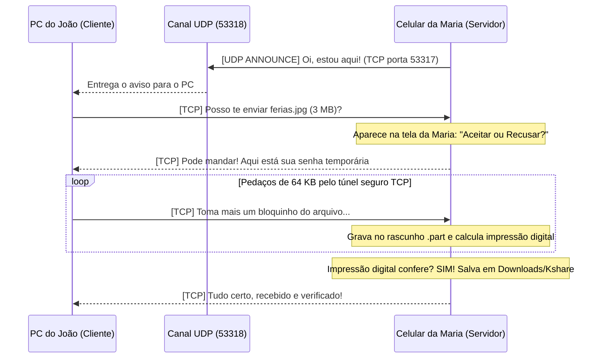

# Como Funcionam o UDP, o TCP e o Protocolo do KShare — Explicação Simples

> **Para quem é este guia?** Para qualquer pessoa que queira entender **como os aparelhos se acham no Wi-Fi e enviam arquivos no KShare** sem precisar saber redes de computadores antes. Usamos comparações simples do cotidiano para explicar cada peça.
>
> **Quer ver os detalhes técnicos ou onde cada coisa fica no código?**
> - Especificação técnica completa: [`../README.md`](../README.md)
> - Guia técnico de Redes com apontamento do código-fonte: [`networking-presentation-guide.md`](networking-presentation-guide.md)

---

## A Ideia em 30 Segundos

Quando você envia uma foto do celular para o computador usando internet comum, o arquivo costuma viajar até servidores distantes (na nuvem) e voltar. Isso gasta internet, demora mais e depende de terceiros.

O **KShare** faz diferente: se os dois aparelhos estão **na mesma rede local** (o mesmo Wi-Fi da casa, da sala ou da faculdade), eles conversam **diretamente entre si**, sem passar pela internet.

Para essa conversa funcionar sem bagunça, o KShare usa **três peças principais**:

1. **O Protocolo (`FSAP/1.0`):** as regras e o "idioma" que os dois aparelhos combinam usar para se entender.
2. **O `UDP` (O Megafone):** usado só para os aparelhos **se encontrarem rapidamente** no Wi-Fi.
3. **O `TCP` (A Transportadora Garantida):** usado para pedir permissão e **entregar o arquivo inteiro sem perder nenhum pedacinho**.

---

## 1. O que é um Protocolo de Rede (`FSAP/1.0`)?

Imagine tentar fazer um pedido em uma loja onde ninguém fala o mesmo idioma nem segue nenhuma regra: você entrega o dinheiro antes de saber o preço, o atendente entrega a caixa errada, ninguém avisa quando terminou. Seria um caos.

Um **protocolo da camada de aplicação** é exatamente um **manual de conversa e regras de etiqueta** entre dois programas de computador. No KShare, esse manual foi batizado de **`FSAP/1.0`** (*FileShare Application Protocol*).

Esse manual combina três coisas simples:

1. **Quais "frases" (mensagens) existem:**
   Por exemplo: *"Tem alguém aí?"* (`DISCOVER`), *"Estou aqui!"* (`ANNOUNCE`), *"Posso te enviar esse arquivo?"* (`TRANSFER_REQUEST`), *"Pode mandar!"* (`TRANSFER_ACCEPT`) ou *"Não quero!"* (`TRANSFER_REJECT`).
2. **Qual a ordem certa de falar (estados):**
   Você não pode começar a jogar os pedaços do arquivo pela rede antes de o outro aparelho avisar que o usuário clicou em **"Aceitar"**. O protocolo proíbe pular etapas.
3. **O que responder quando algo dá errado (erros):**
   Se acabou o espaço no celular, se o usuário demorou mais de 60 segundos para responder, ou se o arquivo chegou com algum erro, o receptor devolve um **código de erro claro** dizendo exatamente o que houve.

---

## 2. O que é o `UDP` e como o KShare usa ele?

### A analogia do megafone em uma sala
Pense no **UDP** como falar com um **megafone dentro de uma sala**.
- Você não precisa pedir permissão nem confirmar que cada pessoa ouviu antes de falar;
- Você simplesmente solta uma frase rápida no ar e segue em frente;
- Se alguém estava distraído naquele segundo e não ouviu, não tem problema: daqui a **5 segundos** você repete a frase de novo.

Em redes, essas frases soltas se chamam **datagramas**. O UDP é extremamente leve e rápido, mas **não garante entrega**: se um pacote se perder no Wi-Fi, o próprio UDP não manda de novo automaticamente.

### O que é Multicast (`239.255.70.83:53318`)?
Em vez de gritar para *todo mundo* na rede sem critério, o KShare sintoniza um "canal de rádio interno" específico: o endereço **`239.255.70.83`** na porta **`53318`**.  
Só os aparelhos que estão com o KShare aberto ficam escutando esse canal. Assim, quando um computador ou celular manda um aviso nesse canal, **todos os outros KShare da mesma rede recebem de uma vez só**.

### As 3 únicas coisas que o KShare fala no UDP:
1. **`DISCOVER` ("Alô, tem alguém com KShare aberto?"):** enviado quando você abre o app ou toca em atualizar. Quem estiver ativo responde dizendo seu nome, aparelho e porta depois de um pequenininho atraso aleatório (`50` a `300 milissegundos`) para não todo mundo falar exatamente ao mesmo tempo.
2. **`ANNOUNCE` ("Oi! Sou o Notebook-Enzo, sistema Linux, estou na porta 53317"):** enviado automaticamente a cada **5 segundos** para dizer *"continuo vivo aqui na rede"*.
   - Se o outro aparelho ficar **18 segundos** sem dar sinal de vida (mais de 3 avisos perdidos), o KShare tira ele automaticamente da lista.
3. **`BYE` ("Tchau, estou fechando o app!"):** enviado quando você fecha o KShare normalmente, para o seu nome sumir na hora da tela dos outros sem precisar esperar 18 segundos.

> **Resumo do UDP:** É leve, direto e perfeito para dizer *"estou aqui!"*. Mesmo que um aviso falhe no ar, 5 segundos depois outro aviso resolve.

---

## 3. O que é o `TCP` e como o KShare usa ele?

### A analogia da transportadora com entrega registrada
Agora pense no **TCP** como uma **transportadora super rigorosa**.  
Quando você quer mandar um livro ou um vídeo inteiro (milhões ou bilhões de bytes), **você NÃO pode aceitar que uma página caia no caminho nem chegue trocada**. Se faltar 1 único byte em uma foto, vídeo ou PDF, o arquivo inteiro pode não abrir!

Antes de enviar qualquer coisa pelo TCP, os dois lados fazem um **"aperto de mão"** (chamado *Three-Way Handshake*):
1. Cliente: *"Oi, você está disponível na porta 53317?"*
2. Servidor: *"Estou! Pode conectar comigo."*
3. Cliente: *"Combinado, estamos conectados!"*

Depois de conectados, o **TCP garante sozinho**:
- **Ordem exata:** se o pedaço #3 chegar antes do pedaço #2 pela rede, o TCP coloca tudo na ordem certa antes de entregar para o KShare;
- **Reenvio automático:** se algum pedaço sumir no meio do Wi-Fi, o TCP percebe que não houve confirmação e reenvia aquele pedaço automaticamente;
- **Controle de ritmo:** se um computador com cabo de rede tentar enviar muito rápido para um celular com Wi-Fi mais lento, o TCP desacelera automaticamente para não engasgar o celular.

### Para que o KShare usa o TCP (porta `53317`)?
1. **Conexão Manual por IP (Plano B):** alguns Wi-Fis de faculdade ou empresa bloqueiam o "megafone" do UDP Multicast por segurança. Nesses casos, você digita o endereço IP e a porta do outro aparelho, e o KShare vai direto pelo TCP perguntando quem está lá (`IDENTIFY`).
2. **Troca de portas automática:** se a porta `53317` já estiver sendo usada por outro programa no mesmo PC, o KShare escolhe automaticamente a próxima porta livre (por exemplo `53319`) e avisa os colegas.
3. **Pedido de permissão e envio do arquivo em pedacinhos de `64 KB`:** em vez de tentar carregar um vídeo de 2 GB inteiro na memória RAM de uma vez (o que faria o celular travar por falta de memória), o KShare lê o arquivo **de `64 KB` em `64 KB`** — como encher um balde usando um copo de cada vez — e vai entregando pelo tubo seguro do TCP.

---

## 4. Comparação Direta: `UDP` vs. `TCP`

| Pergunta | `UDP` (Descoberta) | `TCP` (Negociação e Arquivo) |
| :--- | :--- | :--- |
| **Analogia simples** | Grito rápido no megafone da sala | Transportadora com rastreio e assinatura |
| **Combina conexão antes?** | Não (só envia direto no canal) | Sim (faz o "aperto de mão" antes) |
| **Fala com vários ao mesmo tempo?** | Sim (Multicast 1 para todos) | Não (conversa direta 1 para 1) |
| **Garante entrega e ordem?** | Não (se perder, perdeu) | Sim (reenvia falhas e ordena tudo) |
| **Se perder um pacote...** | O próximo aviso em `5 s` resolve | O próprio TCP detecta e reenvia na hora |
| **O que o KShare manda nele?** | Apenas avisos leves de presença (`DISCOVER`, `ANNOUNCE`, `BYE`) | Pedido de envio, aceite/recusa e todos os bytes do arquivo |

> **Frase fácil de lembrar:**  
> O **UDP** serve para **achar quem está na sala** (*"Estou aqui!"*).  
> O **TCP** serve para **entregar a encomenda com garantia** (*"Toma aqui o arquivo inteiro sem faltar nada"*).

---

## 5. Uma Transferência Completa Contada Como Conversa Real

Vamos acompanhar passo a passo o que acontece quando **João (no PC — Cliente)** envia uma foto `ferias.jpg` para **Maria (no Android — Servidor)** na mesma rede Wi-Fi:

1. **Descoberta (UDP — `53318`):**  
   O celular de Maria manda no canal multicast a cada 5 s: *"Oi, sou o Android da Maria, podem falar comigo na porta TCP 53317"*. O PC de João escuta e mostra `"Android da Maria"` na tela.
2. **Proposta (TCP — `53317`):**  
   João escolhe `ferias.jpg` e clica em enviar. O PC calcula a "impressão digital" matemática do arquivo (`SHA-256`) e manda uma mensagem TCP (`TRANSFER_REQUEST`): *"Maria, quero mandar `ferias.jpg` de 3 MB com a impressão digital `9f86d0...`"*.
3. **Consentimento Humano:**  
   Na tela do celular de Maria aparece uma janela perguntando se ela aceita `ferias.jpg` do PC do João. Maria tem até **60 segundos** para responder. Ela toca em **"Aceitar"**.
4. **Senha Temporária (`transferToken`):**  
   O celular da Maria gera uma senha secreta temporária só para essa transferência e responde (`TRANSFER_ACCEPT`): *"Aceito! Use essa senha para mandar os bytes"*. (Sem essa senha, ninguém consegue mandar bytes para o celular).
5. **Envio em Pedacinhos para um Rascunho (`.part`):**  
   O PC de João lê `ferias.jpg` em bloquinhos de **`64 KB`** e vai jogando no túnel TCP (`TRANSFER_CONTENT`).  
   Do outro lado, o celular da Maria não salva direto com o nome final — ele vai gravando tudo em um **arquivo rascunho terminado em `.part`** enquanto confere o progresso na tela.
6. **Conferência Final ("Impressão Digital" `SHA-256`):**  
   Quando chega o último byte, o celular da Maria compara a impressão digital calculada do arquivo que recebeu com a impressão digital que o PC de João avisou lá no passo 2:
   - **Se bater 100%:** o rascunho `.part` vira o arquivo oficial `ferias.jpg` na pasta **`Downloads/Kshare`** (se já existir outro `ferias.jpg`, vira `ferias (1).jpg` para nunca apagar seu arquivo antigo!).
   - **Se algo falhar, for cancelado ou o Wi-Fi cair (`15 s` sem sinal):** o celular **apaga o `.part` na mesma hora**. Nada de arquivo corrompido pela metade ocupando espaço.

---

## 6. Como o App Garante Segurança e Não Deixa "Lixo" no Aparelho?

Mesmo sendo um app simples de usar na rede local, há quatro cuidados invisíveis funcionando o tempo todo:

1. **Ninguém manda nada sem você aceitar:** mesmo que um estranho esteja no mesmo Wi-Fi, qualquer tentativa de mandar bytes sem clicar em **"Aceitar"** (ou sem a senha temporária `transferToken`) é barrada na hora.
2. **Pasta protegida contra nomes maliciosos:** se alguém tentasse mandar um arquivo com nome disfarçado como `../../sistema/arquivo`, o KShare bloqueia imediatamente para garantir que nada possa ser gravado fora da pasta escolhida (`Downloads/Kshare` ou pasta escolhida por você).
3. **Sem arquivos quebrados no seu celular/PC:** graças ao rascunho **`.part`** e à verificação **SHA-256**, se você clicar em **"Cancelar"** no meio (ou desligar o Wi-Fi), o rascunho é apagado automaticamente.
4. **Cadeado opcional (`TLS`):** se você ativar a opção de criptografia TLS nas configurações, os dados trafegam embaralhados no Wi-Fi e o app mostra um código curto de 8 letras/números para os dois usuários conferirem que estão falando com a pessoa certa e não com alguém interceptando a rede.

---

## 7. Dicionário Sem Complicação (Glossário Rápido)

| Termo | O que significa na prática |
| :--- | :--- |
| **Rede Local (LAN / Wi-Fi)** | A rede interna da sua casa, escritório ou laboratório controlada pelo seu roteador, sem precisar da internet externa. |
| **Endereço IP e Porta** | Pense no **IP** (`192.168.1.42`) como o **endereço do prédio**, e na **Porta** (`53317` ou `53318`) como o **número do apartamento** onde o programa atende. |
| **Cliente e Servidor** | **Servidor** é quem fica esperando pedidos para receber arquivos; **Cliente** é quem toma a iniciativa de conectar e enviar. No KShare, os dois aparelhos conseguem fazer os dois papéis. |
| **Socket** | A "tomada" ou "gancho" no sistema operacional onde um programa espeta o cabo virtual para mandar e receber dados pela rede via UDP ou TCP. |
| **Multicast** | Mandar uma mensagem de uma vez só para um grupo específico de interessados na mesma rede, como um grupo de rádio local. |
| **Chunk / Streaming (`64 KB`)** | Dividir um arquivo grande em pedacinhos pequenos e ir mandando um atrás do outro, sem tentar colocar o arquivo inteiro na memória RAM. |
| **Arquivo `.part`** | Um arquivo temporário de rascunho enquanto o download ainda está acontecendo. Só perde o `.part` depois de ficar 100% completo e verificado. |
| **Hash `SHA-256`** | Uma "impressão digital" matemática única calculada a partir dos bytes do arquivo. Mudar 1 único bit muda completamente o resultado. |
| **Timeout** | Tempo máximo de espera (ex.: `60 s` para você aceitar, `15 s` sem chegar dados antes de concluir que a conexão caiu). |
| **TLS** | Camada de cadeado/criptografia (a mesma por trás do `https://`) que embaralha o conteúdo trafegado para ninguém no mesmo Wi-Fi conseguir bisbilhotar. |
