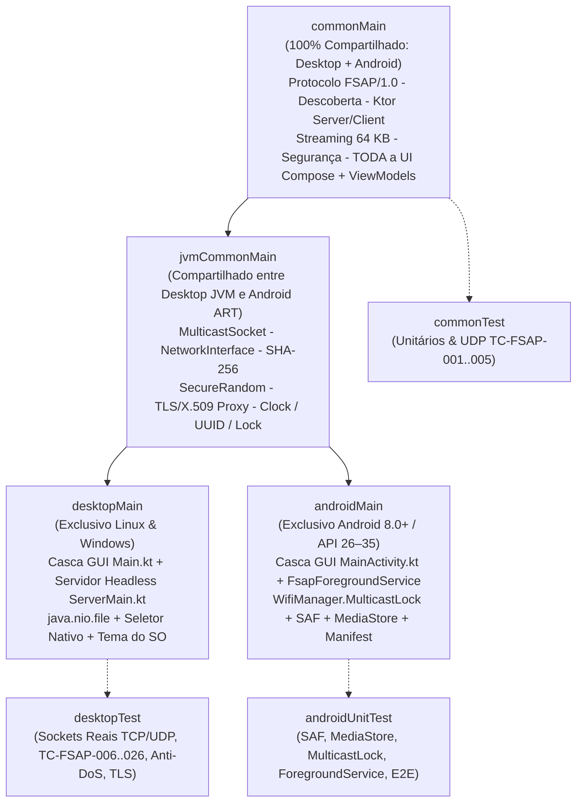

# Guia de Conceitos de Redes e Mapeamento no Código — KShare (`FSAP/1.0`)

> **Objetivo deste documento:** Servir como roteiro técnico de estudo e consulta rápida durante a **apresentação oral da disciplina de Redes de Computadores**. Reúne a explicação completa da **composição de pastas Kotlin Multiplatform (KMP)** — separando protocolo, UDP, TCP, código compartilhado e interfaces Desktop/Android — seguida dos **conceitos de Redes aplicados** com apontamento exato das classes, funções e intervalos de linhas no código-fonte.
>
> **Documento normativo completo:** Para a especificação formal autocontida exigida pelo enunciado, consulte [`../README.md`](../README.md).

---

## Sumário

- [Mapa Rápido da Pilha TCP/IP no KShare](#mapa-rápido-da-pilha-tcpip-no-kshare)
- [1. Composição de Pastas do Projeto e Arquitetura KMP](#1-composição-de-pastas-do-projeto-e-arquitetura-kmp)
  - [1.1. Visão Geral das Pastas Raiz do Monorepo](#11-visão-geral-das-pastas-raiz-do-monorepo)
  - [1.2. Hierarquia dos Source Sets KMP (Compartilhado × Específico)](#12-hierarquia-dos-source-sets-kmp-compartilhado--específico)
  - [1.3. Raio-X Pasta por Pasta (`composeApp/src/`)](#13-raio-x-pasta-por-pasta-composeappsrc)
  - [1.4. Mapa Direto por Responsabilidade (Protocolo, UDP, TCP, UI Desktop e UI Android)](#14-mapa-direto-por-responsabilidade-protocolo-udp-tcp-ui-desktop-e-ui-android)
- [2. Modelo Distribuído Cliente-Servidor e Separação UI × Rede](#2-modelo-distribuído-cliente-servidor-e-separação-ui--rede)
- [3. Endereçamento IPv4 (`RFC 1918`), Interfaces de Rede e Filtro Anti-Virtuais](#3-endereçamento-ipv4-rfc-1918-interfaces-de-rede-e-filtro-anti-virtuais)
- [4. Socket UDP Multicast (`239.255.70.83:53318`), MTU e Controle de Tempestade](#4-socket-udp-multicast-239255708353318-mtu-e-controle-de-tempestade)
- [5. Socket TCP (`53317`), Bind, Conflito de Porta e Fallback Manual Unicast](#5-socket-tcp-53317-bind-conflito-de-porta-e-fallback-manual-unicast)
- [6. Protocolo de Camada de Aplicação (`FSAP/1.0`): Enquadramento, Contratos e Erros](#6-protocolo-de-camada-de-aplicação-fsap10-enquadramento-contratos-e-erros)
- [7. Máquinas de Estados Finitos Determinísticas](#7-máquinas-de-estados-finitos-determinísticas)
- [8. Streaming Binário `O(1)`, Timeouts e Integridade Ponta a Ponta (`SHA-256`)](#8-streaming-binário-o1-timeouts-e-integridade-ponta-a-ponta-sha-256)
- [9. Concorrência, Controle de Sessões e Cancelamento Bilateral](#9-concorrência-controle-de-sessões-e-cancelamento-bilateral)
- [10. Segurança na Rede Local: Token Efêmero, Anti-DoS, *Path Traversal* e TLS com TOFU](#10-segurança-na-rede-local-token-efêmero-anti-dos-path-traversal-e-tls-com-tofu)
- [11. Roteiro de Demonstração Ao Vivo + Perguntas Prováveis do Professor](#11-roteiro-de-demonstração-ao-vivo--perguntas-prováveis-do-professor)

---

## Mapa Rápido da Pilha TCP/IP no KShare

| Camada / Tema | Conceito de Redes Aplicado | Onde Mostrar no Código |
| :--- | :--- | :--- |
| **Arquitetura Distribuída** | Separação Cliente × Servidor em processos distintos, isolamento UI × Rede | [`ServerMain.kt`](../composeApp/src/desktopMain/kotlin/br/edu/fileshare/desktop/server/ServerMain.kt#L38-L174) · [`ServerCliParser.kt`](../composeApp/src/desktopMain/kotlin/br/edu/fileshare/desktop/server/ServerCliParser.kt#L10-L137) · [`FsapHttpClient.kt`](../composeApp/src/commonMain/kotlin/br/edu/fileshare/network/client/FsapHttpClient.kt#L167-L212) |
| **Camada de Rede / Enlace** | Endereçamento privado RFC 1918, filtragem de interfaces virtuais (Docker/WSL2/VPN) e celulares | [`MulticastTransport.kt`](../composeApp/src/commonMain/kotlin/br/edu/fileshare/network/discovery/MulticastTransport.kt#L53-L104) · [`JvmNetworkInterfaceProvider.kt`](../composeApp/src/jvmCommonMain/kotlin/br/edu/fileshare/network/discovery/JvmNetworkInterfaceProvider.kt#L23-L63) |
| **Transporte UDP** | Socket `MulticastSocket`, grupo IGMP `239.255.70.83:53318`, `TTL=1`, MTU ≤ `1024 B`, jitter, TTL `18 s`, `MulticastLock` | [`JvmMulticastTransport.kt`](../composeApp/src/jvmCommonMain/kotlin/br/edu/fileshare/network/discovery/JvmMulticastTransport.kt#L55-L213) · [`DiscoveryBroadcaster.kt`](../composeApp/src/commonMain/kotlin/br/edu/fileshare/network/discovery/DiscoveryBroadcaster.kt#L45-L135) · [`DiscoveryListener.kt`](../composeApp/src/commonMain/kotlin/br/edu/fileshare/network/discovery/DiscoveryListener.kt#L102-L209) · [`AndroidMulticastLockManager.kt`](../composeApp/src/androidMain/kotlin/br/edu/fileshare/android/network/AndroidMulticastLockManager.kt#L37-L318) |
| **Transporte TCP** | Socket TCP passivo (`Ktor CIO`), `SO_REUSEADDR`, fallback automático de porta em conflito e handshake manual unicast | [`FsapHttpServer.kt`](../composeApp/src/commonMain/kotlin/br/edu/fileshare/network/server/FsapHttpServer.kt#L390-L503) · [`ManualPeerConnector.kt`](../composeApp/src/commonMain/kotlin/br/edu/fileshare/network/discovery/ManualPeerConnector.kt#L83-L308) |
| **Camada de Aplicação** | Enquadramento sobre fluxo TCP (*HTTP/1.1 + octet-stream*), contratos `FSAP/1.0`, versionamento e 17 códigos de erro | [`FsapConstants.kt`](../composeApp/src/commonMain/kotlin/br/edu/fileshare/protocol/FsapConstants.kt#L7-L59) · [`FsapEnvelope.kt`](../composeApp/src/commonMain/kotlin/br/edu/fileshare/protocol/model/FsapEnvelope.kt#L16-L67) · [`FsapMessageValidator.kt`](../composeApp/src/commonMain/kotlin/br/edu/fileshare/protocol/validation/FsapMessageValidator.kt#L54-L118) · [`FsapErrorCode.kt`](../composeApp/src/commonMain/kotlin/br/edu/fileshare/protocol/error/FsapErrorCode.kt#L16-L148) |
| **Máquinas de Estados** | 3 FSMs ortogonais com `Mutex` e bloqueio de transições inválidas (`HTTP 409`) | [`FiniteStateMachine.kt`](../composeApp/src/commonMain/kotlin/br/edu/fileshare/protocol/statemachine/FiniteStateMachine.kt#L16-L80) · [`TransferStateMachine.kt`](../composeApp/src/commonMain/kotlin/br/edu/fileshare/protocol/statemachine/TransferStateMachine.kt#L5-L91) |
| **Streaming e Integridade** | Buffers fixos de `64 KB` ($O(1)$), timeout de stream (`15 s`), `.part` atômico e `SHA-256` incremental | [`IncrementalSha256Channel.kt`](../composeApp/src/commonMain/kotlin/br/edu/fileshare/network/streaming/IncrementalSha256Channel.kt#L44-L198) · [`TransferContentRoute.kt`](../composeApp/src/commonMain/kotlin/br/edu/fileshare/network/server/routes/TransferContentRoute.kt#L38-L179) · [`DesktopNioFileStorage.kt`](../composeApp/src/desktopMain/kotlin/br/edu/fileshare/desktop/storage/DesktopNioFileStorage.kt#L131-L360) |
| **Concorrência na LAN** | Sessões isoladas por `SupervisorJob`, limite de 8 sessões (`BUSY`), *long-polling* `60 s` e cancelamento bilateral | [`ServerTransferSessionManager.kt`](../composeApp/src/commonMain/kotlin/br/edu/fileshare/network/server/ServerTransferSessionManager.kt#L76-L264) · [`TransferPrepareRoute.kt`](../composeApp/src/commonMain/kotlin/br/edu/fileshare/network/server/routes/TransferPrepareRoute.kt#L63-L223) · [`TransferControlRoutes.kt`](../composeApp/src/commonMain/kotlin/br/edu/fileshare/network/server/routes/TransferControlRoutes.kt#L42-L205) |
| **Segurança de Rede** | Token efêmero (`256 bits`, *constant-time*), anti-DoS (`256 KB` JSON / `HTTP 507`), anti-*Path Traversal* e TLS com TOFU | [`TransferTokenManager.kt`](../composeApp/src/commonMain/kotlin/br/edu/fileshare/network/server/TransferTokenManager.kt#L56-L167) · [`FileNameSanitizer.kt`](../composeApp/src/commonMain/kotlin/br/edu/fileshare/storage/FileNameSanitizer.kt#L32-L113) · [`PlatformTlsProvider.jvm.kt`](../composeApp/src/jvmCommonMain/kotlin/br/edu/fileshare/security/tls/PlatformTlsProvider.jvm.kt#L54-L388) |

---

## 1. Composição de Pastas do Projeto e Arquitetura KMP

### 1.1. Visão Geral das Pastas Raiz do Monorepo

| Diretório / Arquivo | Papel no Repositório |
| :--- | :--- |
| `composeApp/` | Módulo Gradle **Kotlin Multiplatform + Compose Multiplatform** contendo todo o código-fonte compartilhado e específico de Desktop (Linux/Windows) e Android ([`composeApp/build.gradle.kts`](../composeApp/build.gradle.kts#L16-L41)). |
| `docs/` | Especificação normativa do protocolo `FSAP/1.0`, máquinas de estados, diagramas de fluxo, ADRs, segurança, casos de teste `TC-FSAP-001..026` e este guia de apresentação. |
| `scripts/` | Automação de execução e entrega: servidor CLI (`run-desktop-server.sh`), UI Desktop (`run-desktop-ui.sh`), checagem estrutural (`check-structure.sh`), validação cruzada (`run-interop-checks.sh`) e empacotamento de release (`prepare-release-assets.sh`). |
| `gradle/` | Catálogo centralizado de dependências e versões em [`gradle/libs.versions.toml`](../gradle/libs.versions.toml) (Kotlin, Ktor, Coroutines, Serialization, Compose, AGP) + Gradle Wrapper. |
| `.github/workflows/` | Pipeline de CI/CD para execução dos testes e publicação automática das releases multiplataforma (`.apk`, `.deb`, `.msi`, `.zip` e `.jar`). |
| Raiz (`README.md`, `README-PROJECT.md`, `CONTRIBUTING.md`, `SECURITY.md`, `LICENSE`) | Documentação acadêmica autocontida de Redes (`README.md`), guia de usuário/downloads do projeto (`README-PROJECT.md`), diretrizes de colaboração e licença MIT. |

### 1.2. Hierarquia dos Source Sets KMP (Compartilhado × Específico)

Conforme configurado em [`composeApp/build.gradle.kts`](../composeApp/build.gradle.kts#L22-L29), o código-fonte sob `composeApp/src/` é organizado em camadas hierárquicas de compartilhamento:



> **Como funciona o compartilhamento `expect` / `actual` no Kotlin Multiplatform:** Quando o núcleo em `commonMain` precisa de uma primitiva que depende da plataforma (como cálculo `SHA-256`, geração de token criptográfico, proxy TLS, `UUID`, `Clock` ou detecção de tema escuro), ele declara apenas o contrato **`expect`** (ex.: `expect class IncrementalSha256`) em `commonMain`, e o compilador acopla automaticamente a implementação **`actual`** correspondente de `jvmCommonMain`, `desktopMain` ou `androidMain` na compilação de cada alvo.

### 1.3. Raio-X Pasta por Pasta (`composeApp/src/`)

#### 1) `composeApp/src/commonMain/` — Núcleo 100% Compartilhado (Desktop + Android)
Contém toda a inteligência do protocolo, da rede e também **toda a interface visual reutilizada** entre Desktop GUI e Android:

- `kotlin/br/edu/fileshare/ProjectInfo.kt` — nome oficial (`KShare`) e identificação normativa (`FSAP/1.0`).
- `kotlin/br/edu/fileshare/core/` — infraestrutura básica: `di/AppContainer.kt`, `logging/FsapLogger.kt`, `time/Clock.kt`, `id/UuidGenerator.kt`, `concurrency/PlatformLock.kt`.
- `kotlin/br/edu/fileshare/protocol/` — **o protocolo criado (`FSAP/1.0`):**
  - `FsapConstants.kt`: portas padrão (`53317/TCP`, `53318/UDP`, grupo `239.255.70.83`), limites de pacote/chunk/lote e 11 constantes de temporização;
  - `model/`: `DeviceIdentity.kt`, `FsapEnvelope.kt` (`FsapMessageType`, `FsapEnvelope`, `FsapJson`), `FsapHeaders.kt` (`X-FSAP-*`), `FsapPayloads.kt` (payloads de todas as 12 mensagens);
  - `validation/FsapMessageValidator.kt`: validações sintáticas, UUIDv4, versão `MAJOR.MINOR`, nomes e limites;
  - `statemachine/`: `FiniteStateMachine.kt` (motor genérico com `Mutex`), `LocalNodeStateMachine.kt`, `PeerConnectionStateMachine.kt` e `TransferStateMachine.kt`;
  - `error/FsapErrorCode.kt`: os **17 códigos padronizados `FSAP-ERR-*`**.
- `kotlin/br/edu/fileshare/network/` — **toda a engine de comunicação UDP + HTTP/TCP:**
  - `discovery/`: `MulticastTransport.kt` (`DiscoveryDefaults`, `NetworkInterfaceFilter`), `DiscoveryBroadcaster.kt` (`DISCOVER`, `ANNOUNCE`, `BYE`), `DiscoveryListener.kt` (validação UDP + jitter `50..300 ms`), `DiscoveryCoordinator.kt`, `PeerRegistry.kt`, `PeerRegistrySweeper.kt` e `ManualPeerConnector.kt` (conexão manual via **TCP** `IDENTIFY`);
  - `server/`: `FsapHttpServer.kt` (servidor **Ktor CIO** com seleção automática de porta livre em conflito), `ServerTransferSessionManager.kt`, `TransferApprovalHandler.kt`, `TransferTokenManager.kt` e subpacote `routes/` (`TransferPrepareRoute.kt`, `TransferContentRoute.kt`, `TransferControlRoutes.kt`);
  - `client/`: `FsapHttpClient.kt` (cliente **Ktor CIO** para envio de manifesto, streaming e cancelamento);
  - `streaming/`: `IncrementalSha256Channel.kt` (leitura/escrita em `64 KB` + hash SHA-256 incremental + limpeza `.part`);
  - `transfer/`: `TransferCoordinator.kt` e `TransferProgressTracker.kt` (orquestração unificada envio/recepção e cálculo de taxa/progresso).
- `kotlin/br/edu/fileshare/security/tls/FsapTlsContract.kt` — contrato multiplataforma para certificados efêmeros X.509 e pinning SHA-256 (TOFU).
- `kotlin/br/edu/fileshare/storage/` — portas abstratas de E/S sem acoplamento a disco/SAF (`FileSource.kt`, `FileSink.kt`), `FileNameSanitizer.kt` (bloqueio de *Path Traversal* e não-sobrescrita `arquivo (1).ext`) e `StorageExhaustionClassifier.kt` (detecção de falta de espaço / `HTTP 507`).
- `kotlin/br/edu/fileshare/ui/` + `composeResources/drawable/kshare_icon.png` — **toda a UI compartilhada (Compose Material 3):**
  - `FileShareApp.kt`: tela principal com abas (**Enviar**, **Recebidos**, **Transferências**, **Configurações**) e banners responsivos para Desktop e Android;
  - `components/`: `ManualIpConnectDialog.kt`, `IncomingTransferApprovalDialog.kt`, `TransferProgressScreen.kt`, `KShareUiComponents.kt`;
  - `viewmodel/`: `FileShareMainViewModel.kt`, `ManualIpConnectViewModel.kt`, `IncomingApprovalViewModel.kt`, `TransferProgressViewModel.kt`;
  - `theme/FileShareTheme.kt` e `format/ByteFormatter.kt`.
  - *(Regra arquitetural rigorosa: o pacote `ui.*` consome os fluxos reativos da camada de rede, mas **jamais** é importado por `protocol.*` ou `network.*`, nem pelo Servidor Headless `ServerMainKt`)*.

#### 2) `composeApp/src/jvmCommonMain/` — Primitivas Nativas JVM Compartilhadas (Desktop + Android ART)
Implementa os contratos de rede, criptografia e SO usando as APIs padrão `java.net.*`, `java.security.*` e `javax.net.ssl.*` (que rodam tanto na JVM Desktop quanto no Android):
- `network/discovery/`: `JvmMulticastTransport.kt` (`java.net.MulticastSocket`) e `JvmNetworkInterfaceProvider.kt` (`java.net.NetworkInterface`).
- `network/server/`: `PlatformTokenCrypto.jvm.kt` (`SecureRandom` + `MessageDigest.isEqual`).
- `network/streaming/`: `IncrementalSha256.jvm.kt` (`MessageDigest.getInstance("SHA-256")`).
- `security/tls/`: `PlatformTlsProvider.jvm.kt` (geração X.509 RSA-2048 efêmero, `SSLServerSocket` Proxy TLS e `X509TrustManager` com pinning).
- `core/`: `PlatformLock.jvm.kt`, `UuidGenerator.jvm.kt`, `SystemClock.jvm.kt`.

#### 3) `composeApp/src/desktopMain/` — Aplicação Desktop (Linux e Windows)
Reúne **dois programas independentes** (o Cliente/App gráfico com UI e o Servidor CLI puro) além do armazenamento em disco NIO:
- **Casca da Interface Gráfica Desktop:**
  - `desktop/Main.kt` — ponto de entrada gráfico que abre a janela Desktop (`Window(...)`) e monta [`FileShareApp`](../composeApp/src/commonMain/kotlin/br/edu/fileshare/ui/FileShareApp.kt) vindo de `commonMain`;
  - `desktop/runtime/DesktopAppRuntime.kt` — liga UI/ViewModels ao `FsapHttpServer`, `DiscoveryCoordinator`, `TransferCoordinator` e escolha/restauração da pasta padrão (`~/Downloads/Kshare`);
  - `desktop/storage/DesktopFilePicker.kt` — abre os seletores nativos de arquivos/pastas do SO no Desktop;
  - `ui/theme/PlatformDarkTheme.desktop.kt` — implementa o `actual` que detecta automaticamente o tema claro/escuro do Linux/Windows.
- **Programa Servidor Independente (Headless / CLI — zero dependências de UI):**
  - `desktop/server/ServerMain.kt` — executável de terminal que inicia somente servidor HTTP/TCP + descoberta UDP (`./scripts/run-desktop-server.sh` ou `java -jar kshare-server-all.jar`);
  - `desktop/server/ServerCliParser.kt` — parser das opções `--port`, `--alias`, `--download-dir`, `--tls`, `--auto-accept-test`, `--help`;
  - `desktop/server/ConsoleTransferApprovalHandler.kt` — aprovação interativa no terminal (`stdin`).
- **Infraestrutura Desktop:** `desktop/storage/DesktopNioFileStorage.kt` (`FileChannel`, `.fsap-staging/*.part`, commit atômico via `Files.move`), `desktop/di/DesktopServerContainer.kt`, `desktop/logging/Slf4jFsapLogger.kt` e `resources/` (`kshare-icon.*` e `logback.xml`).

#### 4) `composeApp/src/androidMain/` — Aplicação Android (`8.0+ / API 26–35`)
Adapta a execução da rede em segundo plano e o armazenamento com segurança do Android:
- **Casca da Interface Gráfica Android:**
  - `android/MainActivity.kt` — `ComponentActivity` que chama `setContent { FileShareApp(...) }`, plugando exatamente a **mesma interface gráfica de `commonMain`** sem duplicar telas;
  - `ui/theme/PlatformDarkTheme.android.kt` — `actual` conectado ao tema claro/escuro do sistema Android;
  - `res/` — ícones adaptativos do app.
- **Rede e Serviço em Primeiro Plano Android:**
  - `android/network/AndroidMulticastLockManager.kt` — gerencia `WifiManager.MulticastLock` (`setReferenceCounted(false)`) e exclui interfaces celulares (`rmnet`, `ccmni`, `pdp`, `dummy`), priorizando `wlan*`;
  - `android/service/FsapForegroundService.kt` — serviço `dataSync` que mantém servidor HTTP/TCP, socket UDP, `MulticastLock`, notificações e botão de cancelamento vivos mesmo com tela desligada ou app em segundo plano;
  - `android/service/AndroidNotificationPermissions.kt` e `AndroidManifest.xml` — permissões de Wi-Fi, Multicast, Foreground Service e Notificações.
- **Runtime e Armazenamento Android:**
  - `android/runtime/AndroidFileShareRuntime.kt` — faz a ponte entre a UI Compose (`MainActivity`) e o `FsapForegroundService` + SAF + restauração da pasta padrão (`Downloads/Kshare` via `MediaStore`);
  - `android/storage/AndroidSafFilePicker.kt` e `AndroidSafFileSource.kt` — leitura de arquivos via `OpenMultipleDocuments` (SAF) e `ContentResolver` em streaming `64 KB`;
  - `android/storage/AndroidFileSink.kt` — staging em `cacheDir/incoming/` e promoção atômica para `MediaStore.Downloads` (`Downloads/Kshare`) ou pasta SAF escolhida;
  - `android/di/AndroidAppContainer.kt` e `android/logging/AndroidFsapLogger.kt`.

#### 5) Source Sets de Testes (`composeApp/src/*Test/`)
- `commonTest/` — testes multiplataforma de contratos JSON, 18 transições das FSMs, validadores, tokens, sanitização de nomes, streaming `64 KB`, ViewModels e conformidade UDP **`TC-FSAP-001` a `TC-FSAP-005`**.
- `desktopTest/` — testes com **sockets UDP/TCP reais**: conformidade **`TC-FSAP-006` a `TC-FSAP-026`**, 4 clientes simultâneos (`ConcurrentTransfersTest`), limites anti-DoS (`ResourceExhaustionSecurityTest`), TLS/TOFU e prevenção MITM (`TlsTransportIntegrationTest`), cancelamento bilateral e interoperabilidade GUI ↔ Servidor CLI.
- `androidUnitTest/` — testes de ciclo de vida Android (`FsapForegroundServiceTest`, `AndroidMulticastLockManagerTest`, `AndroidStorageTest` para SAF/`MediaStore`, `AndroidFileShareRuntimeTest` e `AndroidEndToEndTransferIntegrationTest`).

---

### 1.4. Mapa Direto por Responsabilidade (Protocolo, UDP, TCP, UI Desktop e UI Android)

Use esta tabela para apontar rapidamente onde cada parte mora quando o professor perguntar durante a apresentação:

| O que o Professor Perguntar | Onde Mostrar Exatamente |
| :--- | :--- |
| **1. Onde está o protocolo criado (`FSAP/1.0`)?** | Em `commonMain`: [`protocol/FsapConstants.kt`](../composeApp/src/commonMain/kotlin/br/edu/fileshare/protocol/FsapConstants.kt), [`protocol/model/`](../composeApp/src/commonMain/kotlin/br/edu/fileshare/protocol/model/FsapEnvelope.kt), [`protocol/validation/FsapMessageValidator.kt`](../composeApp/src/commonMain/kotlin/br/edu/fileshare/protocol/validation/FsapMessageValidator.kt), [`protocol/statemachine/`](../composeApp/src/commonMain/kotlin/br/edu/fileshare/protocol/statemachine/TransferStateMachine.kt) e [`protocol/error/FsapErrorCode.kt`](../composeApp/src/commonMain/kotlin/br/edu/fileshare/protocol/error/FsapErrorCode.kt). |
| **2. O que faz parte do UDP (Descoberta)?** | Orquestração e filtro RFC 1918 em `commonMain/network/discovery/` (`DiscoveryBroadcaster`, `DiscoveryListener`, `DiscoveryCoordinator`, `PeerRegistry`, `PeerRegistrySweeper`, `MulticastTransport`); socket real `java.net.MulticastSocket` em `jvmCommonMain` ([`JvmMulticastTransport.kt`](../composeApp/src/jvmCommonMain/kotlin/br/edu/fileshare/network/discovery/JvmMulticastTransport.kt), [`JvmNetworkInterfaceProvider.kt`](../composeApp/src/jvmCommonMain/kotlin/br/edu/fileshare/network/discovery/JvmNetworkInterfaceProvider.kt)); `WifiManager.MulticastLock` no Android ([`AndroidMulticastLockManager.kt`](../composeApp/src/androidMain/kotlin/br/edu/fileshare/android/network/AndroidMulticastLockManager.kt)). |
| **3. O que faz parte do TCP (HTTP/1.1, Controle, Streaming e TLS)?** | Servidor TCP passivo Ktor CIO e rotas `/fsap/v1/*` em `commonMain/network/server/` ([`FsapHttpServer.kt`](../composeApp/src/commonMain/kotlin/br/edu/fileshare/network/server/FsapHttpServer.kt), `routes/TransferPrepareRoute.kt`, `routes/TransferContentRoute.kt`, `routes/TransferControlRoutes.kt`), Cliente TCP ativo em [`FsapHttpClient.kt`](../composeApp/src/commonMain/kotlin/br/edu/fileshare/network/client/FsapHttpClient.kt), Fallback manual TCP em [`ManualPeerConnector.kt`](../composeApp/src/commonMain/kotlin/br/edu/fileshare/network/discovery/ManualPeerConnector.kt), streaming `64 KB` em [`IncrementalSha256Channel.kt`](../composeApp/src/commonMain/kotlin/br/edu/fileshare/network/streaming/IncrementalSha256Channel.kt) e Proxy TLS (`SSLServerSocket`) em [`PlatformTlsProvider.jvm.kt`](../composeApp/src/jvmCommonMain/kotlin/br/edu/fileshare/security/tls/PlatformTlsProvider.jvm.kt). |
| **4. O que é compartilhado entre Desktop e Android?** | Todo `commonMain` (protocolo + UDP + TCP + streaming + segurança + **todas as telas, modais, ViewModels e tema Material 3**) + todo `jvmCommonMain` (sockets multicast, enumeração de interfaces, `SHA-256`, `SecureRandom`, proxy TLS, relógio, UUID e locks). |
| **5. Onde está a Interface Gráfica Compartilhada (as telas e estado visual)?** | Em `commonMain/ui/`: [`FileShareApp.kt`](../composeApp/src/commonMain/kotlin/br/edu/fileshare/ui/FileShareApp.kt), `ui/components/` (`IncomingTransferApprovalDialog.kt`, `ManualIpConnectDialog.kt`, `TransferProgressScreen.kt`, `KShareUiComponents.kt`), `ui/viewmodel/` e `ui/theme/FileShareTheme.kt`. |
| **6. Onde está a parte gráfica exclusiva de cada plataforma?** | **Desktop (Linux/Windows):** [`desktop/Main.kt`](../composeApp/src/desktopMain/kotlin/br/edu/fileshare/desktop/Main.kt#L32-L114), [`DesktopAppRuntime.kt`](../composeApp/src/desktopMain/kotlin/br/edu/fileshare/desktop/runtime/DesktopAppRuntime.kt), [`DesktopFilePicker.kt`](../composeApp/src/desktopMain/kotlin/br/edu/fileshare/desktop/storage/DesktopFilePicker.kt) e `PlatformDarkTheme.desktop.kt`.<br>**Android:** [`android/MainActivity.kt`](../composeApp/src/androidMain/kotlin/br/edu/fileshare/android/MainActivity.kt#L33-L130), [`AndroidFileShareRuntime.kt`](../composeApp/src/androidMain/kotlin/br/edu/fileshare/android/runtime/AndroidFileShareRuntime.kt), [`AndroidSafFilePicker.kt`](../composeApp/src/androidMain/kotlin/br/edu/fileshare/android/storage/AndroidSafFilePicker.kt) e `PlatformDarkTheme.android.kt`. Ambas são **cascas finas** que apenas inicializam o runtime nativo e renderizam `FileShareApp(...)` de `commonMain`. |
| **7. Onde está o Servidor Desktop Independente (sem UI)?** | Em [`desktop/server/ServerMain.kt`](../composeApp/src/desktopMain/kotlin/br/edu/fileshare/desktop/server/ServerMain.kt), [`ServerCliParser.kt`](../composeApp/src/desktopMain/kotlin/br/edu/fileshare/desktop/server/ServerCliParser.kt) e [`ConsoleTransferApprovalHandler.kt`](../composeApp/src/desktopMain/kotlin/br/edu/fileshare/desktop/server/ConsoleTransferApprovalHandler.kt) — roda sem Compose/AWT/Swing. |

---

## 2. Modelo Distribuído Cliente-Servidor e Separação UI × Rede

### Conceito para Explicar ao Professor
Embora o usuário final enxergue uma transferência ponto a ponto na rede local, na camada de aplicação e transporte o KShare implementa rigorosamente o **modelo Cliente-Servidor**:
- **Programa Servidor:** Abre sockets passivos (`53317/TCP` para HTTP/FSAP e `53318/UDP` para anúncio multicast), aguarda conexões de entrada, exige aprovação do destinatário, autentica tokens, valida integridade SHA-256 e persiste arquivos no disco local.
- **Programa Cliente:** Descobre servidores na LAN (UDP) ou conecta diretamente por `IP:Porta` (TCP), propõe transferências (`TRANSFER_REQUEST`), faz streaming dos arquivos selecionados e acompanha o progresso/cancelamento.
- **Prova arquitetural da separação:** Existe um **executável servidor 100% independente de interface gráfica** (*headless* / CLI), capaz de rodar em terminal puro ou container Linux sem Compose, AWT ou Swing. Nos apps gráficos (Desktop GUI e Android), o mesmo motor servidor é embutido em paralelo ao módulo cliente apenas para que ambos os dispositivos possam tanto enviar quanto receber arquivos.

### Onde Mostrar no Código
- [`DesktopHeadlessServerRuntime`](../composeApp/src/desktopMain/kotlin/br/edu/fileshare/desktop/server/ServerMain.kt#L38-L78): encapsula apenas rede e armazenamento (`FsapHttpServer`, `DiscoveryCoordinator`, `ServerTransferSessionManager`, `TransferTokenManager` e `DesktopNioFileSink`), sem nenhuma importação de UI.
- [`createDesktopHeadlessServer`](../composeApp/src/desktopMain/kotlin/br/edu/fileshare/desktop/server/ServerMain.kt#L80-L174) e [`main()`](../composeApp/src/desktopMain/kotlin/br/edu/fileshare/desktop/server/ServerMain.kt#L184-L232): inicializa TLS opcional, sobe servidor HTTP/TCP e descoberta UDP e instala um `ShutdownHook` para tratar `SIGINT`/`SIGTERM` graciosamente (enviando `BYE` antes de fechar os sockets).
- [`ServerCliConfig`](../composeApp/src/desktopMain/kotlin/br/edu/fileshare/desktop/server/ServerCliParser.kt#L10-L35) e [`ServerCliParser.parse()`](../composeApp/src/desktopMain/kotlin/br/edu/fileshare/desktop/server/ServerCliParser.kt#L48-L137): configura `--port`, `--alias`, `--download-dir`, `--auto-accept-test` e `--tls` em CLI pura.
- [`FsapHttpClient`](../composeApp/src/commonMain/kotlin/br/edu/fileshare/network/client/FsapHttpClient.kt#L167-L212): implementa o lado **Cliente** sobre `Ktor HttpClient (CIO)`, mantendo cache de clientes TLS pinados por fingerprint.
- [`FsapHttpServer`](../composeApp/src/commonMain/kotlin/br/edu/fileshare/network/server/FsapHttpServer.kt#L371-L487): implementa o lado **Servidor** embutível sobre `Ktor EmbeddedServer (CIO)`.

---

## 3. Endereçamento IPv4 (`RFC 1918`), Interfaces de Rede e Filtro Anti-Virtuais

### Conceito para Explicar ao Professor
Em sistemas operacionais reais (Linux com Docker/KVM/VPN, Windows com WSL2/Hyper-V/VirtualBox ou Android com interface celular `rmnet`), o computador possui várias interfaces de rede simultâneas. Se um socket multicast fizer *join* na interface padrão escolhida aleatoriamente pelo sistema operacional, os pacotes podem ser enviados para uma ponte virtual (`docker0` ou WSL2) em vez da rede Wi-Fi/Ethernet real onde os outros dispositivos estão.

O KShare resolve isso enumerando todas as `NetworkInterface`s e filtrando deterministicamente apenas interfaces que atendem **6 critérios**:
1. Interface ligada (`isUp == true`);
2. Não é loopback (`isLoopback == false`);
3. Suporta multicast (`supportsMulticast() == true`);
4. Não é interface virtual (`isVirtual == false`);
5. Prefixo não pertence à lista negra de virtualização/túneis (`docker`, `br-`, `veth`, `virbr`, `vmnet`, `vboxnet`, `tun`, `tap`, `wg`, `tailscale`, `lo`) — e no Android exclui também interfaces de dados móveis/celulares (`rmnet`, `ccmni`, `pdp`, `dummy`), priorizando `wlan*`;
6. Possui endereço **IPv4 privado RFC 1918** (`10.0.0.0/8`, `172.16.0.0/12` ou `192.168.0.0/16`).

### Onde Mostrar no Código
- [`NetworkInterfaceFilter`](../composeApp/src/commonMain/kotlin/br/edu/fileshare/network/discovery/MulticastTransport.kt#L53-L104): define `EXCLUDED_NAME_PREFIXES`, valida faixas RFC 1918 em [`isRfc1918Ipv4()`](../composeApp/src/commonMain/kotlin/br/edu/fileshare/network/discovery/MulticastTransport.kt#L77-L87) e aplica os 6 critérios em [`selectValidRfc1918Ip()`](../composeApp/src/commonMain/kotlin/br/edu/fileshare/network/discovery/MulticastTransport.kt#L92-L104).
- [`JvmNetworkInterfaceProvider.selectJoinableInterfaces()`](../composeApp/src/jvmCommonMain/kotlin/br/edu/fileshare/network/discovery/JvmNetworkInterfaceProvider.kt#L23-L63) e [`collectIpv4Addresses()`](../composeApp/src/jvmCommonMain/kotlin/br/edu/fileshare/network/discovery/JvmNetworkInterfaceProvider.kt#L84-L94): enumera interfaces do kernel via JVM e extrai somente instâncias `Inet4Address`.
- [`AndroidLanInterfaceHelper`](../composeApp/src/androidMain/kotlin/br/edu/fileshare/android/network/AndroidMulticastLockManager.kt#L204-L238): estende o filtro excluindo `rmnet`, `ccmni`, `pdp`, `dummy` e ordenando interfaces `wlan*` no topo.

---

## 4. Socket UDP Multicast (`239.255.70.83:53318`), MTU e Controle de Tempestade

### Conceito para Explicar ao Professor
Para descobrir dispositivos na LAN sem servidor central nem varredura IP sequencial, o protocolo utiliza **UDP Multicast**:
- **Grupo Multicast Administrativo (`RFC 2365`):** Endereço `239.255.70.83` (escopo local, sendo `.70.83` os códigos ASCII de `'F'` e `'S'`) na porta **`53318/UDP`**.
- **Parâmetros de Socket IP/UDP:**
  - `reuseAddress = true` (`SO_REUSEADDR`): permite múltiplos processos/reinícios rápidos compartilharem a escuta da porta `53318`.
  - `timeToLive = 1`: limita o pacote multicast IP ao enlace local (não atravessa roteadores).
  - `IP_MULTICAST_LOOP`: habilitado no kernel para permitir testes entre processos no mesmo host, enquanto a camada de aplicação filtra o próprio `senderId == localDeviceId` para evitar auto-descoberta fantasma.
  - `joinGroup` explícito por cada interface física selecionada — e no envio, itera pelas interfaces registradas enviando em todas elas.
  - **Proteção contra Fragmentação IP (MTU):** Datagramas limitados a `1024 bytes`, bem abaixo do MTU padrão Ethernet (`1500 bytes`), reduzindo drasticamente a chance de fragmentação ou descarte.
- **Extração confiável do IP de origem:** O receptor **não confia em IP declarado no JSON**; extrai o IPv4 real diretamente do cabeçalho do pacote UDP recebido (`packet.address?.hostAddress`).
- **Prevenção de Tempestade (*Broadcast/Multicast Storm*) e Anti-Amplificação:**
  1. Ao receber um `DISCOVER`, cada par aguarda um **jitter aleatório de `50..300 ms`** antes de responder `ANNOUNCE` (evitando colisões simultâneas CSMA/CA no Wi-Fi).
  2. Datagramas inválidos, não-UTF8 ou > `1024 B` são **descartados silenciosamente** apenas com log local `WARN` — nunca se responde erro em multicast para não amplificar tráfego.
- **Manutenção de Estado Soft-State (*TTL* e Saída Graciosa):**
  - Batimento (`ANNOUNCE`) a cada `5 s`;
  - Varredura (`PeerRegistrySweeper`) a cada `3 s`: marca par silencioso como `STALE` após `12 s` e remove após `18 s` (`T_PEER_TTL = 18 s`, tolerando até 3 pacotes perdidos + margem);
  - Saída normal emite datagrama **`BYE`** para remoção instantânea da lista sem esperar `18 s`.
- **Particularidade do Wi-Fi no Android (`MulticastLock` + `ForegroundService`):** Por padrão, o driver Wi-Fi do Android descarta quadros multicast em hardware para economizar bateria; por isso é obrigatório adquirir `WifiManager.MulticastLock` com `setReferenceCounted(false)` e manter um `ForegroundService` do tipo `dataSync` ativo com liberação garantida em `finally`.

### Onde Mostrar no Código
- [`DiscoveryDefaults`](../composeApp/src/commonMain/kotlin/br/edu/fileshare/network/discovery/MulticastTransport.kt#L6-L15): constantes `239.255.70.83`, porta `53318`, `MULTICAST_TTL = 1`, `MAX_DATAGRAM_BYTES = 1024`, `ANNOUNCE_INTERVAL_MS = 5000`, `DISCOVER_JITTER = 50..300 ms`, `PEER_SWEEP_INTERVAL_MS = 3000`.
- [`JvmMulticastTransport`](../composeApp/src/jvmCommonMain/kotlin/br/edu/fileshare/network/discovery/JvmMulticastTransport.kt#L55-L213):
  - [`open()`](../composeApp/src/jvmCommonMain/kotlin/br/edu/fileshare/network/discovery/JvmMulticastTransport.kt#L55-L126): `reuseAddress = true`, `bind`, `timeToLive = ttl`, `IP_MULTICAST_LOOP`, `joinGroup` por interface;
  - [`send()`](../composeApp/src/jvmCommonMain/kotlin/br/edu/fileshare/network/discovery/JvmMulticastTransport.kt#L128-L163): envia em todas as `joinedInterfaces`;
  - [`receive()`](../composeApp/src/jvmCommonMain/kotlin/br/edu/fileshare/network/discovery/JvmMulticastTransport.kt#L165-L188): extrai `packet.address?.hostAddress` e `packet.port`;
  - [`close()`](../composeApp/src/jvmCommonMain/kotlin/br/edu/fileshare/network/discovery/JvmMulticastTransport.kt#L190-L213): executa `leaveGroup` antes de fechar o socket.
- [`DiscoveryBroadcaster`](../composeApp/src/commonMain/kotlin/br/edu/fileshare/network/discovery/DiscoveryBroadcaster.kt#L45-L135): envia `DISCOVER` inicial, loop `ANNOUNCE` a cada `5 s` e `BYE` no `stop()`.
- [`DiscoveryListener`](../composeApp/src/commonMain/kotlin/br/edu/fileshare/network/discovery/DiscoveryListener.kt#L102-L209): descarte silencioso, filtro de auto-eco em [`#L127-L129`](../composeApp/src/commonMain/kotlin/br/edu/fileshare/network/discovery/DiscoveryListener.kt#L127-L129) e jitter `50..300 ms` em [`handleDiscover()`](../composeApp/src/commonMain/kotlin/br/edu/fileshare/network/discovery/DiscoveryListener.kt#L169-L209).
- [`PeerRegistry`](../composeApp/src/commonMain/kotlin/br/edu/fileshare/network/discovery/PeerRegistry.kt#L102-L252) e [`PeerRegistrySweeper`](../composeApp/src/commonMain/kotlin/br/edu/fileshare/network/discovery/PeerRegistrySweeper.kt#L30-L59): tabela reativa indexada por `deviceId` (não por IP), atualização idempotente em `upsertFromAnnounce()`, remoção instantânea em `removeByBye()` e expiração `STALE`/`DISCONNECTED` em `sweepExpired()`.
- [`AndroidWifiMulticastLockHandle`](../composeApp/src/androidMain/kotlin/br/edu/fileshare/android/network/AndroidMulticastLockManager.kt#L37-L59) e [`AndroidMulticastTransport`](../composeApp/src/androidMain/kotlin/br/edu/fileshare/android/network/AndroidMulticastLockManager.kt#L244-L318): acoplamento `acquire()` / `release()` do `MulticastLock` ao `open()` / `close()` do socket UDP.
- [`FsapForegroundService.enterForeground()`](../composeApp/src/androidMain/kotlin/br/edu/fileshare/android/service/FsapForegroundService.kt#L950-L965): ativa serviço em primeiro plano `FOREGROUND_SERVICE_TYPE_DATA_SYNC`.

---

## 5. Socket TCP (`53317`), Bind, Conflito de Porta e Fallback Manual Unicast

### Conceito para Explicar ao Professor
Toda sinalização de sessão e transferência de arquivos exige entrega confiável, ordenada, sem perda nem duplicação e com controle de congestionamento — propriedades exclusivas do **TCP**.

Principais detalhes implementados na camada TCP:
1. **Motor Assíncrono Ktor `CIO` (`Coroutines-based I/O`):** O servidor faz bind em `0.0.0.0:<port>` com `reuseAddress = true`, atendendo múltiplas conexões TCP concorrentes usando coroutines em `Dispatchers.IO` sem bloquear uma thread inteira do SO por cliente conectado.
2. **Resolução Automática de Conflito de Porta (`EADDRINUSE` / `BindException`):** Se outra instância na mesma máquina (ou outro app) já estiver usando a porta `53317`, o servidor trata o erro de bind (inclusive retries breves para `TIME_WAIT`) e alterna automaticamente para a próxima porta TCP livre (`buildCandidatePorts`, testando até 17 portas sequenciais enquanto pula a `53318` reservada ao UDP, com fallback final para porta `0` atribuída pelo kernel) e passa a anunciar essa porta real nos pacotes `ANNOUNCE` e `IDENTIFY`.
3. **Fallback Determinístico TCP Unicast (`IDENTIFY`):** Em redes Wi-Fi universitárias/corporativas com *AP Isolation* bloqueando multicast (ou entre Emulador Android atrás de NAT `10.0.2.15` e o PC em `10.0.2.2`), o cliente abre uma conexão TCP unicast direta com timeout estrito de `5000 ms` (`T_TCP_CONNECT_TIMEOUT`) para `POST /fsap/v1/identify` e registra o par com origem `PeerOrigin.MANUAL_IP` (isento do sweep multicast).

### Onde Mostrar no Código
- [`FsapHttpServerConfig`](../composeApp/src/commonMain/kotlin/br/edu/fileshare/network/server/FsapHttpServer.kt#L66-L85): flag `autoSelectPortOnConflict: Boolean = true`.
- [`FsapHttpServer.start()`](../composeApp/src/commonMain/kotlin/br/edu/fileshare/network/server/FsapHttpServer.kt#L390-L487) e [`buildCandidatePorts()`](../composeApp/src/commonMain/kotlin/br/edu/fileshare/network/server/FsapHttpServer.kt#L489-L503): loop de tentativa com `engineConfig.reuseAddress = true` na linha `#L428`, exclusão da porta UDP `53318` na linha `#L496` e log da porta real vinculada.
- [`installIdentityRoutes()`](../composeApp/src/commonMain/kotlin/br/edu/fileshare/network/server/FsapHttpServer.kt#L215-L260): endpoints `GET /fsap/v1/info` e `POST /fsap/v1/identify` retornando sempre `effectivePortProvider()` (a porta real obtida pelo kernel).
- [`ManualPeerConnector.connectByManualIp()`](../composeApp/src/commonMain/kotlin/br/edu/fileshare/network/discovery/ManualPeerConnector.kt#L83-L211) e [`handleIdentifyResponse()`](../composeApp/src/commonMain/kotlin/br/edu/fileshare/network/discovery/ManualPeerConnector.kt#L213-L308): handshake TCP direto com `withTimeout(connectTimeoutMs)` (`5 s`), validação de protocolo/versão e proteção TLS anti-MITM.

---

## 6. Protocolo de Camada de Aplicação (`FSAP/1.0`): Enquadramento, Contratos e Erros

### Conceito para Explicar ao Professor
Como sockets TCP oferecem um **fluxo contínuo de bytes sem fronteiras de mensagem (*byte stream*)**, a camada de aplicação precisa definir **enquadramento (*framing*)**:
- **Plano de Controle (Mensagens Estruturadas):** Adota **HTTP/1.1 + JSON UTF-8** sobre um **Envelope Padrão único** (`protocol`, `version`, `type`, `messageId` UUIDv4, `timestamp` ISO-8601 UTC, `senderId` e `payload`), permitindo inspeção legível no Wireshark e roteamento uniforme via `/fsap/v1/...`.
- **Plano de Dados Binários (`TRANSFER_CONTENT`):** Usa corpo bruto **`application/octet-stream`** delimitado pelo cabeçalho TCP/HTTP **`Content-Length`** e metadados via cabeçalhos customizados (`X-FSAP-Protocol`, `X-FSAP-Version`, `X-FSAP-Sender-Id`, `X-FSAP-Transfer-Token`, `X-FSAP-File-SHA256`). Evita codificação Base64 dentro de JSON, que adicionaria **33% de tráfego extra na rede** e consumo desnecessário de CPU.
- **Versionamento `MAJOR.MINOR` (`1.0`):** `ignoreUnknownKeys = true` garante compatibilidade futura entre versões `1.x`; versões com `MAJOR != 1` são rejeitadas deterministamente com `HTTP 505` (`FSAP-ERR-505-UNSUPPORTED_VERSION`).
- **Tratamento Padronizado de Falhas:** Toda exceção HTTP no servidor passa por um plugin único (`FsapErrorHandlingPlugin`), convertendo falhas de deserialização, protocolo ou estado no envelope `ERROR` com um dos **17 códigos canônicos `FSAP-ERR-*`**.

### Onde Mostrar no Código
- [`FsapConstants`](../composeApp/src/commonMain/kotlin/br/edu/fileshare/protocol/FsapConstants.kt#L7-L59): todas as portas, limites (`1024 B`, `256 KB`, `64 KB`, `64 GiB`, `100` arquivos, `8` sessões), 11 constantes de temporização e todas as rotas `/fsap/v1/*`.
- [`FsapMessageType`, `FsapEnvelope` e `FsapJson`](../composeApp/src/commonMain/kotlin/br/edu/fileshare/protocol/model/FsapEnvelope.kt#L16-L67): os 12 tipos de mensagens e o codec JSON com `ignoreUnknownKeys = true`.
- [`FsapHeaders`](../composeApp/src/commonMain/kotlin/br/edu/fileshare/protocol/model/FsapHeaders.kt#L6-L15): os 5 cabeçalhos normativos `X-FSAP-*` e tipos MIME.
- [`FsapMessageValidator`](../composeApp/src/commonMain/kotlin/br/edu/fileshare/protocol/validation/FsapMessageValidator.kt#L54-L118): validação estrita de versão `MAJOR.MINOR` (`validateProtocolVersion`) e envelope (`validateEnvelope`).
- [`FsapErrorCode`](../composeApp/src/commonMain/kotlin/br/edu/fileshare/protocol/error/FsapErrorCode.kt#L16-L148): catálogo completo dos 17 códigos de erro com HTTP Status, categoria e flag `recoverable`.
- [`createFsapErrorHandlingPlugin()`](../composeApp/src/commonMain/kotlin/br/edu/fileshare/network/server/FsapHttpServer.kt#L141-L213): intercepta exceções do Ktor (`CallFailed`) e garante resposta padronizada `ERROR` sem vazar stacktraces ao cliente.

---

## 7. Máquinas de Estados Finitos Determinísticas

### Conceito para Explicar ao Professor
Em protocolos de rede concorrentes, aceitar mensagens fora de ordem (ex.: enviar bytes antes da aprovação ou finalizar lote sem enviar todos os arquivos) causa corrupção de estado. O protocolo `FSAP/1.0` modela o sistema com **três máquinas de estados finitos ortogonais** (Nó Local, Conexão de Par e Sessão de Transferência):
- Separar **Nó Local** de **Par Remoto** permite que o dispositivo continue `AVAILABLE` na LAN para novos colegas enquanto mantém sessões simultâneas com outros pares.
- A tabela de transições permitidas é verificada sob **`Mutex`** atômico; qualquer par `(estadoAtual, evento)` inexistente lança `InvalidStateTransitionException` mapeada para **`HTTP 409 Conflict` (`FSAP-ERR-409-INVALID_STATE_TRANSITION`)** sem efeitos colaterais em disco.
- Estados terminais da transferência (`REJECTED`, `COMPLETED`, `CANCELLED`, `FAILED`) são **imutáveis**.

### Onde Mostrar no Código
- [`FiniteStateMachine`](../composeApp/src/commonMain/kotlin/br/edu/fileshare/protocol/statemachine/FiniteStateMachine.kt#L16-L80): motor genérico com `Mutex`, `StateFlow` reativo, logs estruturados (`logStateTransition`) e bloqueio determinístico de transições inválidas.
- [`LocalNodeStateMachine`](../composeApp/src/commonMain/kotlin/br/edu/fileshare/protocol/statemachine/LocalNodeStateMachine.kt#L5-L59): estados `STOPPED`, `INITIALIZING`, `DISCOVERING`, `AVAILABLE`, `FAULTED`, `SHUTTING_DOWN`.
- [`PeerConnectionStateMachine`](../composeApp/src/commonMain/kotlin/br/edu/fileshare/protocol/statemachine/PeerConnectionStateMachine.kt#L5-L65): estados `DISCONNECTED`, `DISCOVERED`, `STALE`, `CONNECTING`, `CONNECTED`.
- [`TransferStateMachine`](../composeApp/src/commonMain/kotlin/br/edu/fileshare/protocol/statemachine/TransferStateMachine.kt#L5-L91): estados não terminais, `isTerminal = true` nos 4 terminais e tabela completa das **18 transições permitidas**.

---

## 8. Streaming Binário `O(1)`, Timeouts e Integridade Ponta a Ponta (`SHA-256`)

### Conceito para Explicar ao Professor
Um ponto importante para diferenciar camadas na apresentação:
- **Por que usar `SHA-256` se o TCP já tem *Checksum*?** O checksum do TCP (16 bits, complemento de 1) protege apenas segmento a segmento contra ruídos simples de enlace/roteamento e é fraco estatisticamente em grandes volumes, além de não detectar corrupção na leitura/escrita em disco ou truncamento semântico na aplicação. O **SHA-256** provê verificação criptográfica **ponta a ponta** do arquivo completo entre origem e destino.
- **Uso constante de memória $O(1)$:** Arquivos de vários gigabytes jamais cabem em RAM de dispositivos móveis. Cliente e servidor utilizam um único buffer fixo reutilizável de **`64 KB` (`ByteArray(65536)`)** lido sequencialmente do disco e escrito diretamente no `ByteWriteChannel` / `ByteReadChannel` do socket TCP.
- **Timeout de estagnação (`T_STREAM_READ_TIMEOUT = 15 s`):** Cada leitura no socket TCP é envolvida em `withTimeout(readTimeoutMs)`; se o cabo for desconectado ou o Wi-Fi cair silenciosamente (*half-open TCP connection*), o servidor não trava indefinidamente.
- **Escrita Temporária `.part` e *Clean-on-Error*:** Os chunks são gravados em `<transferId>_<fileId>.part` e sincronizados (`FileChannel.force(true)`). O arquivo só é renomeado/publicado para o destino final após validar `bytesReceived == expectedSizeBytes` e `calculatedSha256 == expectedSha256`. Em **qualquer** falha, cancelamento ou overflow, o bloco `finally` com `NonCancellable` garante a remoção imediata do `.part`.

### Onde Mostrar no Código
- [`IncrementalSha256Channel`](../composeApp/src/commonMain/kotlin/br/edu/fileshare/network/streaming/IncrementalSha256Channel.kt#L44-L198):
  - [`computeDigest()`](../composeApp/src/commonMain/kotlin/br/edu/fileshare/network/streaming/IncrementalSha256Channel.kt#L44-L75) e [`copySourceToWriteChannel()`](../composeApp/src/commonMain/kotlin/br/edu/fileshare/network/streaming/IncrementalSha256Channel.kt#L77-L106): lado cliente enviando em chunks de `64 KB`;
  - [`receiveChannelToSinkVerified()`](../composeApp/src/commonMain/kotlin/br/edu/fileshare/network/streaming/IncrementalSha256Channel.kt#L108-L198): timeout `15 s` por chunk ([`#L128-L139`](../composeApp/src/commonMain/kotlin/br/edu/fileshare/network/streaming/IncrementalSha256Channel.kt#L128-L139)), corte de overflow > `expectedSizeBytes` ([`#L144-L151`](../composeApp/src/commonMain/kotlin/br/edu/fileshare/network/streaming/IncrementalSha256Channel.kt#L144-L151)), atualização simultânea de `digest` + disco ([`#L153-L155`](../composeApp/src/commonMain/kotlin/br/edu/fileshare/network/streaming/IncrementalSha256Channel.kt#L153-L155)), verificação de tamanho e `SHA-256` ([`#L159-L176`](../composeApp/src/commonMain/kotlin/br/edu/fileshare/network/streaming/IncrementalSha256Channel.kt#L159-L176)) e limpeza garantida em `finally` + `NonCancellable` ([`#L191-L197`](../composeApp/src/commonMain/kotlin/br/edu/fileshare/network/streaming/IncrementalSha256Channel.kt#L191-L197)).
- [`IncrementalSha256`](../composeApp/src/jvmCommonMain/kotlin/br/edu/fileshare/network/streaming/IncrementalSha256.jvm.kt#L5-L32): wrapper JVM/Android usando `MessageDigest.getInstance("SHA-256")`.
- [`FsapHttpClient.uploadSingleFileContent()`](../composeApp/src/commonMain/kotlin/br/edu/fileshare/network/client/FsapHttpClient.kt#L653-L714): envia o fluxo via `OutgoingContent.WriteChannelContent` com `contentLength` exato e cabeçalhos `X-FSAP-*`.
- [`installTransferContentRoute()`](../composeApp/src/commonMain/kotlin/br/edu/fileshare/network/server/routes/TransferContentRoute.kt#L38-L179): rota `PUT .../content` conectando validação de token, reserva de espaço e `IncrementalSha256Channel`.
- [`DesktopNioFileSink`](../composeApp/src/desktopMain/kotlin/br/edu/fileshare/desktop/storage/DesktopNioFileStorage.kt#L131-L360): abertura de `.part` ([`openPartSession()`](../composeApp/src/desktopMain/kotlin/br/edu/fileshare/desktop/storage/DesktopNioFileStorage.kt#L131-L176)), `channel.force(true)` ([`flushAndSync()`](../composeApp/src/desktopMain/kotlin/br/edu/fileshare/desktop/storage/DesktopNioFileStorage.kt#L305-L322)), commit atômico sem sobrescrita ([`commitPart()`](../composeApp/src/desktopMain/kotlin/br/edu/fileshare/desktop/storage/DesktopNioFileStorage.kt#L324-L348)) e remoção em erro ([`discardPart()`](../composeApp/src/desktopMain/kotlin/br/edu/fileshare/desktop/storage/DesktopNioFileStorage.kt#L350-L360)).

---

## 9. Concorrência, Controle de Sessões e Cancelamento Bilateral

### Conceito para Explicar ao Professor
Em sistemas cliente-servidor distribuídos, múltiplos clientes podem enviar requisições ao mesmo servidor simultaneamente:
- **Isolamento por `transferId`:** Cada transferência cria um `ServerTransferSession` com seu próprio `Mutex`, seu `SupervisorJob` (a falha ou cancelamento de um cliente **não** derruba sessões paralelas de outros pares) e seu próprio arquivo `.part` (`<transferId>_<fileId>.part`).
- **Controle de Admissão (`BUSY`) e Proteção TOCTOU em Disco:** Para evitar que duas requisições concorrentes pensem que há espaço em disco suficiente antes dos bytes chegarem (*Time-of-Check to Time-of-Use*), a preparação usa uma trava (`withPrepareAdmissionLock`) somando `reservedRemainingBytes()` de todas as sessões ativas antes de admitir a nova sessão — e rejeita novas entradas acima do limite de `8` sessões simultâneas com `TRANSFER_REJECT (reasonCode = BUSY)`.
- **Long-Polling de Aprovação Humana (`60 s`):** A requisição `POST /fsap/v1/transfers/prepare` mantém a conexão suspensa de forma não bloqueante (`withTimeoutOrNull(60 s)`) aguardando o clique de "Aceitar" ou "Recusar" do destinatário, sem necessidade de abrir conexão reversa através de NAT/firewalls.
- **Cancelamento Bilateral:** Se o destinatário cancelar enquanto o cliente está transmitindo ou enfrentando timeout TCP, o cliente consulta `isRemoteSessionCancelled()` (`GET .../status`) para distinguir falha de enlace de cancelamento voluntário da outra ponta.

### Onde Mostrar no Código
- [`ServerTransferSession`](../composeApp/src/commonMain/kotlin/br/edu/fileshare/network/server/ServerTransferSessionManager.kt#L76-L119) e [`ServerTransferSessionManager`](../composeApp/src/commonMain/kotlin/br/edu/fileshare/network/server/ServerTransferSessionManager.kt#L147-L264): reserva concorrente `reservedRemainingBytes()` ([`#L153-L184`](../composeApp/src/commonMain/kotlin/br/edu/fileshare/network/server/ServerTransferSessionManager.kt#L153-L184)) e limite `maxConcurrentSessions = 8` ([`#L195-L203`](../composeApp/src/commonMain/kotlin/br/edu/fileshare/network/server/ServerTransferSessionManager.kt#L195-L203)).
- [`installTransferPrepareRoute()`](../composeApp/src/commonMain/kotlin/br/edu/fileshare/network/server/routes/TransferPrepareRoute.kt#L63-L223): admissão serializada + `ensureCapacity` ([`#L78-L87`](../composeApp/src/commonMain/kotlin/br/edu/fileshare/network/server/routes/TransferPrepareRoute.kt#L78-L87)), rejeição `BUSY` ([`#L96-L110`](../composeApp/src/commonMain/kotlin/br/edu/fileshare/network/server/routes/TransferPrepareRoute.kt#L96-L110)) e *long-polling* `withTimeoutOrNull(approvalTimeoutMs)` ([`#L126-L170`](../composeApp/src/commonMain/kotlin/br/edu/fileshare/network/server/routes/TransferPrepareRoute.kt#L126-L170)).
- [`installTransferControlRoutes()`](../composeApp/src/commonMain/kotlin/br/edu/fileshare/network/server/routes/TransferControlRoutes.kt#L42-L205): rotas `GET .../status`, `POST .../cancel` e `POST .../complete`.
- [`FsapHttpClient.isRemoteSessionCancelled()`](../composeApp/src/commonMain/kotlin/br/edu/fileshare/network/client/FsapHttpClient.kt#L640-L651): verificação remota de cancelamento iniciada pelo receptor.

---

## 10. Segurança na Rede Local: Token Efêmero, Anti-DoS, *Path Traversal* e TLS com TOFU

### Conceito para Explicar ao Professor
Uma LAN aberta (como Wi-Fi de laboratório ou universidade) é um ambiente compartilhado onde outros hosts podem tentar abusar das portas abertas:
1. **Autorização Efêmera por Sessão (`transferToken`):** Somente após aprovação humana o servidor gera um token de **256 bits** com gerador criptográfico (`SecureRandom`), validado por **comparação em tempo constante** (`MessageDigest.isEqual`, mitigando *timing side-channel attacks*) e expiração em `30 s` de ociosidade (`T_TOKEN_IDLE_TTL`).
2. **Proteção Anti-DoS (Esgotamento de Memória/Disco):**
   - Leitura limitada a **`256 KB`** para qualquer payload JSON HTTP (`readUtf8Bounded`), prevenindo ataque de exaustão de heap mesmo usando *Transfer-Encoding: chunked* sem `Content-Length`.
   - Reserva concorrente de espaço + mapeamento `ENOSPC` -> `HTTP 507 Insufficient Storage` + corte imediato se um cliente tentar enviar mais bytes do que declarou no stream.
3. **Prevenção contra *Path Traversal*:** Um atacante poderia enviar `fileName = "../../etc/cron.d/backdoor"`. O servidor sanitiza todos os nomes (bloqueando `/`, `\`, `..`, bytes nulos `\u0000`, sufixos inválidos e nomes reservados `CON`, `NUL`, `AUX`, `COM1..9`, `LPT1..9`) e ainda valida a contenção física via caminho canônico (`toRealPath()`).
4. **Criptografia TLS em LAN sem Autoridade Certificadora (`TOFU`):** Em uma rede local sem DNS público nem AC confiável (Let's Encrypt), usa-se **TLS 1.3 / 1.2 com certificado X.509 RSA-2048 autoassinado efêmero** (contendo *Subject Alternative Names* dos IPs LAN ativos) acoplado ao modelo **TOFU (*Trust On First Use*)**: o cliente valida o certificado por **pinning de fingerprint SHA-256** no `X509TrustManager` e confere se o fingerprint anunciado no envelope `IDENTIFY` bate exatamente com o certificado apresentado no handshake TLS (proteção contra *Man-in-the-Middle*), exibindo ainda o sufixo curto de 8 dígitos hexadecimais na UI para conferência visual entre os usuários.

### Onde Mostrar no Código
- [`TransferTokenManager`](../composeApp/src/commonMain/kotlin/br/edu/fileshare/network/server/TransferTokenManager.kt#L56-L167) e [`PlatformTokenCrypto`](../composeApp/src/jvmCommonMain/kotlin/br/edu/fileshare/network/server/PlatformTokenCrypto.jvm.kt#L7-L23): geração com `SecureRandom` (32 bytes = 256 bits), comparação em tempo constante (`MessageDigest.isEqual`) e renovação de TTL `30 s`.
- [`receiveBoundedJsonEnvelope()` e `readUtf8Bounded()`](../composeApp/src/commonMain/kotlin/br/edu/fileshare/network/server/FsapHttpServer.kt#L292-L353): corte em streaming aos `262144 bytes` (`256 KB`) protegendo inclusive corpos *chunked*.
- [`FileNameSanitizer`](../composeApp/src/commonMain/kotlin/br/edu/fileshare/storage/FileNameSanitizer.kt#L32-L113) e [`resolveContainedTargetPath()`](../composeApp/src/desktopMain/kotlin/br/edu/fileshare/desktop/storage/DesktopNioFileStorage.kt#L215-L233): sanitização e garantia de que `candidate.parent == canonicalTargetDir`.
- [`PlatformTlsProvider`](../composeApp/src/jvmCommonMain/kotlin/br/edu/fileshare/security/tls/PlatformTlsProvider.jvm.kt#L54-L198) e [`JvmLoopbackTlsProxy`](../composeApp/src/jvmCommonMain/kotlin/br/edu/fileshare/security/tls/PlatformTlsProvider.jvm.kt#L247-L388): geração do par X.509 RSA-2048 (`buildKeyStore` + SANs de IP), `SSLServerSocket` (`TLSv1.3`/`TLSv1.2`), ponte loopback para o motor CIO e `createPinningTrustManager()` verificando fingerprint SHA-256.
- [`ManualPeerConnector` (anti-MITM)](../composeApp/src/commonMain/kotlin/br/edu/fileshare/network/discovery/ManualPeerConnector.kt#L267-L277): rejeita divergência entre o fingerprint anunciado em `IDENTIFY` e o certificado real observado na negociação TLS.

---

## 11. Roteiro de Demonstração Ao Vivo + Perguntas Prováveis do Professor

### Roteiro Sugerido para Apresentação (10–15 minutos)

1. **Explicar o Propósito e Arquitetura (2 min):**
   - Mostrar o diagrama do [`../README.md`](../README.md#22-topologia-e-fluxo-entre-módulos) destacando o **Programa Servidor Headless (`ServerMainKt`)** separado do **Programa Cliente (`MainKt` / Android)**.
2. **Subir o Programa Servidor Independente e o Wireshark/`tcpdump` (2 min):**
   ```bash
   # Terminal 1: Servidor headless independente na porta 53319 (opcionalmente adicione --tls)
   ./scripts/run-desktop-server.sh --port 53319 --alias Servidor-Redes

   # Terminal 2: Captura de pacotes em tempo real
   sudo tcpdump -i any "tcp port 53317 or tcp port 53319 or udp port 53318" -nn
   ```
   *(Ou usar o Display Filter no Wireshark: `udp.port == 53318 or tcp.port == 53317 or tcp.port == 53319`)*.
3. **Subir o Cliente Desktop (ou Android) e Mostrar Descoberta UDP (3 min):**
   ```bash
   # Terminal 3: Cliente gráfico Desktop (também sobe automaticamente em porta livre se 53317 estiver livre)
   ./scripts/run-desktop-ui.sh
   ```
   - Apontar no Wireshark/tcpdump os datagramas UDP na porta `53318` (`239.255.70.83`), o payload `DISCOVER` seguido dos `ANNOUNCE` periódicos de `5 s` e a descoberta imediata na UI.
4. **Demonstrar Fluxo TCP Completo + Integridade (4 min):**
   - Enviar um arquivo grande ou lote multi-arquivo do Cliente GUI (ou smartphone Android) para o `Servidor-Redes`;
   - Mostrar a solicitação `TRANSFER_REQUEST` chegando no console do servidor headless e aceitar manualmente;
   - Apontar os chunks `64 KB` trafegando na conexão TCP `53319`, a gravação em `.fsap-staging/*.part` e a validação final `SHA-256 OK`;
   - *(Opcional impressionante)*: repetir o envio e cancelar no meio para comprovar que o `.part` é removido instantaneamente (*Clean-on-Error*), ou conectar manualmente por IP (`IDENTIFY`) mostrando o fallback para redes sem multicast.
5. **Fechar e Mostrar Saída Graciosa `BYE` + Encerramento com `TC-FSAP` (2 min):**
   - Pressionar `Ctrl+C` no servidor CLI, mostrando no `tcpdump` o pacote UDP `BYE` saindo e o nó sumindo da lista de dispositivos do cliente na mesma hora.
   - Se o professor pedir evidência de testes automatizados: `./gradlew :composeApp:desktopTest`.

### Perguntas Clássicas da Banca de Redes (Respostas Prontas)

1. **"Por que vocês usaram tanto UDP quanto TCP em vez de usar só um deles?"**
   - **Resposta:** Descoberta em rede local é um problema **1-para-N sem conhecimento prévio dos IPs**, onde TCP exigiria sondar 254 endereços abrindo dezenas de handshakes desnecessários; o **UDP Multicast** resolve com 1 datagrama e sua natureza *best-effort* é compensada pelo anúncio periódico a cada `5 s`. Já o envio de arquivos é **1-para-1 e não tolera perda, duplicação nem reordenação**, exigindo **TCP** (retransmissão, controle de fluxo/congestionamento e ordenação) enquadrado via HTTP/1.1 (`Content-Length` + `octet-stream`).
2. **"Como vocês garantem que o cliente ou servidor reconheça onde termina uma mensagem no TCP (já que TCP é fluxo de bytes)?"**
   - **Resposta:** Usando **HTTP/1.1** sobre TCP (`Ktor CIO`): as mensagens de controle usam `Content-Type: application/json` delimitadas pelo framing HTTP (com leitura limitada a `256 KB` em [`readUtf8Bounded()`](../composeApp/src/commonMain/kotlin/br/edu/fileshare/network/server/FsapHttpServer.kt#L322-L353)), e o streaming de arquivos usa `Content-Length` exato em bytes no `PUT .../content` ([`TransferContentRoute.kt`](../composeApp/src/commonMain/kotlin/br/edu/fileshare/network/server/routes/TransferContentRoute.kt#L54-L107)).
3. **"Se um dispositivo perder a conexão no meio sem enviar `BYE` ou sem fechar o socket (`FIN`), como o outro lado detecta?"**
   - **Resposta:** Em dois níveis: (a) na presença UDP, o `PeerRegistrySweeper` marca como `STALE` após `12 s` e remove após `18 s` (`T_PEER_TTL`); (b) durante uma transferência TCP ativa, [`receiveChannelToSinkVerified()`](../composeApp/src/commonMain/kotlin/br/edu/fileshare/network/streaming/IncrementalSha256Channel.kt#L128-L139) aplica `withTimeout(15_000 ms)` a cada leitura — estourando `STREAM_TIMEOUT` se nenhum byte chegar por `15 s` e apagando o `.part` no `finally`.
4. **"O que acontece se o arquivo for maior que a memória RAM do celular ou do PC?"**
   - **Resposta:** Nunca carregamos o arquivo na RAM (`readBytes()` é proibido). Tanto o pré-cálculo do hash quanto o envio (`WriteChannelContent`) e a gravação (`FileChannel` / `ContentResolver`) operam em loop com um buffer fixo reutilizável de **64 KB (`65536 bytes`)** em [`IncrementalSha256Channel.kt`](../composeApp/src/commonMain/kotlin/br/edu/fileshare/network/streaming/IncrementalSha256Channel.kt#L44-L198). O consumo de memória por stream ativo permanece constante $O(1)$.
5. **"Por que calcular SHA-256 na aplicação se o TCP já tem checksum?"**
   - **Resposta:** O checksum do TCP é de apenas 16 bits por segmento para detectar erros simples na camada de transporte, não oferecendo resistência criptográfica nem protegendo contra falhas de disco, truncamento ou erro de serialização nas pontas. O **SHA-256** calculado incrementalmente em [`IncrementalSha256.jvm.kt`](../composeApp/src/jvmCommonMain/kotlin/br/edu/fileshare/network/streaming/IncrementalSha256.jvm.kt#L5-L32) garante integridade ponta a ponta de todo o arquivo antes de promovê-lo de `.part` para o diretório final.
6. **"E se dois celulares responderem ao `DISCOVER` ao mesmo tempo no Wi-Fi? E se o host tiver Docker/VPN?"**
   - **Resposta:** Ao receber `DISCOVER`, [`DiscoveryListener.handleDiscover()`](../composeApp/src/commonMain/kotlin/br/edu/fileshare/network/discovery/DiscoveryListener.kt#L187-L194) sorteia um **jitter aleatório de `50..300 ms`** antes de responder `ANNOUNCE`, reduzindo colisões no meio compartilhado. Para Docker/VPN/WSL2/celular, [`NetworkInterfaceFilter`](../composeApp/src/commonMain/kotlin/br/edu/fileshare/network/discovery/MulticastTransport.kt#L53-L104) e [`AndroidLanInterfaceHelper`](../composeApp/src/androidMain/kotlin/br/edu/fileshare/android/network/AndroidMulticastLockManager.kt#L204-L238) filtram interfaces virtuais e exigem IPv4 privado RFC 1918 com suporte a multicast.
7. **"Como evitaram que um cliente malicioso envie arquivos sem aprovação ou grave em pastas do sistema?"**
   - **Resposta:** Três defesas combinadas: (1) `PUT .../content` exige `X-FSAP-Transfer-Token` aleatório de 256 bits emitido apenas após aprovação humana em [`TransferTokenManager`](../composeApp/src/commonMain/kotlin/br/edu/fileshare/network/server/TransferTokenManager.kt#L56-L167), validado em tempo constante; (2) [`FileNameSanitizer`](../composeApp/src/commonMain/kotlin/br/edu/fileshare/storage/FileNameSanitizer.kt#L32-L83) e [`resolveContainedTargetPath()`](../composeApp/src/desktopMain/kotlin/br/edu/fileshare/desktop/storage/DesktopNioFileStorage.kt#L215-L233) bloqueiam *Path Traversal* (`../`, barras, bytes nulos, nomes reservados); (3) `--tls` ativa criptografia TLS + verificação de fingerprint SHA-256 estilo TOFU.
8. **"Onde vocês tratam múltiplas transferências simultâneas sem travar o servidor?"**
   - **Resposta:** Em [`ServerTransferSessionManager`](../composeApp/src/commonMain/kotlin/br/edu/fileshare/network/server/ServerTransferSessionManager.kt#L76-L203): cada `transferId` recebe sua própria máquina de estados, `Mutex`, `SupervisorJob` e arquivo `.part` isolado, suportando até **8 sessões simultâneas** de forma concorrente sobre coroutines Ktor CIO e pré-reservando espaço em disco para evitar condição de corrida entre clientes paralelos.
