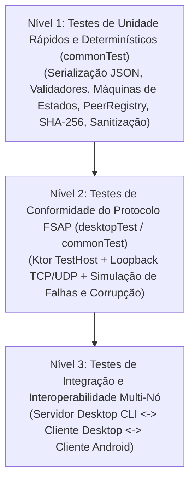

# Estratégia Geral de Testes e Garantia de Qualidade — FileShare

> **Status:** Plano de Testes e Matriz de Interoperabilidade M5 (`TASK-TEST-005`)  
> **Relacionado a:** [protocol-test-cases.md](file:///home/enzosarmento/Documents/2026.2/redes/fileshare/docs/protocol-test-cases.md), [backlog.md](file:///home/enzosarmento/Documents/2026.2/redes/fileshare/tasks/backlog.md)

---

## 1. Pirâmide de Testes no Kotlin Multiplatform

O projeto FileShare estrutura sua verificação em três níveis complementares dentro do monorepo:



### Nível 1: Testes Unitários em `commonTest` (`./gradlew :composeApp:desktopTest` / `testDebugUnitTest`)
Executam em milissegundos, sem abrir sockets reais do sistema operacional:
- **Serialização e Contratos FSAP:** Verifica ida e volta (*round-trip*) de todas as 12 mensagens JSON do protocolo e rejeição de payloads inválidos.
- **Máquinas de Estados (`LocalNodeState`, `PeerConnectionState`, `TransferState`):** Verifica todas as 18 transições válidas de `TransferState` e garante que qualquer transição inválida lance `InvalidStateTransitionException`.
- **`PeerRegistry` com Relógio Virtual:** Utilizando `kotlinx-coroutines-test` (`TestScope` / `advanceTimeBy`), verifica que dispositivos entram em `STALE` aos 12 s e expiram aos 18 s (`T_PEER_TTL`).
- **Sanitização e Segurança (`FileNameSanitizer`):** Testa vetores de *Path Traversal* (`../`, `..\`, bytes nulos, nomes reservados Windows) e resolução de colisões de nomes.
- **Motor de Hashing Incremental:** Verifica que o cálculo de SHA-256 em blocos de 64 KB produz o mesmo digest dos vetores de teste NIST.

### Nível 2: Testes de Conformidade de Rede em `desktopTest`
Utilizam `ktor-server-test-host` ou sockets reais em `127.0.0.1` com portas efêmeras (`port = 0`) e diretórios temporários (`Files.createTempDirectory`):
- Execução automatizada da suíte `TC-FSAP-001` a `TC-FSAP-026` ([protocol-test-cases.md](file:///home/enzosarmento/Documents/2026.2/redes/fileshare/docs/protocol-test-cases.md)).
- Injeção controlada de falhas no canal de stream (`FaultInjectingByteReadChannel`) para simular:
  - Bit-flip no meio do arquivo (validando `FSAP-ERR-422-HASH_MISMATCH` e exclusão do `.part`);
  - Queda abrupta de socket aos 50% (validando `FSAP-ERR-400-SIZE_MISMATCH` / `FSAP-ERR-503-CONNECTION_LOST`);
  - Congelamento de envio por mais de 15 s (validando `FSAP-ERR-408-STREAM_TIMEOUT`).

### Nível 3: Testes de Integração e Aceitação em Rede Local Real
Executados antes do fechamento das Milestones M2, M3, M5 e M6:
- **Cenário 1 (Mesma Máquina / Loopback):** Servidor Desktop Independente (`./scripts/run-desktop-server.sh --port 53319`) recebendo arquivos enviados pelo Cliente Gráfico Desktop (`./scripts/run-desktop-ui.sh`).
- **Cenário 2 (Desktop ↔ Desktop em LAN):** Dois computadores (Windows/Linux) na mesma rede Wi-Fi/Ethernet descobrindo-se via UDP Multicast e transferindo arquivos pequenos (10 KB) e grandes (1 GB).
- **Cenário 3 (Desktop ↔ Android em LAN):** Transferência bidirecional entre computador e smartphone Android (via Wi-Fi e via Conexão Manual por IP).

---

## 2. Matriz e Roteiro de Interoperabilidade Desktop ↔ Android (`TASK-TEST-005`)

Antes do encerramento da Milestone **M5**, todas as quatro direções de transferência devem ser validadas tanto nos testes automatizados em loopback (`desktopTest` + `testDebugUnitTest`) quanto na bancada física em Wi-Fi local.

### 2.1. Cobertura Automatizada em Loopback e Multi-Nó

| Direção / Cenário | O que valida | Onde está implementado |
| :--- | :--- | :--- |
| **Desktop UI → Servidor Headless** | Descoberta/handshake `IDENTIFY`, envio em lote multi-arquivo via `DesktopNioFileSource` e ausência de `.part` residuais | `CrossPlatformDesktopInteropTest` (`desktopTest`) |
| **Desktop ↔ Perfil Android (`MOBILE`)** | Handshake com `platform="ANDROID"`, aprovação explícita, recusa explícita (`REJECTED`) e fluxo reverso | `CrossPlatformDesktopInteropTest` (`desktopTest`) |
| **Desktop → Android Runtime + SAF/MediaStore** | Transferência multi-chunk (`384 KB`), modal de aprovação Android, barra de progresso, notificação ativa e commit em `Downloads` | `AndroidEndToEndTransferIntegrationTest` (`androidUnitTest`) |
| **Android (SAF) → Servidor Desktop** | Seleção SAF em streaming (`AndroidSafFileSource`), múltiplo envio, persistência de histórico após parada do serviço | `AndroidEndToEndTransferIntegrationTest` (`androidUnitTest`) |
| **Android ↔ Android** | Dois nós `FsapForegroundNodeController` trocando arquivos via HTTP/TCP com aprovação explícita e verificação SHA-256 | `AndroidEndToEndTransferIntegrationTest` (`androidUnitTest`) |
| **Cancelamento pela Notificação / Recusa** | Ação `"Cancelar envios"` (`ACTION_CANCEL_TRANSFERS`) durante `TRANSFERRING` removendo `.part`; recusa explícita preservando disco limpo | `AndroidEndToEndTransferIntegrationTest` (`androidUnitTest`) |

Execução automatizada unificada:

```bash
./scripts/run-interop-checks.sh
```

### 2.2. Roteiro de Execução em Bancada Física (LAN Real / Wi-Fi)

1. **Preparação dos nós na mesma sub-rede `/24`:**
   - **Servidor Desktop Independente (Linux/Windows):**
     ```bash
     ./scripts/run-desktop-server.sh --port 53319 --alias Server-Bancada --download-dir ./tmp-recebidos
     ```
   - **Cliente Desktop Gráfico (UI Compose):**
     ```bash
     ./scripts/run-desktop-ui.sh
     ```
   - **Cliente/Servidor Android (Smartphone/Emulador):**
     ```bash
     ./gradlew :composeApp:assembleDebug
     adb install -r composeApp/build/outputs/apk/debug/composeApp-debug.apk
     ```
2. **Caso IT-LAN-01 — Descoberta Multicast e Conexão Manual (`ANNOUNCE`/`DISCOVER`/`IDENTIFY`):**
   - Verificar listagem automática recíproca em `< 5 s` entre Desktop e Android na porta UDP `53318`.
   - Em Wi-Fi com *AP Isolation* (onde multicast seja bloqueado pelo roteador), validar o fallback via **Conexão Manual por IP** (`POST /fsap/v1/identify`) e verificar no Wireshark filtro `udp.port == 53318 or tcp.port == 53317 or tcp.port == 53319`.
3. **Caso IT-LAN-02 — Matriz das 4 Direções (Arquivos Pequenos + Grandes `>= 50 MB`):**
   - **Desktop → Android:** Enviar imagem + arquivo binário grande; aprovar no modal Android; conferir barra de progresso na tela e na notificação persistente; validar arquivo em `Downloads/FileShare` via MediaStore (`sha256sum` idêntico ao original).
   - **Android → Desktop:** Selecionar múltiplos documentos pelo seletor nativo SAF (`OpenMultipleDocuments`); enviar para Desktop GUI e para o Servidor Headless; aprovar e conferir integridade SHA-256.
   - **Desktop ↔ Desktop:** Enviar lote entre GUI Desktop e Servidor Headless na porta `53319`.
   - **Android ↔ Android:** Conectar dois aparelhos Android (multicast ou IP manual) e transferir foto/vídeo conferindo `WakeLock` e progresso com tela apagada por 30 s.
4. **Caso IT-LAN-03 — Recusa Explícita e Cancelamento em Voo:**
   - Recusar uma transferência no modal destinatário e confirmar status `REJECTED` no remetente sem criação de arquivo nem `.part`.
   - Iniciar envio de arquivo grande, acionar **Cancelar** na UI ou **Cancelar envios** na notificação do Android a ~50% e confirmar estado `CANCELLED` + remoção imediata de `.part`.
5. **Caso IT-LAN-04 — Queda Abrupta de Wi-Fi no Meio da Transferência:**
   - Desativar o Wi-Fi do dispositivo remetente/destinatário durante `TRANSFERRING`.
   - Confirmar detecção de queda (`CONNECTION_LOST` / `SIZE_MISMATCH` / `STREAM_TIMEOUT`), limpeza automática do arquivo `.part` no destinatário e recuperação limpa ao religar o Wi-Fi.

### 2.3. Critérios de Aceitação M5

- Zero arquivos `.part` remanescentes após sucesso, recusa, cancelamento ou falha de rede.
- SHA-256 idêntico em todas as 4 direções testadas (`sha256sum` / hash exibido em log).
- Notificação Android `FsapForegroundService` acompanha progresso e permite `Cancelar envios` / `Parar servico` com emissão de `BYE`.


